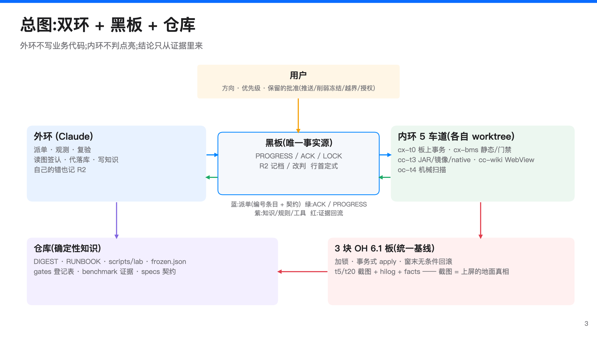

# 让 AI 干系统级的活:Westlake harness 方法交流

**主题**:把未修改的 Android APK 原包跑上 OpenHarmony 6.1 开发板。这个过程里,我们怎样让一组 AI agent 的产出变得**可验证、可累积、可交接**。

**对象**:终端 OS / 系统专家。建议 45–60 分钟,配 PPT(`harness-briefing.pptx`)和 3 分钟离线演示(`demo.sh`)。

**数据口径**:
- 仓库统计钉在快照 `aa948b8c9a`(2026-10-03)上;
- 黑板统计截至 2026-10-08 21:15,当时 21,907 行,SHA `bfb4eb5d…`;
- 每个数字的命令与出处见文末附录。
- 本稿经 cx-t0 逐句对抗核对(`benchmark/2026-10-08-briefing-factcheck/`,185 项断言),错误与误导项已全部改正。

---

## 0. 一页看懂

| | |
|---|---|
| **做什么** | Route A:Android APK 不改一个字节,经 OH 包管理(BMS)安装。由 `appspawn-x` 孵化子进程,子进程里跑 ART、适配到 OH 服务的 Android framework 和 bridge native 层,窗口、图形、输入、包管理都对接 OH。 |
| **做到哪** | 签认点亮 **129 个 APK、128 个不同应用**:当前统一态 U13 有 126 个,候选 U14 新增 3 个。2026-09-30 的 U2 那一轮是 24 个。「点亮」= 启动后约第 20 秒的截图里是 app 自己的界面(含启动页、空列表、带错误框的首屏),**不代表**登录、网络、相机、音频、后台等功能已验收。ArkWeb 已在 Android app 进程里渲染并上屏(M2 里程碑)。 |
| **谁在做(车道快照)** | 外环 1 个(Claude,审查与裁决);内环 5 条车道(2 条 codex、2 条 Claude、1 条 octoscode/kimi,模型分配随时间变过);3 块 OH 板;构建跑在 Mac SDK、OrbStack 虚机/Docker 和远端构建机 hw248 上。 |
| **留下了什么** | 快照时 1,282 个提交,其中 1,163 个落在 09-28 到 10-03 这 6 天;379 个已入库的证据目录(benchmark);259 个工具源文件(137 个运行/辅助 + 122 个测试/适配);791 行事实摘要(DIGEST);207 行操作手册(RUNBOOK);8 项冻结 API;8 条缺陷记录(FLAW)。 |

**核心论点**:AI agent 快,但不可靠。所以我们不把「可靠」寄托在 agent 身上,而是放在**证据、工具、门禁和仓库里的知识**上。

- agent 的每次错误都变成记录、规则或一道门;
- 复发会被计数、被看见,而且越来越少,但不是从此绝迹;
- 例:「单因归因无对照」(FLAW-008)复发了 8 次,才被 `compare_runs.py` 和 `digest_append.sh` 的门彻底框住。



*蓝:派单(编号条目 + 契约);绿:ACK / PROGRESS;紫:知识 / 规则 / 工具;红:证据回流。外环不写业务代码,内环不判点亮。*

---

## 1. 哲学:八条原则,每条都有一次有记录的事故作例证

### 1.1 地面真相:外环读过的截图
- **原则**:进程活着、`state=READY`、脚本打印 PASS 都不算「上屏」。只认外环读过的最终截图:常规是 t20(启动后约第 20 秒);长等待实验按事先约定的时刻,如 t45、t90。
- **事故一(FLAW-007)**:Wikipedia、NewPipe 在 t5 上了屏,到 t20 已经退回桌面,却被报成「全亮」。
- **事故二(R2 screenshot-unread)**:车道看到 hilog 里有 unknown sessionId,就判对照失败、中途停跑。外环去读了 4 张图,其实全亮。
- **签认按状态判,不按观感判**:签认看「app 的状态有没有变」,不看「截图有没有变丑」。U14 修好 z 序之后,fd-stk 原本就有的错误框被翻到了最上层;U13 那次的「亮」,其实是启动画面盖住了错误。
- **边界**:截图证明上屏,证明不了功能没回退,见故事 §5.6 的 U12 加密反例。

### 1.2 先静态,后上板;运行时的问题做最小关键实验
- **原则**:凡是「哪台机、部署件里到底有什么、哪个库开进哪个 namespace(静态拓扑)」这类问题,先做全量静态扫描(open-site、符号、字符串、命名空间边界),再上板。
- **事故**:白屏的「双拷贝」归因拖了 N11f、N11g 两轮,每轮都要构建、占上板窗口、再回滚。
  - 反汇编部署件当天就能看清:`appspawn-x` 有 6 个库加载点,其中 5 个用 `dlopen_ns` 开进别的 namespace。
  - 后来外环把亮的 key 也数了一遍:有 maps 的 115 个亮 key 里,**bridge 都是两份**;runtime 两份的 85 个、一份的 30 个。17 个白屏 key 的分布与之相当。
  - 结论:副本数区分不了这一簇白屏,用它做的点亮预测归 0。这不等于否定某些 app 里跨 owner 的缓存字段/JNI 缺陷。
- **例外**:运行时的实际 namespace 选择与时序、信号处理顺序、偶发崩溃,静态看不出。这时不写设计文档、也不估算,直接做最小关键实验,但事先写清通过/失败判据和退路。

### 1.3 按「首个致命点」排优先级,预测为 0 就不开工
- **原则**:修墙之前,先把最近一轮各 key 在 hilog 里的**首个致命点**聚成簇表,按「挡住的 key 数」排序。静态命中数只算上界。
- **反例**:`__errno` 静态有 50 个 key 导入,日志里真正因它失败的只有 2 个。同一天还有三件预测为 0 的工作(android.net 桩、bionic 导出、settings 接通),本可以不开工。
- **预测要按生效部署件重算**:sysconf 编号错位在 U13 底座上是次级墙(单修移走 0 个 key);U14 清掉前面的墙后,10-03 的计划按部署件推算为 +4;10-08 用 U14 实测 hilog 复核,确定 +2、上限 +3(见 §5.3)。沿用旧簇表、或只推算不实测,都会误判。

### 1.4 按簇批量出版,统一态 + 阶段式晋级
- **原则**:每轮只出一个 JAR 版本和一个 native 版本,合进所有该层的修复。
- **统一态**:三块板平时保持一个签认过的统一基线,以 `runtime-fingerprint.txt` 逐件核。按板的例外显式登记,例如 61b 的安装链(libinstalls)版本不同。
- **测量**:规则目标是三板分片、一轮全量约 30 分钟;实际 166 个 key 的阶段A 要跨几个 ≤45 分钟的观察窗。出现回退再对半拆。
- **晋级**:候选先过阶段A(三板观察窗,窗末无条件回滚),外环逐图签认,零确认回退;再进阶段B,晋级成新统一态。
  - U1…U17 是候选/实验编号,不是 17 个统一态。U12 就没有晋级,见 §5.6。
- **反例**:单独的 U10.1 对 U9 是平手、零回退、无净增益,当时不晋级;后来 U10.1+T8+U11i 在阶段A 测全 115 个 U9 亮键、k/n 下 0 确认回退后,经批准合并晋级。

### 1.5 冻结是棘轮
- **门槛**:公共 API 墙(系统服务、JNI、安装器授权……)修好后,要 ≥2 个不同 app 过墙,其中至少 1 个 t20 截图亮,才登记进 `knowledge/frozen/frozen.json`。
- **执行**:之后任何构建和部署前都跑 `check_frozen.py`,与登记不符就拒。
- **改动权限**:外环只能批三类改动:证明冻结项本身有缺陷、平台/ABI 变化必须重编、加功能且原行为保留。删除或削弱冻结项只有用户能批。
- **事故**:T8 的补丁 JAR 打在了 underlay 上,而不是板上真跑的那份。G1/G2 都过了,但如果上板,会悄悄删掉两条冻结 API(FZ-007/008)。之后 `deployed_class_diff.py` 增加了 `--frozen`。

### 1.6 门禁按最严写,另设例外表
- **原则**:判据按最严来写,真实存在的例外进登记表,每条写清对象、理由、证据。放宽就加例外,收紧就删例外,**门禁代码本身不动**。
- **现状**:`knowledge/gates/` 有 9 个策略/例外登记表,形状不一,其中还有 flaky-keys、benign-log-signatures 这类登记。
  - 最大的是 native 预部署门,2,966 条精确绑定的例外,其中包含按已审发现逐条追溯的「自动同一」转移,不是 2,966 次独立人工审。

### 1.7 不信自报,只数证据
- **原则**:ACK 里的截图数、存活数,一律原样贴 `facts.txt` 或 `run_facts.py` 的输出,不按计划去写。数不出来就写 unknown。
- **事故一(FLAW-001,复发 7 次)**:#63、#71 两次把「0 张截图」报成「26 张」。
- **事故二(R2 fake-verified)**:车道说「commit 已落、已落板」,实际 HEAD 没动,黑板上也没有那一行。
- **外环同样受约束**:外环的错也记 R2。比如给 U12 签认时把 bundle SHA 写成了未武装的包,被车道的准入门原样拒掉。

### 1.8 知识与可复现性进仓库;保留给人的决定写清楚
- **知识进仓库**:DIGEST 记学到了什么,RUNBOOK 记怎么操作,`scripts/lab/` 放工具。agent 的私有记忆别的会话看不到,会话也会猝死。
- **产物必须带源**:上板产物要连同源码快照、补丁序列、工具链哈希和**原始构建日志**一起入库或存到持久位置。
  - 反面教材(DIGEST E.7):R155 只有产物进了 git,构建机释放后,只能从反汇编反推修复。
  - 至今仍有件(bridge `84695d62`、libhwui)没有可复现源。
- **保留给用户的**:战役方向与优先级、版本晋级的关键批准、推送、削弱冻结项、越出契约边界、给能写板上 `/system` 的会话授权。
- **契约内的事车道自己定**:写进 PROGRESS,「提问不阻塞」。

---

## 2. 工具:从哪来、怎么分类、各干什么

### 2.1 工具是怎么产生的
cx-t0 对快照 `aa948b8c9a` 做了逐文件清单(`benchmark/2026-10-08-harness-tools-inventory/`)。从 git 历史和文件头能看到四条来路:

1. **收编**:把 westlake-inputs 里原有的实验室脚本版本化。09-28 一次性入库 59 个,它们更早的创建时间不可考。
2. **随手写**:为重建、构建、可复现探针写的小脚本。
3. **事故驱动**:把事故和用户规则变成 fail-closed 检查与固定流程。
   - 5 条有完整「事故 → 规则 → 工具」证据链,见 §2.3;
   - 259 个文件里,19 个有明确的事故/规则出生链,15 个有头注释写明动机,其余 225 个的具体起因如实标「未确立」。
4. **契约适配**:Rust 集成测试模块暴露 `cargo test` 选择器,转调真正的 Python/shell 检查器,让 agent-spec 契约能机器验收。

RUNBOOK 有一条硬规则:**上板失败定因后,必须回答「哪条静态检查本可以在上板前拦住它」**。下面四道门各自补上了一个有记录的盲区(各门创建日期见 tools.json):

| 门 | 拦什么 | 对应的盲区 |
|---|---|---|
| N1 | native 初始化(源码/DEX 扫描绑定到新包) | N3b 的 RTLD_NOLOAD、N4 的 JNI 注册顺序 |
| N2 | 原私有 namespace 里的 DT_NEEDED 闭包 | Flutter 私有域的传递依赖 |
| G1 | 镜像与 BCP jar 的 dex checksum 一致 | T7c 镜像与板上 jar 不符 |
| G2 | 编译码入口对照已知能用的镜像 | T5b 的隐式挂起检查 |

### 2.2 分类(259 个源文件 = 137 个运行/辅助 + 122 个测试/回放/契约适配)

| 类别 | 数量 | 代表工具 → 作用 |
|---|---:|---|
| 构建、输入准备、产物核验 | 41 | `fdroid_fetch.py` / `apkpure_fetch.py` 拉 arm64 包;`reproduce_dex2oat_toolchain.sh` 复现冻结补丁序列和 27 个 boot image;`artifact_identity.py` 先确认「本地这份就是板上那份」再推理 |
| 对照与签认辅助 | 7 | `compare_runs.py` 归因前先列出所有变量;`pair_sheet.py` 把同 key 的 t20 与参考 t20 配对预筛,只是辅助,判词仍由人读图下;`abi_diff.py` 比导出表、签名与消费方,`--calls` 再比逐函数的调用目标集(调用图漂移);`deployed_class_diff.py` / `deployed_strings_diff.py` 对**板上真跑的那份**比类集和字符串 |
| 证据与事实观测 | 18 | `run_facts.py` 从 record.json 数截图和存活;`first_fatal.py` 先找终止点,再取异常链或崩溃栈;`installation_chain.py` 只读核安装身份 |
| 上板执行与部署 | 15 | `board_run.py` 把每次上板的固定步骤做成一条命令;`u7_executor.py` 停父进程后做 native+boot+JAR 事务,带 journal 和回滚;`deploy_generation.py` 部署时逐件核身份 |
| 准入与策略门 | 16 | `activation_smoke.py`:候选身份 + HW/ZZ 对照 + 声明过的激活探针,有些修复没有日志标记,要到阶段A 的 movers 观测才算生效;`check_frozen.py`;`native_predeploy.py`(N1/N2);`jni_gate.py`;`check_fix_observers.py` 要求每个改动件至少有一个观察者;`check_user_paths.py` |
| 静态扫描与预测 | 10 | `open_site_scan.py` 列每个库加载点及其 namespace;`cluster_first_cause.py` 出首个致命点簇表;`predict_vs_actual.py` 全量前写预测、全量后对账 |
| 调度与黑板 | 15 | `lane_send.sh` 派单并确认车道接住;`lane_watch.sh` 负信号哨;`board_cursor.sh` 外环读游标;`land.py` 代落库;`unlanded.py` 找没落库的交件 |
| 知识与进化 | 3 | `digest_append.sh` 写 DIGEST:默认按措辞拦下没有对照的「根因」(exit 3),证据确在句中但用词不被识别时可显式 `--force`;`evo_family.py` 给进化卡归家族、数复发 |
| 环境、迁移、归档 | 12 | `lab_paths.py`(不写死用户路径);`pack_airdrop.sh` / `setup_new_mac.sh` 换控制机;`push_lab_state.sh` 把不进 git 的实验室状态镜像到构建机 |
| 测试与契约适配 | 122 | 回放夹具、已知答案测试;86 个 Rust 集成测试模块,共 310 个 `#[test]` 声明 |

**口径**:
- 一个文件算一行,这是源码维护面,不是独立功能数。
- 114 个文件没有头注释:其中 17 个运行类条目是人工整理的作用,其余 97 个按测试声明/正文回退。
- 证据不足的标「未观测」,不猜。

### 2.3 五条「事故 → 规则 → 工具」链(每条都有行号证据)

| | 事故 | 规则 | 工具 |
|---|---|---|---|
| C1 | ACK 里的截图数、存活数没有截图支撑(#63/#71/#76) | 数留存证据,原样引用;拍到截图本身不等于点亮 | `run_facts.py` |
| C2 | 单因归因没有对照(FLAW-008,一夜 5 次) | 先列变量;只有单变量对照才能写「X 造成 Y」;0 变量翻转要重复 3 次 | `compare_runs.py` |
| C3 | 手写派单丢了 `--hilog`、两个分片并行、漏了留存/回滚步骤 | 把派单写成固定的「加锁→冒烟→分片→facts→回滚→放锁」流程 | `board_run.py` |
| C4 | 全量跑了,但两个修复根本没生效;第一次冒烟就抓到缺失的 J9-NOTITLE 标记 | 全量前证明修复生效;编译通过、身份一致都不算生效 | `activation_smoke.py` |
| C5 | T8 对着 underlay JAR 重建,rb/t4b/G1/G2 全过,却会删掉 FZ-007/008 | 对**生效的部署件**比类集和冻结类;基线有歧义就拒 | `deployed_class_diff.py` |

### 2.4 主干流水线:一个 U 版本怎么从候选变成统一态

```
输入与来源 → 静态扫描(身份/ABI/类集/open-site) → native/冻结/generation 门
   → 计划 + 加锁 + 事务式 apply → 激活冒烟 → 分片串行观测(t5/t20 截图 + hilog)
   → 截图 + facts + 首个致命点 → pair_sheet 预筛 + 外环逐图签认
   → 知识 / 冻结登记 / 规则改进 ──┐
   ↑                              │
   └──────────────────────────────┘     (观测窗末:无条件回滚到上一统一态 + 恢复冒烟)
```

- **观察键表四类**:movers(预计会变的)、white-watch(白屏观察)、lottery(偶发键)、lit-regression(已亮的回归保护)。lottery 的次数按每次战役批准的预算,例如 U14 是每个 6 次记 k/n,别的窗用过 3 次。
- **窗口纪律**:第 35 分钟后不开新 key,45 分钟必停;阶段B 给回滚留至少 10 分钟。
- **实例一(U13 阶段A)**:122 个参考亮 key 在 k/n 下全部同屏或亮;219 条候选运行记录:180 PASS、39 条逐条解释过的 unknown,selftest_error / badtag / probe_error 都是 0。
- **实例二(U14 阶段A,10-03 窗1–5 签认截点)**:参考 126 个 key 测到亮 124 个;fd-seal 等 61b,fd-organicmaps 窗6 判「板相关白窗、未定」。

---

## 3. 用 OctoLoop 驱动调度

### 3.1 角色

| 角色 | 谁 | 干什么 |
|---|---|---|
| 用户 | 人 | 方向、优先级与保留的批准(推送、削弱冻结、越界、授权) |
| 外环 | Claude | 派单、观测、复验、**读图签认**、代落库、写 DIGEST;自己的错也记 R2 |
| cx-t0 | codex | 板上事务执行器(阶段A 窗、apply、回滚、恢复) |
| cx-bms | codex | 静态分析、门禁、打包、离线审 |
| cc-t3 | Claude | Java/JAR、boot image、native/ABI 调查,逆向与反汇编坐实 |
| cc-wiki | Claude | WebView / ArkWeb、镜像烘焙 |
| oc-t4 | octoscode + kimi/glm | 机械扫描,只派带锚点、可机械复核的活 |

**按长处派活**:本战役里观察到,codex 会话对内存破坏诊断、hook、二进制补丁类任务会先 ACK 再转 idle,看起来像卡住,实际是拒绝。这类活交给 Claude 车道。这是对本战役会话的观察,不是对产品策略的一般断言。

### 3.2 黑板:唯一事实源,正式记录用行首定式

`.octos/boards/app-lighting.md`,09-28 开板。正式记录用行首定式,机器可数、可采集;其中也夹着代码块、命令输出和早期非定式消息。下表计数截至 2026-10-08 21:15(21,907 行):

| 定式(正则锚在行首) | 行数 | 含义 |
|---|---:|---|
| `PROGRESS(` | 2,819 | 进度 |
| `ACK(` | 1,786 | 交件状态:done / wontdo / blocked / observed 等,词表可扩展;对 wontdo,外环只能接受或升级,不能再打回 |
| `LOCK(` / `UNLOCK(` | 353 / 355 | 板锁记录;真正的互斥由 flock 持有进程保证,不是由行数配对 |
| `> 外环(…)·R2 记档(#N): … [家族:X]` | 104 | 正式纠错记录(含「R2 记档」字样的行共 120) |
| `> 外环(…)·改判(…)` | 27 | 推翻已发判词(其中 15 条是「作废 #N」形式) |

### 3.3 派单:编号条目 + 契约 + 可靠投递
- **条目自包含**:worktree、独占板、契约、背景、步骤、交付、验收、预算档。
- **agent-spec 契约**:`specs/` 下 93 个主题、283 个 spec 文件,交给 agent 前 `agent-spec lint --min-score 0.7` 必须过。
  - 验收选择器指向 86 个 Rust 集成测试模块,由它们转调真正的检查器;
  - 要读截图才能判的场景标 `审核: human`,测试通过也只到 pendingreview。
- **投递**:一律走 `lane_send.sh`。octoscode 忙时会丢文本,所以它等窗格 Idle 再发,20 秒内确认车道离开 Idle,没接住就再发一次。

### 3.4 侦听:双哨
- **正信号**:`board_cursor.sh wait` 盯黑板新行。游标只在外环读完后才前移,起因是曾漏看一份冻结稿 75 分钟。
- **负信号**:`lane_watch.sh` 盯车道状态,连续两次 idle/blocked/done 才报;API 断连判为 interrupted。
- **教训(R2 sentinel-baseline)**:4 份交件被漏看,5 条车道空转约 30 分钟。只盯正信号时,「车道熔断的沉默」和「还在干活」区分不开。

### 3.5 板子纪律
- 写操作前先只读检查。用 `board_note.sh lock` 加锁:flock 持有进程,别人已持有就 exit 75。
- 加锁前先在黑板宣布拟用哪块板。这是 10-03 cc-t3 撞上 cx-t0 已宣布的 5cd 之后的约定。
- 窗口:单项 ≤30 分钟,批量 ≤45 分钟,用完立即放锁。
- **踩过的坑**:
  - `kill -9 appspawn-x` 会让 OH init 在 CheckOndemandService 空指针崩溃,整机宕、从 USB 消失(RUNBOOK §1)。
  - 观察到 hdc 的部分传输失败仍以 exit 0 返回,所以每条远端命令都要求一个终止状态标记并回读。
  - 有一次 `hdc kill` 与另一车道写事务丢标记在时间上重合,怀疑是共享传输干扰,但没有做单变量证明。规则因此定为:别人持锁时禁止 `hdc kill`。

### 3.6 落库:车道不碰 master
- 每条车道一个 worktree(现 72 个)。在本战役的 codex workspace-write 沙箱里,车道写不了 `.git`,所以车道交 `landing-paths.txt`,由外环跑 `land.py`。
- `land.py` 依次做:路径前缀白名单 → `knowledge/gates` 和 `frozen` 需要 `--allow-gates` → 复制 → 用户路径门、`check_frozen`、落库附带的测试、`cargo test` → 提交。
- 提交主题写 `(landed from <wt>@<sha>, N files, listing <hash>)`。快照时 1,282 个提交里,有 434 个主题是这样代落的。
- 推送一律等用户明示。

### 3.7 升级、提问、额度
- **升级**:契约内的事车道自决;越界、跨车道冲突交外环裁决;保留事项交用户。
  - 车道在 PROGRESS 里写「请外环定 / 请外环读图」,不停下等。
  - octoscode 另有 MCP 信道 ask_outer:90 秒超时降级,每进程最多 3 次。
- **额度用尽是常态**:
  - 09-28 Claude 额度不足,改判工作转给 kimi;
  - 10-03 oc-t4 的 kimi 额度用尽,外环暂停对它派单,把待办转派给别的车道;
  - 10-08 两条 Claude 车道的周额度在 20:00 重置后恢复派单。

### 3.8 一个回合长什么样(U14 阶段A 窗2,2026-10-03)
1. 外环按观察键表派 #90 条目给 cx-t0,写清板、窗长、回滚要求。
2. cx-t0 LOCK 三块板,事务式 apply U14 候选,跑激活冒烟。
3. 分片串行跑 key,每个 key 留 t5/t20 截图、hilog、facts;窗末无条件回滚到 U13,跑恢复冒烟,然后 UNLOCK。
4. cx-t0 交 ACK,截图数原样贴 facts。
5. 外环跑 `pair_sheet.py` 预筛,再读拼图逐图签:23 个参考亮 key、33 次全亮、0 回退。
6. 签认件入库,DIGEST 加一行。
   - 同窗 61b 在 `bm uninstall` 中途从 USB 消失,也记进 DIGEST,锁和候选留在板上。
   - 10-08 61b 回线,回线处置脚本只读取证后,因原锁的持有进程已不在而按设计拒绝继续,改由 cx-t0 走「新 boot」分支恢复。

---

## 4. 怎么进化:改流程、改工具、积累确定性知识

### 4.1 进化环

```
黑板上的定式行(R2 记档 / 改判 / ACK blocked)
   → olp-evo-harvest.sh 采集(identity 去重、字节游标)→ .octos/EVOLUTION.md(现 126 张卡)
   → olp-evo-retro.sh 分组出简报
   → 外环人工判跨条目复发 → FLAW-NNN 记录(每次最多 3 条:指纹、复发次数、症状、责任步、根因、修复、预防)
   → 规则精炼成一行进 DIGEST / RUNBOOK;能改工具的改工具、能加门的加门
   → 下一轮派单与门禁带上它
```

**进化环自己也坏过**:FLAW-006 记的是更正写成了散文、没用行首定式,一夜采到 0 张卡。现在采集只认带署名的行首定式。

### 4.2 FLAW 现状(8 条,7 条已关;按复发次数排)

| 记录 | 内容 | 复发 | 落成了什么 |
|---|---|---:|---|
| FLAW-008 | 跨板/跨版本的差异被归到一个变量上,没有单变量对照 | 8 | `compare_runs.py` 末行给判词;`flaky-keys.json` 每边 ≥3 次;`digest_append.sh` 默认拦下无对照的「根因」 |
| FLAW-001 | ACK 里的截图数、存活数按计划写,不是从证据数出来 | 7 | `run_facts.py`、bms_batch 自动写 facts.txt、AGENTS 规定 ACK 原样贴 |
| FLAW-002 | 测量缺口被当成结论(日志被冲、截图被拒,读出假根因) | 4 | 缺证据写 unknown,不推断 |
| FLAW-006 | 改判与更正没用行首定式,采集哨一夜采到 0 张卡 | 4 | 采集只认带署名的行首定式 |
| FLAW-004 | 板间运行库漂移不进运行记录,被当成 JAR 回退 | 3 | 运行记录带 RUNTIME/BOOTIMAGE 指纹;统一态逐件核 |
| FLAW-007 | 只凭 t5 或转述就报「点亮」,t20 已回桌面 | 3 | 只认最终截图,且必须外环读图 |
| FLAW-005(开) | 容忍守卫/桥接把代码放得更深,撞上新墙造成回退 | 3 | 仍在观察;上板前预判 |
| FLAW-003 | auto 模式会话被服务端硬拒板上 /system 写入,部署卡约 3 小时 | 2 | 写 /system 的会话授权归用户 |

### 4.3 确定性知识的五种形态

| 形态 | 现状 | 回答的问题 |
|---|---|---|
| DIGEST | 791 行(09-26 首次入库 58 行,09-28 开板当天末 331 行;438 次提交改过它) | 我们确认了什么事实?踩过什么坑? |
| RUNBOOK | 207 行(09-28 首次入库 62 行) | 机器怎么操作才不出事? |
| 冻结表 | 8 项(09-30 登记 4 项、10-01 登记 4 项) | 哪些修复已经被验证过,不许悄悄改? |
| 策略/例外登记表 | 9 个 | 哪些「不合规」是审过、可以放行的? |
| 证据目录 + 签认件 | 快照时 379 个已入库 benchmark | 每个结论的原始证据在哪,能不能重放? |

### 4.4 错误怎样变成永久门禁(另外 4 例)
- **`abi_diff.py` 的两次加固**:
  - 签名漂移:一次重建只凭导出表就被接受,上板后所有 app 都死了,`createSession` 多了一个 int 参数(`…iiiim` → `…iiiiim`)。之后加了签名与消费方比对。
  - 调用图漂移:另一个构造函数签名不变,函数体却改成调用一个 JNI 附着守卫。之后加了 `--calls`,比逐函数的调用目标集。
- **`board_run.py`**:手写派单先后走样(丢 `--hilog`、两个分片并行、全量跑了未生效的修复),于是把步骤固化成一条命令。之后又各自加固:
  - 工具 6 分钟超时杀掉 board_run、板子停在锁定状态 → 加 `--detach`;
  - before_unlock 修正;
  - 永不删输出。
- **真数据夹具**:board_run 曾用两层 glob 和简化夹具去匹配真实的三层输出树,测试全绿,线上误判。用真实运行目录重放才暴露。规则:已知答案测试必须用生产对象,不能用简化夹具冒认修好。
- **证据留存**:车道为解 merge 冲突在 worktree 里 `git clean -fd`,删掉了 U8 全量签认的原始运行文件(hilog、facts、maps、指纹),无法恢复。之后加了只读留存与运行索引保全。这也说明「每个结论都能重放原始证据」本身需要保护。
- **`pair_sheet.py` 跨板回落**:61b 掉线后,它的 key 挪到别的板代测,参考清单只按测的那块板查,34 对里 33 对找不到参考。补上「恰好一块别的板有该 key 时取它」之后,34/34 全部解析,修复带单元测试当天落库。

### 4.5 点亮曲线(每个点是一次签认;分母与口径不同,如实标出)

```
09-30 U2   24 / 66  单轮                     ▇▇▇▇▇
09-30 U3   25 / 66  单轮(当时累计亮过 27)    ▇▇▇▇▇
10-01 U7   34 / 66  正式签图                 ▇▇▇▇▇▇▇      ← 语料从 66 扩到 166 个 key
10-01 U8   99 /166  初签(后补测为 100)       ▇▇▇▇▇▇▇▇▇▇▇▇▇▇▇▇▇▇▇▇
10-01 U9  115 /166  终签                     ▇▇▇▇▇▇▇▇▇▇▇▇▇▇▇▇▇▇▇▇▇▇▇
10-02 U10.1T8  116  签认(另有抽奖键 k/n)     ▇▇▇▇▇▇▇▇▇▇▇▇▇▇▇▇▇▇▇▇▇▇▇
10-03 U13  122 → 126  参考 → 晋级后统一态     ▇▇▇▇▇▇▇▇▇▇▇▇▇▇▇▇▇▇▇▇▇▇▇▇▇
10-03 U14  129      候选,阶段A 中            ▇▇▇▇▇▇▇▇▇▇▇▇▇▇▇▇▇▇▇▇▇▇▇▇▇▇
```

U14 新增的 3 个是 VLC(Gecko/native ABI 修后从死到欢迎页)、3D 模型查看器、Termux(首屏带 bootstrap 错误框)。

---

## 5. 六个故事(讲给系统专家听的)

### 5.1 少一个宏,虚函数表错一槽
- **现象**:ArkWeb 探针在窗11 SEGV,窗12 的 `CreateNWeb` 返回 0。
- **静态坐实**:编探针时没加 `-DOHOS_PLATFORM`,而 OH c_utils 的 `refbase.h` 把 `virtual bool CanPromote();` 包在 `#ifdef OHOS_PLATFORM` 里。少了这个虚函数,所有 RefBase 派生对象的虚调用都错一槽:
  - 探针以为槽 0x48 是 `GetProducer`,板上 libsurface 的 0x48 其实是 `IsConsumer`,sret 没写,拿到垃圾 sptr 后崩;
  - 0xc8 实际调到 `SetQueueSize`,0x110 实际调到 `GetUniqueId`。
- **留下的规则**:
  - 用 OH inner_api 头编 native,一律带 `-DOHOS_PLATFORM`;
  - 核对虚调用槽位时,vtable 项大多在 `.relr.dyn`,要读文件里存的字;`llvm-readelf -r` 只列出 ABS64 那几项。

### 5.2 ArkWeb 在 Android app 进程里上屏
- **窗13(无头)**:runtime 入口 → `nweb_ns` → libarkweb_engine → `CreateNWeb` 非空 → 页面 JS 运行。consumer surface 收到 5 帧,第 2–5 帧中心像素是页面 JS 设的 `#12ab34`。render 子进程由 OH 自己的 nwebspawn 拉起。
- **窗16(首次上屏)**:在 Activity 窗口的 RSSurfaceNode 下建子节点,页面上屏,中文字体正确。
- **窗19(正式路径)**:SurfaceView → `surfaceCreated` → 读 `Surface.mNativeObject`(运行时自己的 ANW 包装)→ 取出真 OH 窗口 → `OH_NativeWindow_GetSurfaceId` → `CreateNWeb`,页面铺满 SurfaceView。
- **关键**:加载器走的是 OH `dynlink.c` 为 ArkWeb 设计的 namespace 白名单正门,不是绕过。`nweb_ns` 整个留给 OH 自己的 NWebHelper,因为谁先建 `nweb_ns`,谁的 lib_path 就赢。

### 5.3 sysconf 编号错位:预测从 0 到 +4 再到 +2~3,但要用户批
- **现象**:NDK app 按 bionic 的 `_SC_*` 编号调 `sysconf`,OH musl 把同一个整数当成别的选择器。
  - bionic `_SC_PAGESIZE`=39,在 musl 里 39 是 `_SC_BC_STRING_MAX`,返回 1000;
  - mozjemalloc 断言页大小是 2 的幂,主动崩溃;Realm 用这个值定 mmap 大小,解 NULL 崩溃。
- **预测随底座变**:
  - 在 U13 底座上,这 4 个 key 先死在别的墙上:fennec/firefox 死在 native_abi,im-vector/mcdonalds 死在 Realm `_ctype_`。当时 sysconf 是次级墙,单修预测移走 0 个 key。
  - U14 部署的 native_abi `f8619ad5` 已经清掉这两堵墙。10-03 的 U17 计划按**生效部署件**(composition.json)推算:sysconf 成了这 4 个 key 的首个致命点,预测 +4。
  - 10-08 cc-t3 用 U14 实测 hilog 复核:fennec(mozjemalloc)、im-vector(Realm SlabAlloc)确实崩在 sysconf;mcdonalds 实测是早期初始化里的 SIGILL(app 自带 handler 跑完后重抛),日志里没有 Realm 栈,剔除;firefox 没有 U14 观测,等窗7。预测改为 **确定 +2、上限 +3**。
  - 外环一度照旧簇表批了「再加 `_ctype_`」,开建前发现它早已在现役件里,记了 R2。
- **为什么还没修**:修法要求 libbionic_compat 在 namespace 继承顺序里排到 libc 前面。这个顺序属于冻结的 appspawn-x 行为,所以**交用户决定**。冻结机制在这里的作用,正是「别为一个修复悄悄动已验证的行为」。
- **已做的风险面分析**:libbionic_compat 的 46 个导出与 musl libc 的 1,873 个导出 0 重叠。

### 5.4 板子掉线与事务式回滚
- **10-03 13:50**:61b 在 `bm uninstall` 中途从 USB 消失。因为每次上板都是带 journal 的事务,锁和候选件留在板上,等人工重插后处置。
- **10-08 61b 回线**:处置脚本先只读取证:
  - boot_id 变了,即新 boot,候选的 bind 层可能已随重启消失;
  - 10-03 那把锁的 flock 持有进程已不在;
  - 事发时段的两份 cppcrash 是已知的 app 墙(firefox / localsend),不是掉线原因的证据。
  - 脚本按设计在第 8 步拒绝继续,零写、锁不动,交外环裁决后改走「新 boot」分支。
- **09-30 18:11**:三块板同时物理断开,重连后发现全部重启过,bind 叠层不跨重启,统一态要整套重布。这次事件强化了「回线必须重放校验 + 逐件核指纹」。指纹核对在此之前已有(FLAW-004)。

### 5.5 外环也被记账
- **推翻自己的推测**:「白屏 = 双拷贝」从 N11 系列一路沿用。外环自己去数,发现亮的 key 也普遍有两份 bridge,当场改判(数字见 §1.2)。
- **R2 wrong-object**:外环签认时把 bundle SHA 写成了未武装的包,车道的准入门原样拒绝。工具不认人。
- **R2 outer-side-effect**:外环在车道 worktree 里切分支,删掉了执行计划直接引用的文件,导致一个窗报 FileNotFoundError。

### 5.6 截图不是全部:U12 的加密反例
- **现象**:U12 阶段A 逐键签认看起来没有回退,但进程级加密自检在 174 次运行里失败 154 次(AES/GCM 的 AEAD 缺陷,`Cipher.init` 不调 `spi.engineInit`)。
- **处置**:
  - U12 **没有晋级**。
  - U13 把进程自检做成晋级门:selftest_error / badtag / probe_error 三类必须为 0,每条 unknown 都要外环逐条解释。
  - U13 的 219 条候选记录:180 PASS、39 条已解释 unknown、三类错误都是 0。
- **意义**:「截图是地面真相」只管上屏;功能性回退要靠另一类证据。对专家讲这个,比讲「错误不再犯」更有说服力。

---

## 6. 三分钟离线演示(只读、不碰板;`demo.sh` 一键跑,三步都已在留存数据上实跑 rc0)

```sh
WORKSPACES=<放 westlake-harness 与 westlake-harness-u7-executor 的目录> bash demo.sh
```

前提:需要本机有留存的历史运行目录(在 `westlake-harness-u7-executor/benchmark/2026-10-03-u14-stage-a-plan/` 下);一个全新的公开克隆不包含这些数据。`demo.sh` 写死了具体输入路径。

1. **ACK 只能贴这个**:`run_facts.py <U14 窗2 5cd anki 的运行目录>`
   - 输出:`RUNTIME fingerprint=32c76e6fac13 … FROZEN checked=4 violations=0`,`anki shots 2/2 alive t5=yes t20=yes … foreground_unconfirmed`,`TOTAL keys=1 screenshots_captured=2/2 alive_t5=1 alive_t20=1`。
   - 要点:`foreground_unconfirmed` 说明进程活着不等于上屏,最后还要看图。
2. **归因前先数变量**:`compare_runs.py <U13 同板对照> <U14 候选>`(OrganicMaps,5cd,U14 阶段A 窗6)
   - 输出:`variables: 7`,包括 runtime JAR、ICU ×3、bridge、appspawn-x、20 个 boot image 文件。
   - 末行:`verdict: 7 variables differ; any single-cause attribution is a hypothesis until a run that changes only that variable`。
3. **冻结棘轮**:`check_frozen.py --git --fingerprint <同一次运行的 runtime-fingerprint.txt>`
   - 输出:每个冻结源码对 git blob 逐个核,末行 `frozen: 8 entries, 34 checked, 0 violation(s)`。这是对这一份输入的结果,不是对任意指纹的不变式。

演示要传达的意思:**结论由工具从证据里数出来,不由 agent 说出来;截图仍是 UI 签认的最终权威。** 现场不演示部署、加锁、安装和重启。

---

## 7. 讨论

### 7.1 专家最可能追问的 5 个问题(先备好答案)
1. **「129 个 app 能用」指什么?**
   - 129 个签认的 APK、128 个包名;约定时刻的启动界面是 app 自己的,包括启动页、空列表、带错误框的首屏。
   - **不**证明登录、TLS、相机、音频、持久化、后台生命周期或完整功能。
   - 候选增益(3 个)和已晋级基线(126 个)要分开说。
2. **增长曲线可比吗?**
   - 不完全可比:混了 66 和 166 两个语料、单轮样本、累计亮过和 k/n 验收。
   - 所以 §4.5 每个点都标了分母、日期和口径。
3. **既然亮的 app 也双拷贝,为什么还修双拷贝?**
   - 证据否定的是「副本数」作为这一簇白屏的判别量;
   - 并没有否定少数 app 里跨 owner 的缓存字段/JNI 缺陷。要区分相关性、机制和已测试的修复范围。
4. **门禁都过了,能证明兼容吗?**
   - 不能。门禁有显式例外、未解析的加载点、声明式探针和外环判断。
   - U12 的 AES/GCM 回退在启动截图里看不见(§5.6)。要说清每道门查什么、查不了什么。
5. **独立的机器能复现吗?**
   - 259 个文件里 122 个是测试/适配,不是 259 个独立工具;
   - 复现还需要留存的运行数据、工具链和原始日志;
   - 不是每个部署过的 bridge/HWUI 构建都有可复现源。

### 7.2 我们认为可以直接迁移到终端团队的做法
1. **把「判定」从执行者手里拿走**:执行者交证据,判定由独立的一方用工具和截图做。
2. **事故驱动工具化**:每次上板失败都追问「哪条静态检查本可以拦住它」,答案落成门。
3. **棘轮 + 例外登记**:验证过的就冻结;门禁最严,例外显式登记;放宽和收紧都不改门禁代码。
4. **统一基线 + 分片观测 + 阶段式晋级**:真机上的「CI + 金丝雀」,回退对半拆。
5. **行首定式的黑板**:同一份文本既是协作记录,又能被机器采集成组织记忆。
6. **按 agent 长处派活,额度用尽当常态设计**。

### 7.3 还没解决的问题(欢迎讨论)
- **读图签认仍是瓶颈**:`pair_sheet` 预筛能排除大部分「同屏」对,但新亮、可疑的仍需要看图。能否用 OH 侧的窗口/渲染可观测性做更强的自动判据?
- **功能性验收**:启动截图之外,怎样低成本地覆盖网络、加密、存储、生命周期?(U12 的教训)
- **板子的物理可靠性**:USB 掉线、`kill appspawn-x` 整机宕。有没有更安全的进程级恢复手段?
- **只有产物、没有可复现源的件**:例如 bridge `84695d62`、libhwui。
- **冻结项的受控演进**:sysconf 需要调整 namespace 继承顺序。这类改动的流程怎样设计更好?
- **namespace / appspawn 的设计约束**:哪些是 OH 的有意设计、可以依赖,哪些可能随版本变?

---

## 附录:数字与出处

| 数字 | 值 | 命令 / 出处 |
|---|---|---|
| 签认点亮 | 129 APK / 128 包名(126 统一态 + 3 候选增益) | `benchmark/2026-10-03-u14-stage-b/inputs/reference.json`;U14 窗1 签认件 gains;`benchmark/2026-10-08-lit-apps-report/` |
| 提交 | 1,282;代落 434;09-28..10-03 共 1,163(作者日期) | `git rev-list --count aa948b8c9a`;`git log aa948b8c9a --format=%s \| grep -c 'landed from'` |
| 证据目录 | 379(快照时已入库) | `git ls-tree --name-only aa948b8c9a benchmark/ \| wc -l` |
| 工具源文件 | 259 = 172 lab 脚本 + 87 Rust;137 运行/辅助 + 122 测试/适配 | `benchmark/2026-10-08-harness-tools-inventory/tools.json` |
| DIGEST / RUNBOOK | 791 / 207 行;首次入库 58(09-26)/ 62(09-28) | `git show aa948b8c9a:<file> \| wc -l`;`git log --diff-filter=A` |
| 冻结 / FLAW / 进化卡 | 8 / 8 / 126 | `knowledge/frozen/frozen.json`;`knowledge/context/evolution/`;`.octos/EVOLUTION.md` |
| 黑板 | 21,907 行(2026-10-08 21:15);PROGRESS 2,819、ACK 1,786、LOCK 353 / UNLOCK 355、正式 R2 104(含字样 120)、改判 27(作废式 15) | 行首正则计数;`benchmark/2026-10-08-briefing-factcheck/evidence/statistics.json` |
| 契约 | 93 主题 / 283 spec / 86 Rust 集成模块(310 个 `#[test]`) | `specs/`、`tools/spec-checks/tests/` |
| 策略/例外登记表 | 9 个 | `knowledge/gates/*.json` |
| 本稿核对 | 185 项断言:122 确认 / 11 错 / 45 误导 / 7 不可核,已全部改正 | `benchmark/2026-10-08-briefing-factcheck/` |
