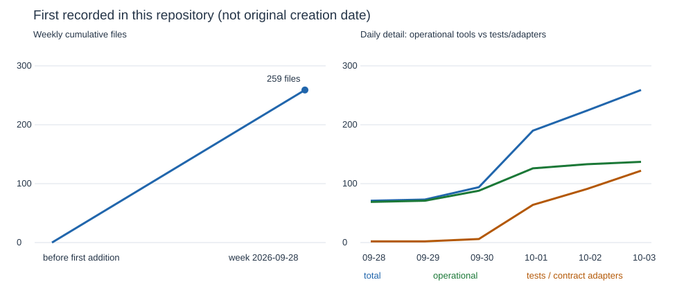
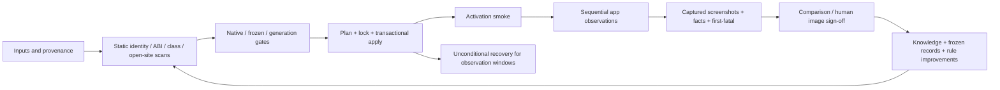

# Harness tools: evidence-bound inventory

Earlier reports could mistake a file name for a role, a retained reference for an executed call, or a bulk import for the date a tool was created. This inventory separates those claims. It does not run any lab tool or access devices.

**Snapshot:** [`aa948b8c9a85`](https://github.com/A2OH/westlake-harness/commit/aa948b8c9a857ef9a674b138f772056b3a2594aa), committed 2026-10-03T18:47:29+08:00; inventoried on 2026-10-08. **259 source files = 137 operational/helper files + 122 test/replay/contract-adapter files.** The snapshot is five days older than the report date; unlanded work in other worktrees is not silently included.

## Scope and how tools were generated

- `scripts/lab/**`: all **172** tracked `.py` / `.sh` files, including tests and historical ad-hoc patches.
- `scripts/olp-*.sh`, top level only: **0 files**. The `olp-*` harvest/append tools mentioned in operational documents belong to the external octoscode installation; their callers are listed here, their implementation is outside the requested repository scope.
- `tools/spec-checks/**`: **87 Rust source files** (one library unit and 86 integration-test units). `Cargo.toml`, `Cargo.lock` and `.gitignore` are support files, enumerated in `tools.json`, not counted as executable tools.
- Actual source languages: 116 Python, 56 shell, 87 Rust. `lane_watch.sh` is Python despite its retained `.sh` suffix.
- One file is one catalogue row. Shell/Python wrappers count separately; this is a source-maintenance surface, not the number of independent commands or features. Our generator, validator and new Rust adapter are excluded by the pinned snapshot.

The recorded generation routes are: (1) version existing lab scripts from westlake-inputs, (2) write small scripts for reconstruction, builds and repeatable probes, (3) turn incidents/user rules into fail-closed checks and executable dispatches, and (4) add Rust `#[test]` adapters that invoke Python evidence checks so agent-spec can select Cargo tests. These are git/header observations, not a claim to know the original human/AI authoring process.

In particular, **59 files** first entered together in [`1a2bb87234da`](https://github.com/A2OH/westlake-harness/commit/1a2bb87234da) (“scripts/lab: version the westlake-inputs lab scripts”). Their earlier creation dates are unknown here. History stores both author and committer timestamps; the requested growth counts use the first-add author date. Renames, deleted tools, external tools and untracked files are not counted in this surviving-file cohort.

## Categories

The suggested categories are retained, with **environment/transfer/archive** and **tests/contract adapters** split out so build/deploy totals do not hide support or proof code. Each tool has one primary category, chosen from its inspected role. An activation smoke gate may execute board probes, but its primary purpose is admission.

| Category | Files | Representative role |
|---|---:|---|
| Build, input preparation and artifact verification | 41 | Fetch an arm64-capable build of each package from APKPure, trying every variant APKPure lists. |
| Sign-off support and comparisons | 7 | Compare the dynamic ABI of a rebuilt library against the deployed one: exports AND call signatures. |
| Evidence and factual observation | 18 | Per-TCP-flow byte counts from a wl-netcap pcap, named by TLS SNI where the ClientHello was seen. |
| Board execution and deployment | 15 | Launch each app key on one OH board, one at a time, and record what a person watching the screen would see: a screenshot after WAIT seconds, whether the child is still alive, new faultlog entries and lifecycle markers. |
| Admission and policy gates | 16 | Activation smoke gate: prove on the board that each new fix is live before anyone starts a full sweep. |
| Knowledge and evolution | 3 | Append one knowledge line to .octos/KNOWLEDGE-DIGEST.md and flag an unproven cause before it becomes "known". |
| Environment, transfer and archive | 12 | Run a2hlab builds in OrbStack amd64 docker containers instead of the a2hlab VM's shell. |
| Static scans and predictions | 10 | Merge per-app gap maps into one leaderboard: which open gaps block the most apps. |
| Scheduling and campaign board | 15 | List every ACK on the OLP board under the entry it answers, so no reply is missed. |
| Tests and contract adapters | 122 | Test/replay: Replay for the G3 gate bcp_duplicate_classes.py (board #95, T7C-CHECKSYSTEMCLASS.md). |

## Growth

All first-add dates in the requested surviving scope fall in ISO week **2026-W40** (Monday 2026-09-28). There is only one observed weekly growth step; no earlier creation dates or later weeks are invented. The daily inset explains the bulk import and later additions. This is not a historical count of every tool that ever existed.

| Week starting | Added | Cumulative |
|---|---:|---:|
| 2026-09-28 | 259 | 259 |



[Weekly data](weekly-growth.csv) · [Daily data](daily-growth.csv)

| Date | New operational/helper files | New test/adapter files | Total added |
|---|---:|---:|---:|
| 2026-09-28 | 69 | 2 | 71 |
| 2026-09-29 | 2 | 0 | 2 |
| 2026-09-30 | 17 | 4 | 21 |
| 2026-10-01 | 38 | 58 | 96 |
| 2026-10-02 | 7 | 27 | 34 |
| 2026-10-03 | 4 | 31 | 35 |

## Evidence and limits

- Roles come from module docstrings/leading comments. **114 files have no such header**; the catalogue labels manually inspected body or test-declaration fallbacks instead of guessing from the basename.
- **58 tools** have an exact-basename DIGEST/RUNBOOK reference. Each retained match carries a path, line and excerpt; a missing match is `[]`, not an invented quotation.
- Birth provenance: **19** explicit incident/rule chains, **15** header motivations, **225** without an established specific originating incident. Every row still has its first-add subject/date/commit. A later rule citation is explicitly not proof that the later incident originally created the tool.
- **27 source files** have an identified static gate/executor call/import; **40/137** operational/helper files have observed static test evidence. Those are lower bounds: dynamic helper calls, variable-only shell paths and external callers can be missed. “Not observed” never means “not called” or “no tests exist.”
- `callers.static_invocations` retains typed imports, command arguments and plan argv edges. Non-call code references are counted separately. Command argument extraction follows locally assigned names and is not path-sensitive; it establishes static wiring, not execution or branch reachability. `runtime_verified=false` on every row.
- Rust rows list test declarations, Python-check target strings and spec-selector references. Cargo provides their test entry point; no historical evidence/board wrapper was executed to compile this inventory. `tests_executed_by_this_inventory=false` refers to each inventoried legacy tool, not our separately-run catalogue validation.
- Source SHA256 values bind the pinned files; purpose/caller/document references point to that snapshot. Home-account components in copied excerpts are redacted. Full source remains reachable by its pinned git link. Full commit subjects are retained; first-add dates denote introduction at the current path, not a rename-following ancestry claim.

## Five incidents → rules → tools

| Chain | Incident | Rule and resulting tool | Evidence |
|---|---|---|---|
| C1 | ACK screenshot and liveness claims were not backed by captures (#63/#71/#76). | Count retained evidence and quote facts verbatim; screenshot capture does not itself prove a lit UI. → `scripts/lab/run_facts.py` | [incident: `.octos/KNOWLEDGE-DIGEST.md:383`](https://github.com/A2OH/westlake-harness/blob/aa948b8c9a857ef9a674b138f772056b3a2594aa/.octos/KNOWLEDGE-DIGEST.md#L383)<br>[rule: `.octos/OPS-RUNBOOK.md:130`](https://github.com/A2OH/westlake-harness/blob/aa948b8c9a857ef9a674b138f772056b3a2594aa/.octos/OPS-RUNBOOK.md#L130)<br>[source: `scripts/lab/run_facts.py:2`](https://github.com/A2OH/westlake-harness/blob/aa948b8c9a857ef9a674b138f772056b3a2594aa/scripts/lab/run_facts.py#L2)<br>[first add `83ab7bb878`](https://github.com/A2OH/westlake-harness/commit/83ab7bb87867cb05f180cbe4d1d1c0a72854bb0d) |
| C2 | FLAW-008: single-cause attribution without a control. | Enumerate changed variables; only a single-variable comparison supports attribution, and zero-variable flips need repeat trials. → `scripts/lab/compare_runs.py` | [incident: `knowledge/context/evolution/FLAW-008.md:18`](https://github.com/A2OH/westlake-harness/blob/aa948b8c9a857ef9a674b138f772056b3a2594aa/knowledge/context/evolution/FLAW-008.md#L18)<br>[rule: `.octos/OPS-RUNBOOK.md:145`](https://github.com/A2OH/westlake-harness/blob/aa948b8c9a857ef9a674b138f772056b3a2594aa/.octos/OPS-RUNBOOK.md#L145)<br>[source: `scripts/lab/compare_runs.py:2`](https://github.com/A2OH/westlake-harness/blob/aa948b8c9a857ef9a674b138f772056b3a2594aa/scripts/lab/compare_runs.py#L2)<br>[first add `56d78c92d6`](https://github.com/A2OH/westlake-harness/commit/56d78c92d6189fe543400927e3b98d131f4f3e56) |
| C3 | Hand-written board dispatches omitted --hilog, overlapped shards and omitted required retention/recovery steps. | Encode the dispatch as one fixed plan-driven lock/smoke/run/facts/recovery workflow. → `scripts/lab/board_run.py` | [incident: `scripts/lab/board_run.py:9`](https://github.com/A2OH/westlake-harness/blob/aa948b8c9a857ef9a674b138f772056b3a2594aa/scripts/lab/board_run.py#L9)<br>[rule: `.octos/OPS-RUNBOOK.md:45`](https://github.com/A2OH/westlake-harness/blob/aa948b8c9a857ef9a674b138f772056b3a2594aa/.octos/OPS-RUNBOOK.md#L45)<br>[source: `scripts/lab/board_run.py:2`](https://github.com/A2OH/westlake-harness/blob/aa948b8c9a857ef9a674b138f772056b3a2594aa/scripts/lab/board_run.py#L2)<br>[first add `22ffe8ca08`](https://github.com/A2OH/westlake-harness/commit/22ffe8ca08fdffc856f3169ec735565a5640b1a6) |
| C4 | A hand-written full-sweep dispatch ran with two fixes that had never activated; the first smoke-gate trial then caught the missing J9-NOTITLE marker. | Verify each fix is active before a full sweep; compilation and identity alone do not prove activation. → `scripts/lab/activation_smoke.py` | [incident: `scripts/lab/board_run.py:10`](https://github.com/A2OH/westlake-harness/blob/aa948b8c9a857ef9a674b138f772056b3a2594aa/scripts/lab/board_run.py#L10)<br>[rule: `.octos/OPS-RUNBOOK.md:46`](https://github.com/A2OH/westlake-harness/blob/aa948b8c9a857ef9a674b138f772056b3a2594aa/.octos/OPS-RUNBOOK.md#L46)<br>[source: `scripts/lab/activation_smoke.py:2`](https://github.com/A2OH/westlake-harness/blob/aa948b8c9a857ef9a674b138f772056b3a2594aa/scripts/lab/activation_smoke.py#L2)<br>[first add `24a32cfc67`](https://github.com/A2OH/westlake-harness/commit/24a32cfc67a1039d8669f6780901e2047af544b5) |
| C5 | T8 rebuilt against an underlay JAR instead of effective f3bcc9d7, losing FZ-007/FZ-008 classes despite rb/t4b/G1/G2 passing. | Diff candidate classes and frozen class shape against the effective deployed JAR; reject ambiguous baselines. → `scripts/lab/deployed_class_diff.py` | [incident: `.octos/KNOWLEDGE-DIGEST.md:625`](https://github.com/A2OH/westlake-harness/blob/aa948b8c9a857ef9a674b138f772056b3a2594aa/.octos/KNOWLEDGE-DIGEST.md#L625)<br>[rule: `.octos/KNOWLEDGE-DIGEST.md:625`](https://github.com/A2OH/westlake-harness/blob/aa948b8c9a857ef9a674b138f772056b3a2594aa/.octos/KNOWLEDGE-DIGEST.md#L625)<br>[source: `scripts/lab/deployed_class_diff.py:2`](https://github.com/A2OH/westlake-harness/blob/aa948b8c9a857ef9a674b138f772056b3a2594aa/scripts/lab/deployed_class_diff.py#L2)<br>[first add `458ff94e63`](https://github.com/A2OH/westlake-harness/commit/458ff94e635a90a3715ac4ea331d7d1253f1c5c1) |

## Presenting this to terminal experts

Use **one workflow slide, the five incident chains, then a three-minute offline evidence replay**. Keep the 259-row catalogue as a searchable appendix. Present operational tools separately from tests/adapters; show the growth chart only with the bulk-import caveat.



For the demo, use an already-recorded run: show `record.json` → `run_facts.py` totals, compare two saved fingerprints with `compare_runs.py`, then show a known rejected deployed-JAR comparison and its source rule. Use retained output if private inputs are unavailable. Do not demonstrate deployment, locks, installs or restarts during an expert talk. The main message is that incidents become recorded rules and repeatable checks, while screenshots remain the UI sign-off authority.

## Reproduce and validate offline

```sh
python3 benchmark/2026-10-08-harness-tools-inventory/build_inventory.py
python3 benchmark/2026-10-08-harness-tools-inventory/render_report.py
python3 benchmark/2026-10-08-harness-tools-inventory/test_inventory.py
cargo test --manifest-path tools/spec-checks/Cargo.toml --test harness_tools_inventory
```

The generator reads pinned git blobs/history rather than mutable checkout content; validation also verifies that the inventoried local source files match the snapshot. The report remains a dated snapshot. See `results.json` and `validation.txt` for checks actually run.

## Complete catalogue

Each source file has one row below. The JSON contains complete first-add subjects, all retained DIGEST/RUNBOOK references and typed callers; the table abbreviates caller lists and origin prose. **G/E** = observed static gate/executor wiring; **T** = observed test wiring/self-tests, **adapter** = test/replay source, **?** = not observed. There is no runtime-call claim.

### Build, input preparation and artifact verification

| Path / role source | One-sentence role | First add | Birth evidence | G/E callers | Tests |
|---|---|---|---|---|---|
| [`scripts/lab/apkpure_fetch.py`:1](https://github.com/A2OH/westlake-harness/blob/aa948b8c9a857ef9a674b138f772056b3a2594aa/scripts/lab/apkpure_fetch.py#L1) | Fetch an arm64-capable build of each package from APKPure, trying every variant APKPure lists. | 2026-09-28<br>[`1a2bb87234`](https://github.com/A2OH/westlake-harness/commit/1a2bb87234da05bf6082c4c507f1f4bca27ee404) | scripts/lab: version the westlake-inputs lab scripts<br>DIGEST/RUNBOOK: no exact citation<br>Specific incident: unknown | ? | ? |
| [`scripts/lab/apply_touchfix_8.py`:8](https://github.com/A2OH/westlake-harness/blob/aa948b8c9a857ef9a674b138f772056b3a2594aa/scripts/lab/apply_touchfix_8.py#L8) | Patches the input bridge to select the Android root under a display-space tap and translate the tap into that root's local coordinates. | 2026-09-28<br>[`1a2bb87234`](https://github.com/A2OH/westlake-harness/commit/1a2bb87234da05bf6082c4c507f1f4bca27ee404) | scripts/lab: version the westlake-inputs lab scripts<br>DIGEST/RUNBOOK: no exact citation<br>Specific incident: unknown | ? | ? |
| [`scripts/lab/artifact_identity.py`:2](https://github.com/A2OH/westlake-harness/blob/aa948b8c9a857ef9a674b138f772056b3a2594aa/scripts/lab/artifact_identity.py#L2) | Say whether a local binary is the one deployed in the unified state, before anyone reasons from it. | 2026-10-01<br>[`94fd124a7e`](https://github.com/A2OH/westlake-harness/commit/94fd124a7e9ed92eac3c590bc1e8444ae87058cd) | EVO-0053 and repeated conclusions reasoned from local binaries whose hashes did not match deployed artifacts; establish exact deployed identity before interpretation (header and first-add subject).<br>[DIGEST:488](https://github.com/A2OH/westlake-harness/blob/aa948b8c9a857ef9a674b138f772056b3a2594aa/.octos/KNOWLEDGE-DIGEST.md#L488) | ? | ? |
| [`scripts/lab/assemble_webview_input.sh`:2](https://github.com/A2OH/westlake-harness/blob/aa948b8c9a857ef9a674b138f772056b3a2594aa/scripts/lab/assemble_webview_input.sh#L2) | assemble_webview_input.sh <shim build dir> <out dir>: the webview-t payload layout probe_source_app.py --webview-input reads. | 2026-09-28<br>[`1a2bb87234`](https://github.com/A2OH/westlake-harness/commit/1a2bb87234da05bf6082c4c507f1f4bca27ee404) | scripts/lab: version the westlake-inputs lab scripts<br>DIGEST/RUNBOOK: no exact citation<br>Specific incident: unknown | ? | ? |
| [`scripts/lab/audit_fetch.py`:1](https://github.com/A2OH/westlake-harness/blob/aa948b8c9a857ef9a674b138f772056b3a2594aa/scripts/lab/audit_fetch.py#L1) | List each manifest lock's projects and whether they are fetched into the workspace. | 2026-09-28<br>[`1a2bb87234`](https://github.com/A2OH/westlake-harness/commit/1a2bb87234da05bf6082c4c507f1f4bca27ee404) | scripts/lab: version the westlake-inputs lab scripts<br>DIGEST/RUNBOOK: no exact citation<br>Specific incident: unknown | ? | ? |
| [`scripts/lab/build_extras.sh`:2](https://github.com/A2OH/westlake-harness/blob/aa948b8c9a857ef9a674b138f772056b3a2594aa/scripts/lab/build_extras.sh#L2) | Builds and packages the OpenGL-JNI and missing-natives libraries that the manifest build does not produce. | 2026-09-28<br>[`1a2bb87234`](https://github.com/A2OH/westlake-harness/commit/1a2bb87234da05bf6082c4c507f1f4bca27ee404) | scripts/lab: version the westlake-inputs lab scripts<br>DIGEST/RUNBOOK: no exact citation<br>Specific incident: unknown | ? | ? |
| [`scripts/lab/build_phase2a.sh`:2](https://github.com/A2OH/westlake-harness/blob/aa948b8c9a857ef9a674b138f772056b3a2594aa/scripts/lab/build_phase2a.sh#L2) | SOURCE_STACK.md framework steps with explicit commands, run in the author's workspace path so artifact hashes stay comparable with manifest reports. | 2026-09-28<br>[`1a2bb87234`](https://github.com/A2OH/westlake-harness/commit/1a2bb87234da05bf6082c4c507f1f4bca27ee404) | scripts/lab: version the westlake-inputs lab scripts<br>DIGEST/RUNBOOK: no exact citation<br>Specific incident: unknown | ? | ? |
| [`scripts/lab/build_phase2b.sh`:2](https://github.com/A2OH/westlake-harness/blob/aa948b8c9a857ef9a674b138f772056b3a2594aa/scripts/lab/build_phase2b.sh#L2) | Framework build, steps 1-20 of the reconstructed SOURCE_STACK DAG, in dependency waves. | 2026-09-28<br>[`1a2bb87234`](https://github.com/A2OH/westlake-harness/commit/1a2bb87234da05bf6082c4c507f1f4bca27ee404) | scripts/lab: version the westlake-inputs lab scripts<br>DIGEST/RUNBOOK: no exact citation<br>Specific incident: unknown | ? | ? |
| [`scripts/lab/build_phase3a.sh`:2](https://github.com/A2OH/westlake-harness/blob/aa948b8c9a857ef9a674b138f772056b3a2594aa/scripts/lab/build_phase3a.sh#L2) | Native platform, object builds that need no generated headers (N1 of the reconstructed plan). | 2026-09-28<br>[`1a2bb87234`](https://github.com/A2OH/westlake-harness/commit/1a2bb87234da05bf6082c4c507f1f4bca27ee404) | scripts/lab: version the westlake-inputs lab scripts<br>DIGEST/RUNBOOK: no exact citation<br>Specific incident: unknown | ? | ? |
| [`scripts/lab/build_phase3b.sh`:2](https://github.com/A2OH/westlake-harness/blob/aa948b8c9a857ef9a674b138f772056b3a2594aa/scripts/lab/build_phase3b.sh#L2) | Native platform N2 (generated headers), N3 (objects needing them), N4 (renderer object combine). | 2026-09-28<br>[`1a2bb87234`](https://github.com/A2OH/westlake-harness/commit/1a2bb87234da05bf6082c4c507f1f4bca27ee404) | scripts/lab: version the westlake-inputs lab scripts<br>DIGEST/RUNBOOK: no exact citation<br>Specific incident: unknown | ? | ? |
| [`scripts/lab/build_phase3c.sh`:2](https://github.com/A2OH/westlake-harness/blob/aa948b8c9a857ef9a674b138f772056b3a2594aa/scripts/lab/build_phase3c.sh#L2) | Host-side device inputs that need no board: runtime data (fonts/ICU), host apps (HAP), development signing. | 2026-09-28<br>[`1a2bb87234`](https://github.com/A2OH/westlake-harness/commit/1a2bb87234da05bf6082c4c507f1f4bca27ee404) | scripts/lab: version the westlake-inputs lab scripts<br>DIGEST/RUNBOOK: no exact citation<br>Specific incident: unknown | ? | ? |
| [`scripts/lab/build_phase3d.sh`:2](https://github.com/A2OH/westlake-harness/blob/aa948b8c9a857ef9a674b138f772056b3a2594aa/scripts/lab/build_phase3d.sh#L2) | Native platform N5-N8: object map (reconstructed, validated read-only), link-only imports, platform link, media JNI, appspawn-x link, composed native runtime. | 2026-09-28<br>[`1a2bb87234`](https://github.com/A2OH/westlake-harness/commit/1a2bb87234da05bf6082c4c507f1f4bca27ee404) | scripts/lab: version the westlake-inputs lab scripts<br>DIGEST/RUNBOOK: no exact citation<br>Specific incident: unknown | ? | ? |
| [`scripts/lab/build_runtime.sh`:2](https://github.com/A2OH/westlake-harness/blob/aa948b8c9a857ef9a674b138f772056b3a2594aa/scripts/lab/build_runtime.sh#L2) | The SOURCE_STACK.md build sequence, run as two waves; each step logs to $LOGS/<step>.log. | 2026-09-28<br>[`1a2bb87234`](https://github.com/A2OH/westlake-harness/commit/1a2bb87234da05bf6082c4c507f1f4bca27ee404) | scripts/lab: version the westlake-inputs lab scripts<br>DIGEST/RUNBOOK: no exact citation<br>Specific incident: unknown | ? | ? |
| [`scripts/lab/build_runtime_helpers.sh`:2](https://github.com/A2OH/westlake-harness/blob/aa948b8c9a857ef9a674b138f772056b3a2594aa/scripts/lab/build_runtime_helpers.sh#L2) | Builds and packages six public-SDK runtime helpers and the asset bridge absent from manifest-composed native runtime. | 2026-09-28<br>[`1a2bb87234`](https://github.com/A2OH/westlake-harness/commit/1a2bb87234da05bf6082c4c507f1f4bca27ee404) | scripts/lab: version the westlake-inputs lab scripts<br>DIGEST/RUNBOOK: no exact citation | ? | ? |
| [`scripts/lab/fdroid_fetch.py`:1](https://github.com/A2OH/westlake-harness/blob/aa948b8c9a857ef9a674b138f772056b3a2594aa/scripts/lab/fdroid_fetch.py#L1) | Download the suggested F-Droid build of each candidate, preferring an arm64-v8a (or ABI-free) APK. | 2026-09-28<br>[`1a2bb87234`](https://github.com/A2OH/westlake-harness/commit/1a2bb87234da05bf6082c4c507f1f4bca27ee404) | scripts/lab: version the westlake-inputs lab scripts<br>DIGEST/RUNBOOK: no exact citation<br>Specific incident: unknown | ? | ? |
| [`scripts/lab/fetch_aosp_blob.sh`:2](https://github.com/A2OH/westlake-harness/blob/aa948b8c9a857ef9a674b138f772056b3a2594aa/scripts/lab/fetch_aosp_blob.sh#L2) | fetch_aosp_blob.sh <aosp project path> <ref> <file in repo> <out file> Partial clone (no blobs) from googlesource, falling back to the TUNA AOSP mirror; then read one blob. | 2026-09-28<br>[`1a2bb87234`](https://github.com/A2OH/westlake-harness/commit/1a2bb87234da05bf6082c4c507f1f4bca27ee404) | scripts/lab: version the westlake-inputs lab scripts<br>DIGEST/RUNBOOK: no exact citation<br>Specific incident: unknown | ? | ? |
| [`scripts/lab/fetch_missing.py`:1](https://github.com/A2OH/westlake-harness/blob/aa948b8c9a857ef9a674b138f772056b3a2594aa/scripts/lab/fetch_missing.py#L1) | Fetch every not-yet-present project of the given manifest locks with the manifest's own fetch(). | 2026-09-28<br>[`1a2bb87234`](https://github.com/A2OH/westlake-harness/commit/1a2bb87234da05bf6082c4c507f1f4bca27ee404) | scripts/lab: version the westlake-inputs lab scripts<br>DIGEST/RUNBOOK: no exact citation<br>Specific incident: unknown | ? | ? |
| [`scripts/lab/fetch_retry.sh`:2](https://github.com/A2OH/westlake-harness/blob/aa948b8c9a857ef9a674b138f772056b3a2594aa/scripts/lab/fetch_retry.sh#L2) | Re-run fetch_missing.py until every project of the given locks is READY (max 5 rounds). | 2026-09-28<br>[`1a2bb87234`](https://github.com/A2OH/westlake-harness/commit/1a2bb87234da05bf6082c4c507f1f4bca27ee404) | scripts/lab: version the westlake-inputs lab scripts<br>DIGEST/RUNBOOK: no exact citation<br>Specific incident: unknown | ? | ? |
| [`scripts/lab/fetch_rust194.sh`:2](https://github.com/A2OH/westlake-harness/blob/aa948b8c9a857ef9a674b138f772056b3a2594aa/scripts/lab/fetch_rust194.sh#L2) | Fetch the Rust 1.94.0 x86_64-linux archives the manifest pins, from a mirror first, then the official server with resume; verify each against inputs/rust-compiler194-linux-x64/index.json. | 2026-09-28<br>[`1a2bb87234`](https://github.com/A2OH/westlake-harness/commit/1a2bb87234da05bf6082c4c507f1f4bca27ee404) | scripts/lab: version the westlake-inputs lab scripts<br>DIGEST/RUNBOOK: no exact citation<br>Specific incident: unknown | ? | ? |
| [`scripts/lab/finish_lfs.py`:1](https://github.com/A2OH/westlake-harness/blob/aa948b8c9a857ef9a674b138f772056b3a2594aa/scripts/lab/finish_lfs.py#L1) | Finish a manifest fetch that stopped at `git lfs pull` (LFS budget), using locally supplied objects. | 2026-09-28<br>[`1a2bb87234`](https://github.com/A2OH/westlake-harness/commit/1a2bb87234da05bf6082c4c507f1f4bca27ee404) | scripts/lab: version the westlake-inputs lab scripts<br>DIGEST/RUNBOOK: no exact citation<br>Specific incident: unknown | ? | ? |
| [`scripts/lab/finish_static100_v2.py`:1](https://github.com/A2OH/westlake-harness/blob/aa948b8c9a857ef9a674b138f772056b3a2594aa/scripts/lab/finish_static100_v2.py#L1) | Post-run checks: waits for the writer lock, then verifies one-app invalidation. | 2026-09-28<br>[`1a2bb87234`](https://github.com/A2OH/westlake-harness/commit/1a2bb87234da05bf6082c4c507f1f4bca27ee404) | scripts/lab: version the westlake-inputs lab scripts<br>DIGEST/RUNBOOK: no exact citation<br>Specific incident: unknown | ? | ? |
| [`scripts/lab/local_pins.py`:1](https://github.com/A2OH/westlake-harness/blob/aa948b8c9a857ef9a674b138f772056b3a2594aa/scripts/lab/local_pins.py#L1) | Rewrite app-inputs.lock.json for inputs this workstation supplies differently, recording each change. | 2026-09-28<br>[`1a2bb87234`](https://github.com/A2OH/westlake-harness/commit/1a2bb87234da05bf6082c4c507f1f4bca27ee404) | scripts/lab: version the westlake-inputs lab scripts<br>DIGEST/RUNBOOK: no exact citation<br>Specific incident: unknown | ? | ? |
| [`scripts/lab/local_pins_webview.py`:1](https://github.com/A2OH/westlake-harness/blob/aa948b8c9a857ef9a674b138f772056b3a2594aa/scripts/lab/local_pins_webview.py#L1) | Re-pin the six device-captured WebView files in parity27-runtime-inputs.lock.json to a local payload. | 2026-09-28<br>[`1a2bb87234`](https://github.com/A2OH/westlake-harness/commit/1a2bb87234da05bf6082c4c507f1f4bca27ee404) | scripts/lab: version the westlake-inputs lab scripts<br>DIGEST/RUNBOOK: no exact citation<br>Specific incident: unknown | ? | ? |
| [`scripts/lab/oatdump_remote.sh`:2](https://github.com/A2OH/westlake-harness/blob/aa948b8c9a857ef9a674b138f772056b3a2594aa/scripts/lab/oatdump_remote.sh#L2) | Synchronizes images and BCP JARs to the build host, runs the matching host oatdump and returns its output and exit code. | 2026-10-01<br>[`13de645443`](https://github.com/A2OH/westlake-harness/commit/13de6454439c7c5f0a0f3af5b3a2a63972a25830) | oatdump_remote.sh (oc-t4): run the hw248 host oatdump from the Mac for gate G2 -- --image and --oat-file forms, BCP path translation, content-hash cache; LAB_HOME required. Outer live call on T5c isOHEnvironment: rc 0, explicit suspend poll present<br>DIGEST/RUNBOOK: no exact citation<br>Specific incident: unknown | `benchmark/2026-10-02-u12-assembly/offline_gates.py`, `benchmark/2026-10-02-u12-final-assembly/offline_gates.py`, `benchmark/2026-10-03-u14-stage-a-plan/window1/61b/production_gates.py` (+7; JSON) | ? |
| [`scripts/lab/pin_aligned.py`:1](https://github.com/A2OH/westlake-harness/blob/aa948b8c9a857ef9a674b138f772056b3a2594aa/scripts/lab/pin_aligned.py#L1) | Pin record-aligned baseline apps into the manifest's app-inputs.lock.json (same entry format as the corpus100 pins). | 2026-09-28<br>[`1a2bb87234`](https://github.com/A2OH/westlake-harness/commit/1a2bb87234da05bf6082c4c507f1f4bca27ee404) | scripts/lab: version the westlake-inputs lab scripts<br>DIGEST/RUNBOOK: no exact citation<br>Specific incident: unknown | ? | ? |
| [`scripts/lab/planned_staging.py`:1](https://github.com/A2OH/westlake-harness/blob/aa948b8c9a857ef9a674b138f772056b3a2594aa/scripts/lab/planned_staging.py#L1) | Write a deploy-check report of what this workstation would stage, before any device run. | 2026-09-28<br>[`1a2bb87234`](https://github.com/A2OH/westlake-harness/commit/1a2bb87234da05bf6082c4c507f1f4bca27ee404) | scripts/lab: version the westlake-inputs lab scripts<br>[RUNBOOK:104](https://github.com/A2OH/westlake-harness/blob/aa948b8c9a857ef9a674b138f772056b3a2594aa/.octos/OPS-RUNBOOK.md#L104)<br>Specific incident: unknown | ? | ? |
| [`scripts/lab/prepare_all.py`:1](https://github.com/A2OH/westlake-harness/blob/aa948b8c9a857ef9a674b138f772056b3a2594aa/scripts/lab/prepare_all.py#L1) | Run the manifest's tools/prepare_app.py for every application in its app-inputs.lock.json. | 2026-09-28<br>[`1a2bb87234`](https://github.com/A2OH/westlake-harness/commit/1a2bb87234da05bf6082c4c507f1f4bca27ee404) | scripts/lab: version the westlake-inputs lab scripts<br>DIGEST/RUNBOOK: no exact citation | ? | ? |
| [`scripts/lab/provenance_static100.py`:11](https://github.com/A2OH/westlake-harness/blob/aa948b8c9a857ef9a674b138f772056b3a2594aa/scripts/lab/provenance_static100.py#L11) | Checks runtime-lock hashes against local build outputs and records provider library and source provenance for the static-100 audit. | 2026-09-28<br>[`1a2bb87234`](https://github.com/A2OH/westlake-harness/commit/1a2bb87234da05bf6082c4c507f1f4bca27ee404) | scripts/lab: version the westlake-inputs lab scripts<br>DIGEST/RUNBOOK: no exact citation<br>Specific incident: unknown | ? | ? |
| [`scripts/lab/rebuild_all.sh`:2](https://github.com/A2OH/westlake-harness/blob/aa948b8c9a857ef9a674b138f772056b3a2594aa/scripts/lab/rebuild_all.sh#L2) | Full board-free rebuild against the westlake checkout in the workspace; every stage is resumable. | 2026-09-28<br>[`1a2bb87234`](https://github.com/A2OH/westlake-harness/commit/1a2bb87234da05bf6082c4c507f1f4bca27ee404) | scripts/lab: version the westlake-inputs lab scripts<br>[RUNBOOK:86](https://github.com/A2OH/westlake-harness/blob/aa948b8c9a857ef9a674b138f772056b3a2594aa/.octos/OPS-RUNBOOK.md#L86)<br>Specific incident: unknown | ? | ? |
| [`scripts/lab/render_static100.py`:7](https://github.com/A2OH/westlake-harness/blob/aa948b8c9a857ef9a674b138f772056b3a2594aa/scripts/lab/render_static100.py#L7) | Renders the static-100 audit, gap analysis and verification data into comparison tables and the report. | 2026-09-28<br>[`1a2bb87234`](https://github.com/A2OH/westlake-harness/commit/1a2bb87234da05bf6082c4c507f1f4bca27ee404) | scripts/lab: version the westlake-inputs lab scripts<br>DIGEST/RUNBOOK: no exact citation<br>Specific incident: unknown | ? | ? |
| [`scripts/lab/repack_toolchain.py`:1](https://github.com/A2OH/westlake-harness/blob/aa948b8c9a857ef9a674b138f772056b3a2594aa/scripts/lab/repack_toolchain.py#L1) | Rebuild one toolchains/ LFS archive from its verified upstream tree with the manifest's packager. | 2026-09-28<br>[`1a2bb87234`](https://github.com/A2OH/westlake-harness/commit/1a2bb87234da05bf6082c4c507f1f4bca27ee404) | scripts/lab: version the westlake-inputs lab scripts<br>DIGEST/RUNBOOK: no exact citation<br>Specific incident: unknown | ? | ? |
| [`scripts/lab/reproduce_dex2oat_toolchain.sh`:2](https://github.com/A2OH/westlake-harness/blob/aa948b8c9a857ef9a674b138f772056b3a2594aa/scripts/lab/reproduce_dex2oat_toolchain.sh#L2) | Verifies the frozen AOSP patch series, reproduces dex2oat and 27 boot-image outputs, and runs rb/t4b gates. | 2026-10-01<br>[`604111b246`](https://github.com/A2OH/westlake-harness/commit/604111b246b0d41de5e8c1800fe466535d4bf409) | reproduce_dex2oat_toolchain.sh (oc-t4): forced rebuild on hw248 reproduces dex2oat64 ae865ddd byte for byte (outer re-hashed); image differs only by the output path string in the oat header<br>[DIGEST:435](https://github.com/A2OH/westlake-harness/blob/aa948b8c9a857ef9a674b138f772056b3a2594aa/.octos/KNOWLEDGE-DIGEST.md#L435); [DIGEST:457](https://github.com/A2OH/westlake-harness/blob/aa948b8c9a857ef9a674b138f772056b3a2594aa/.octos/KNOWLEDGE-DIGEST.md#L457)<br>Specific incident: unknown | ? | ? |
| [`scripts/lab/touchfix8_cleanup.py`:8](https://github.com/A2OH/westlake-harness/blob/aa948b8c9a857ef9a674b138f772056b3a2594aa/scripts/lab/touchfix8_cleanup.py#L8) | Patches touch diagnostics to require WL_TOUCH_TRACE rather than print unconditionally. | 2026-09-28<br>[`1a2bb87234`](https://github.com/A2OH/westlake-harness/commit/1a2bb87234da05bf6082c4c507f1f4bca27ee404) | scripts/lab: version the westlake-inputs lab scripts<br>DIGEST/RUNBOOK: no exact citation<br>Specific incident: unknown | ? | ? |
| [`scripts/lab/touchfix8_comments.py`:13](https://github.com/A2OH/westlake-harness/blob/aa948b8c9a857ef9a674b138f772056b3a2594aa/scripts/lab/touchfix8_comments.py#L13) | Rewrites input-bridge comments to describe display-to-window coordinate routing and Android window eligibility. | 2026-09-28<br>[`1a2bb87234`](https://github.com/A2OH/westlake-harness/commit/1a2bb87234da05bf6082c4c507f1f4bca27ee404) | scripts/lab: version the westlake-inputs lab scripts<br>DIGEST/RUNBOOK: no exact citation<br>Specific incident: unknown | ? | ? |
| [`scripts/lab/touchfix8_diagnostic.py`:8](https://github.com/A2OH/westlake-harness/blob/aa948b8c9a857ef9a674b138f772056b3a2594aa/scripts/lab/touchfix8_diagnostic.py#L8) | Replaces the selected-root log call with stderr diagnostics and an immediate flush. | 2026-09-28<br>[`1a2bb87234`](https://github.com/A2OH/westlake-harness/commit/1a2bb87234da05bf6082c4c507f1f4bca27ee404) | scripts/lab: version the westlake-inputs lab scripts<br>DIGEST/RUNBOOK: no exact citation<br>Specific incident: unknown | ? | ? |
| [`scripts/lab/touchfix8_flags.py`:10](https://github.com/A2OH/westlake-harness/blob/aa948b8c9a857ef9a674b138f772056b3a2594aa/scripts/lab/touchfix8_flags.py#L10) | Patches root selection to read LayoutParams flags and reject windows with FLAG_NOT_TOUCHABLE. | 2026-09-28<br>[`1a2bb87234`](https://github.com/A2OH/westlake-harness/commit/1a2bb87234da05bf6082c4c507f1f4bca27ee404) | scripts/lab: version the westlake-inputs lab scripts<br>DIGEST/RUNBOOK: no exact citation<br>Specific incident: unknown | ? | ? |
| [`scripts/lab/touchfix8_layer.py`:4](https://github.com/A2OH/westlake-harness/blob/aa948b8c9a857ef9a674b138f772056b3a2594aa/scripts/lab/touchfix8_layer.py#L4) | Patches root priority to use Android window type ahead of insertion order and focus, because insertion order is not reliable Z-order. | 2026-09-28<br>[`1a2bb87234`](https://github.com/A2OH/westlake-harness/commit/1a2bb87234da05bf6082c4c507f1f4bca27ee404) | scripts/lab: version the westlake-inputs lab scripts<br>DIGEST/RUNBOOK: no exact citation<br>Specific incident: unknown | ? | ? |
| [`scripts/lab/touchfix8_rebuild.sh`:15](https://github.com/A2OH/westlake-harness/blob/aa948b8c9a857ef9a674b138f772056b3a2594aa/scripts/lab/touchfix8_rebuild.sh#L15) | Archives the previous touchfix outputs, recompiles bridge sources, links platform/media/appspawn components and composes the updated native runtime. | 2026-09-28<br>[`1a2bb87234`](https://github.com/A2OH/westlake-harness/commit/1a2bb87234da05bf6082c4c507f1f4bca27ee404) | scripts/lab: version the westlake-inputs lab scripts<br>DIGEST/RUNBOOK: no exact citation<br>Specific incident: unknown | ? | ? |
| [`scripts/lab/verify_apks.py`:1](https://github.com/A2OH/westlake-harness/blob/aa948b8c9a857ef9a674b138f772056b3a2594aa/scripts/lab/verify_apks.py#L1) | Check downloaded APKs (and split files) against app-inputs.lock.json by SHA-256. | 2026-09-28<br>[`1a2bb87234`](https://github.com/A2OH/westlake-harness/commit/1a2bb87234da05bf6082c4c507f1f4bca27ee404) | scripts/lab: version the westlake-inputs lab scripts<br>DIGEST/RUNBOOK: no exact citation<br>Specific incident: unknown | ? | ? |
| [`scripts/lab/verify_static100.py`:8](https://github.com/A2OH/westlake-harness/blob/aa948b8c9a857ef9a674b138f772056b3a2594aa/scripts/lab/verify_static100.py#L8) | Recomputes locked static-100 input, native resolution and gap-map checks and records mismatches. | 2026-09-28<br>[`1a2bb87234`](https://github.com/A2OH/westlake-harness/commit/1a2bb87234da05bf6082c4c507f1f4bca27ee404) | scripts/lab: version the westlake-inputs lab scripts<br>DIGEST/RUNBOOK: no exact citation<br>Specific incident: unknown | ? | ? |
| [`scripts/lab/zig_prefetch_build.sh`:2](https://github.com/A2OH/westlake-harness/blob/aa948b8c9a857ef9a674b138f772056b3a2594aa/scripts/lab/zig_prefetch_build.sh#L2) | Build herdr when Zig's own HTTP client fails through the proxy (HTTP 400): each dependency URL Zig reports is downloaded with curl and added to Zig's package cache with `zig fetch <file>` (content-hashed, so it is the same package build.zig.zon pins), then the build is retried. | 2026-09-28<br>[`1a2bb87234`](https://github.com/A2OH/westlake-harness/commit/1a2bb87234da05bf6082c4c507f1f4bca27ee404) | Zig HTTP fetching failed through the proxy; fetch pinned dependencies with curl into Zig's content-addressed cache before retrying (header).<br>DIGEST/RUNBOOK: no exact citation | ? | ? |

### Sign-off support and comparisons

| Path / role source | One-sentence role | First add | Birth evidence | G/E callers | Tests |
|---|---|---|---|---|---|
| [`scripts/lab/abi_diff.py`:2](https://github.com/A2OH/westlake-harness/blob/aa948b8c9a857ef9a674b138f772056b3a2594aa/scripts/lab/abi_diff.py#L2) | Compare the dynamic ABI of a rebuilt library against the deployed one: exports AND call signatures. | 2026-10-01<br>[`9ae7bbe3d8`](https://github.com/A2OH/westlake-harness/commit/9ae7bbe3d8b640730a7fa1c951d7f4169e00cb50) | abi_diff.py: rebuilt-library acceptance diffs call signatures (mangled names), not just exports; 846 bridge rebuild has 8 drifts incl. createSession +int (user rule 2026-10-01)<br>[DIGEST:532](https://github.com/A2OH/westlake-harness/blob/aa948b8c9a857ef9a674b138f772056b3a2594aa/.octos/KNOWLEDGE-DIGEST.md#L532); [DIGEST:533](https://github.com/A2OH/westlake-harness/blob/aa948b8c9a857ef9a674b138f772056b3a2594aa/.octos/KNOWLEDGE-DIGEST.md#L533); +1 in JSON | `scripts/lab/generation_static_checks.py` | T |
| [`scripts/lab/compare_runs.py`:2](https://github.com/A2OH/westlake-harness/blob/aa948b8c9a857ef9a674b138f772056b3a2594aa/scripts/lab/compare_runs.py#L2) | List every variable that differs between two bms_batch.py runs before anyone names a cause. | 2026-09-30<br>[`56d78c92d6`](https://github.com/A2OH/westlake-harness/commit/56d78c92d6189fe543400927e3b98d131f4f3e56) | FLAW-008 attributed failures to one cause without a controlled comparison; enumerate board/reboot/artifact variables before naming a cause (first-add subject; RUNBOOK:145).<br>[DIGEST:404](https://github.com/A2OH/westlake-harness/blob/aa948b8c9a857ef9a674b138f772056b3a2594aa/.octos/KNOWLEDGE-DIGEST.md#L404); [RUNBOOK:145](https://github.com/A2OH/westlake-harness/blob/aa948b8c9a857ef9a674b138f772056b3a2594aa/.octos/OPS-RUNBOOK.md#L145); +1 in JSON | ? | T |
| [`scripts/lab/contact_sheet.sh`:2](https://github.com/A2OH/westlake-harness/blob/aa948b8c9a857ef9a674b138f772056b3a2594aa/scripts/lab/contact_sheet.sh#L2) | Tile many board screenshots into one labeled image so the outer loop reads a whole batch in one look. | 2026-09-29<br>[`ee10e06a07`](https://github.com/A2OH/westlake-harness/commit/ee10e06a07b6acfebdb73dbe64558df0e715f528) | AGENTS.md: compact round steps + exceptions, copy-first, single-file swap, non-blocking questions, ACK counts from record.json; contact_sheet.sh for outer image review<br>[RUNBOOK:131](https://github.com/A2OH/westlake-harness/blob/aa948b8c9a857ef9a674b138f772056b3a2594aa/.octos/OPS-RUNBOOK.md#L131)<br>Specific incident: unknown | ? | ? |
| [`scripts/lab/deployed_class_diff.py`:2](https://github.com/A2OH/westlake-harness/blob/aa948b8c9a857ef9a674b138f772056b3a2594aa/scripts/lab/deployed_class_diff.py#L2) | Compare a rebuilt JAR with the DEPLOYED JAR it replaces: classes it drops, adds, or changes the shape of. | 2026-10-02<br>[`458ff94e63`](https://github.com/A2OH/westlake-harness/commit/458ff94e635a90a3715ac4ea331d7d1253f1c5c1) | T8 rebuilt stubs on an underlay instead of the effective deployed JAR, dropping frozen classes despite other gates passing; compare against the deployed class set and reject ambiguous same-name copies (DIGEST:625).<br>[DIGEST:625](https://github.com/A2OH/westlake-harness/blob/aa948b8c9a857ef9a674b138f772056b3a2594aa/.octos/KNOWLEDGE-DIGEST.md#L625) | `benchmark/2026-10-02-t8-executor-support/prepare_t8.py`, `benchmark/2026-10-02-u12-jar-plan/gate_u12.py`, `benchmark/2026-10-03-u13-61b-effective-base/offline_gates.py` (+3; JSON) | T |
| [`scripts/lab/deployed_strings_diff.py`:2](https://github.com/A2OH/westlake-harness/blob/aa948b8c9a857ef9a674b138f772056b3a2594aa/scripts/lab/deployed_strings_diff.py#L2) | Compare a rebuilt native candidate with the DEPLOYED binary it replaces: strings it drops or adds. | 2026-10-01<br>[`11aba10f0e`](https://github.com/A2OH/westlake-harness/commit/11aba10f0eb1b5f0bb3f129fed631964b51bc1f2) | U10's rebuilt policy lost libsoundpool.so from the deployed U9 system-library list while exports/NEEDED looked unchanged; compare deployed strings, not a reproduced baseline (header).<br>[DIGEST:608](https://github.com/A2OH/westlake-harness/blob/aa948b8c9a857ef9a674b138f772056b3a2594aa/.octos/KNOWLEDGE-DIGEST.md#L608) | ? | ? |
| [`scripts/lab/deployed_whois.py`:2](https://github.com/A2OH/westlake-harness/blob/aa948b8c9a857ef9a674b138f772056b3a2594aa/scripts/lab/deployed_whois.py#L2) | Which copy of a library / class is actually deployed and loaded -- answer this before changing or judging it. | 2026-10-01<br>[`58340fa1c6`](https://github.com/A2OH/westlake-harness/commit/58340fa1c6911a128bde12be1aecee3c87cda4e7) | deployed_whois.py: one command for 'which copy is deployed and mapped' -- every deployed copy of a library (sha, SONAME, NEEDED, SONAME-mismatch flag) plus its hits in the signed U9 maps, or which deployed JARs carry a class (retro 21)<br>[DIGEST:607](https://github.com/A2OH/westlake-harness/blob/aa948b8c9a857ef9a674b138f772056b3a2594aa/.octos/KNOWLEDGE-DIGEST.md#L607) | ? | ? |
| [`scripts/lab/pair_sheet.py`:2](https://github.com/A2OH/westlake-harness/blob/aa948b8c9a857ef9a674b138f772056b3a2594aa/scripts/lab/pair_sheet.py#L2) | Pair a window's per-key t20 with the same key's U9-signed t20, pre-screen each pair, and contact-sheet only the pairs the outer still has to eyeball -- so a whole window is signed in one look instead of hand-pairing screenshots. | 2026-10-02<br>[`995e0a8c28`](https://github.com/A2OH/westlake-harness/commit/995e0a8c28bc731cdeeeac8f8063f1276261f6fb) | pair_sheet.py: window t20 next to the same key's U9 outer-signed t20 for every measured key (smoke shards skipped), per-pair stdout and a sign-off JSON skeleton with window_verdict left blank (cc-wiki) (landed from westlake-harness-wiki@8877c516c0, 3 files, listing 16ec1fe8d05b)<br>DIGEST/RUNBOOK: no exact citation | ? | T |

### Evidence and factual observation

| Path / role source | One-sentence role | First add | Birth evidence | G/E callers | Tests |
|---|---|---|---|---|---|
| [`scripts/lab/adhoc/flows.py`:1](https://github.com/A2OH/westlake-harness/blob/aa948b8c9a857ef9a674b138f772056b3a2594aa/scripts/lab/adhoc/flows.py#L1) | Per-TCP-flow byte counts from a wl-netcap pcap, named by TLS SNI where the ClientHello was seen. | 2026-09-28<br>[`93ca770bff`](https://github.com/A2OH/westlake-harness/commit/93ca770bff1e7d7fa71289e757fd8aa8267145e8) | Rescue work that only existed in session scratchpads<br>DIGEST/RUNBOOK: no exact citation<br>Specific incident: unknown | ? | ? |
| [`scripts/lab/adhoc/oatver.py`:5](https://github.com/A2OH/westlake-harness/blob/aa948b8c9a857ef9a674b138f772056b3a2594aa/scripts/lab/adhoc/oatver.py#L5) | Extracts embedded three-digit OAT versions from supplied binary files. | 2026-09-28<br>[`93ca770bff`](https://github.com/A2OH/westlake-harness/commit/93ca770bff1e7d7fa71289e757fd8aa8267145e8) | Rescue work that only existed in session scratchpads<br>DIGEST/RUNBOOK: no exact citation<br>Specific incident: unknown | ? | ? |
| [`scripts/lab/adhoc/thread_sched_tap.sh`:2](https://github.com/A2OH/westlake-harness/blob/aa948b8c9a857ef9a674b138f772056b3a2594aa/scripts/lab/adhoc/thread_sched_tap.sh#L2) | Injects a fixed tap and compares main-thread and fixed-vsync-thread schedstat before and after an eight-second wait. | 2026-09-28<br>[`93ca770bff`](https://github.com/A2OH/westlake-harness/commit/93ca770bff1e7d7fa71289e757fd8aa8267145e8) | Rescue work that only existed in session scratchpads<br>DIGEST/RUNBOOK: no exact citation<br>Specific incident: unknown | ? | ? |
| [`scripts/lab/adhoc/thread_sched_trace.sh`:5](https://github.com/A2OH/westlake-harness/blob/aa948b8c9a857ef9a674b138f772056b3a2594aa/scripts/lab/adhoc/thread_sched_trace.sh#L5) | Injects a fixed tap and samples two supplied threads' schedstat and the first thread's wait channel 24 times. | 2026-09-28<br>[`93ca770bff`](https://github.com/A2OH/westlake-harness/commit/93ca770bff1e7d7fa71289e757fd8aa8267145e8) | Rescue work that only existed in session scratchpads<br>DIGEST/RUNBOOK: no exact citation<br>Specific incident: unknown | ? | ? |
| [`scripts/lab/adhoc/vsync_threads.sh`:2](https://github.com/A2OH/westlake-harness/blob/aa948b8c9a857ef9a674b138f772056b3a2594aa/scripts/lab/adhoc/vsync_threads.sh#L2) | Compares schedstat snapshots five seconds apart for named vsync, RenderThread and Thread-2 threads. | 2026-09-28<br>[`93ca770bff`](https://github.com/A2OH/westlake-harness/commit/93ca770bff1e7d7fa71289e757fd8aa8267145e8) | Rescue work that only existed in session scratchpads<br>DIGEST/RUNBOOK: no exact citation<br>Specific incident: unknown | ? | ? |
| [`scripts/lab/bind_status.py`:2](https://github.com/A2OH/westlake-harness/blob/aa948b8c9a857ef9a674b138f772056b3a2594aa/scripts/lab/bind_status.py#L2) | Bind-status of each key from hilog.txt files in run directories. | 2026-10-03<br>[`31fed353ca`](https://github.com/A2OH/westlake-harness/commit/31fed353caf8c77e169a458b49928eff653958ca) | bind_status.py: per-key bound / fatal_before_bind / unbound_at_capture from hilog (oc-t4, landed from westlake-harness-t4@bee1432ccc); U12 stage A known answer 6 unbound + 3 fatal-before-bind reproduced<br>DIGEST/RUNBOOK: no exact citation<br>Specific incident: unknown | ? | T |
| [`scripts/lab/board_inventory.sh`:2](https://github.com/A2OH/westlake-harness/blob/aa948b8c9a857ef9a674b138f772056b3a2594aa/scripts/lab/board_inventory.sh#L2) | Read-only inventory of an OH board: what our lab has put on it beyond the factory image, so a clean board brought up elsewhere can be diffed against a known-good one (env.md §7). | 2026-09-30<br>[`0c04dffcfe`](https://github.com/A2OH/westlake-harness/commit/0c04dffcfed877affc4583d429aa88b47a3a5a5c) | Clean-board bring-up: board whitelist in knowledge/boards.json, inventories of the U2 boards, check/diff/plan tool<br>DIGEST/RUNBOOK: no exact citation<br>Specific incident: unknown | `scripts/lab/bringup_clean_board.py` | ? |
| [`scripts/lab/candidate_first_fatal.py`:12](https://github.com/A2OH/westlake-harness/blob/aa948b8c9a857ef9a674b138f772056b3a2594aa/scripts/lab/candidate_first_fatal.py#L12) | Extracts and clusters first-fatal evidence from window5 runs for keys not lit in the U9 sign-off. | 2026-10-02<br>[`2aa6c49df0`](https://github.com/A2OH/westlake-harness/commit/2aa6c49df0c1e99ae85c7616ff252f6572211c96) | First-fatal clusters of all 51 U9 non-lit keys on the candidate base (window 5 runs, first_fatal.py + cluster_first_cause.py): no observed termination 20, SIGABRT 8 (5 Flutter + glmark2 + subwaysurfers + localsend), process disappeared 6, then single Java causes<br>DIGEST/RUNBOOK: no exact citation<br>Specific incident: unknown | ? | ? |
| [`scripts/lab/dlopen_failures.py`:2](https://github.com/A2OH/westlake-harness/blob/aa948b8c9a857ef9a674b138f772056b3a2594aa/scripts/lab/dlopen_failures.py#L2) | Aggregate 'MUSL-LDSO: load <lib> failed' lines from hilog.txt files in run directories. | 2026-10-03<br>[`854c05ae0f`](https://github.com/A2OH/westlake-harness/commit/854c05ae0f50dd61c4da5d355683b35449159aa9) | dlopen_failures.py: aggregate MUSL-LDSO 'load <lib> failed, namespace=<ns>, errno=<n>' across run dirs by lib (oc-t4, landed from westlake-harness-t4@507af05efa)<br>[DIGEST:712](https://github.com/A2OH/westlake-harness/blob/aa948b8c9a857ef9a674b138f772056b3a2594aa/.octos/KNOWLEDGE-DIGEST.md#L712)<br>Specific incident: unknown | ? | T |
| [`scripts/lab/first_fatal.py`:2](https://github.com/A2OH/westlake-harness/blob/aa948b8c9a857ef9a674b138f772056b3a2594aa/scripts/lab/first_fatal.py#L2) | Find target termination first, then its exception chain or fault-thread stack. | 2026-10-01<br>[`1208efc6bb`](https://github.com/A2OH/westlake-harness/commit/1208efc6bb35352ab05958b67c938132dd9cb91e) | U6 strict scoring and first_fatal.py (cx-bms, committed by outer: shared index.lock blocked the lane's git add)<br>[DIGEST:458](https://github.com/A2OH/westlake-harness/blob/aa948b8c9a857ef9a674b138f772056b3a2594aa/.octos/KNOWLEDGE-DIGEST.md#L458); [DIGEST:463](https://github.com/A2OH/westlake-harness/blob/aa948b8c9a857ef9a674b138f772056b3a2594aa/.octos/KNOWLEDGE-DIGEST.md#L463)<br>Specific incident: unknown | ? | T |
| [`scripts/lab/installation_chain.py`:2](https://github.com/A2OH/westlake-harness/blob/aa948b8c9a857ef9a674b138f772056b3a2594aa/scripts/lab/installation_chain.py#L2) | Read-only installation identity: disk aliases plus actual service mappings. | 2026-10-01<br>[`8859d87899`](https://github.com/A2OH/westlake-harness/commit/8859d878999b82c079c63a6b2fefb38bde051640) | installation chain into identity/fingerprint: libinstalls aliases in sweep/bms fingerprints, 318 assertions; new 123-file fp differs 5ea/5cd vs 61b until aligned (landed from westlake-harness-u7-executor, cx-t0) (landed from westlake-harness-u7-executor@9bfebf630d, 11 files, listing c9969a2a0818)<br>DIGEST/RUNBOOK: no exact citation<br>Specific incident: unknown | `benchmark/2026-09-28-bms-route-deploy/batch/bms_batch.py`, `scripts/lab/sweep_bind_deploy.py` | T |
| [`scripts/lab/n11h_readout.py`:2](https://github.com/A2OH/westlake-harness/blob/aa948b8c9a857ef9a674b138f772056b3a2594aa/scripts/lab/n11h_readout.py#L2) | Read out an N11h observation window per key, per readout-procedure.md + knowledge/smoke/n11h.json, so the outer signs the window from one table instead of hand-reading maps + hilog. | 2026-10-02<br>[`55e0f4c07c`](https://github.com/A2OH/westlake-harness/commit/55e0f4c07c577c450e97a665fdccb830264f25cc) | N11h refutation forensics: copy A = sealed owner (child RealOpenLocalNow@0x41c8 into closure_namespace, inherited by the host into configured bridge/app ns); copy B = the B8 runtime-CL native namespace (createClassloaderNamespace, search /system/android/lib64) never linked to westlake.sealed.child, so it loads its own bridge/runtime; window-5 control identical; minimal fix = dlns_inherit sealed.child into the CL namespace; n11h_readout.py (cc-wiki; outer re-checked bases, B8 line and MUSL errno on the real window hilog/maps) (landed from westlake-harness-wiki@ad746d1cee, 9 files, listing dbf666e56866)<br>DIGEST/RUNBOOK: no exact citation<br>Specific incident: unknown | ? | T |
| [`scripts/lab/run_facts.py`:2](https://github.com/A2OH/westlake-harness/blob/aa948b8c9a857ef9a674b138f772056b3a2594aa/scripts/lab/run_facts.py#L2) | Count the facts an ACK may state about a bms_batch.py run, straight from its files. | 2026-09-29<br>[`83ab7bb878`](https://github.com/A2OH/westlake-harness/commit/83ab7bb87867cb05f180cbe4d1d1c0a72854bb0d) | ACKs reported screenshots/liveness without counting retained captures (#63/#71/#76); count captured slots and UID process tables and quote facts verbatim (DIGEST:383; RUNBOOK:130).<br>[DIGEST:383](https://github.com/A2OH/westlake-harness/blob/aa948b8c9a857ef9a674b138f772056b3a2594aa/.octos/KNOWLEDGE-DIGEST.md#L383); [RUNBOOK:127](https://github.com/A2OH/westlake-harness/blob/aa948b8c9a857ef9a674b138f772056b3a2594aa/.octos/OPS-RUNBOOK.md#L127); +1 in JSON | `benchmark/2026-09-28-bms-route-deploy/batch/bms_batch.py` | T |
| [`scripts/lab/run_index.py`:2](https://github.com/A2OH/westlake-harness/blob/aa948b8c9a857ef9a674b138f772056b3a2594aa/scripts/lab/run_index.py#L2) | Index every bms_batch run directory so past board evidence can be queried instead of re-run. | 2026-10-01<br>[`7a0518cb82`](https://github.com/A2OH/westlake-harness/commit/7a0518cb82b55f44394cf478792ea42505823862) | Existing maps/hilog evidence could already answer double-load and unknown-session hypotheses but was repeatedly recollected; index runs for offline queries (header).<br>[DIGEST:532](https://github.com/A2OH/westlake-harness/blob/aa948b8c9a857ef9a674b138f772056b3a2594aa/.octos/KNOWLEDGE-DIGEST.md#L532); [DIGEST:571](https://github.com/A2OH/westlake-harness/blob/aa948b8c9a857ef9a674b138f772056b3a2594aa/.octos/KNOWLEDGE-DIGEST.md#L571); +2 in JSON | ? | T |
| [`scripts/lab/scan_first_frame.py`:2](https://github.com/A2OH/westlake-harness/blob/aa948b8c9a857ef9a674b138f772056b3a2594aa/scripts/lab/scan_first_frame.py#L2) | Read-only PID-scoped graphics observations, not proof of frame presentation. | 2026-10-01<br>[`ae6aff7d83`](https://github.com/A2OH/westlake-harness/commit/ae6aff7d83d2db7c286f7f67267aa7cdc01eca24) | First-frame suspect scan (cx-bms, committed by outer: shared index.lock blocked the lane's git add)<br>DIGEST/RUNBOOK: no exact citation<br>Specific incident: unknown | ? | ? |
| [`scripts/lab/stack_depth_sampler.py`:1](https://github.com/A2OH/westlake-harness/blob/aa948b8c9a857ef9a674b138f772056b3a2594aa/scripts/lab/stack_depth_sampler.py#L1) | Sample every thread's native stack depth of one board process, to tell stack exhaustion by a growing thread from a fault inside a shallow stack. | 2026-09-28<br>[`1a2bb87234`](https://github.com/A2OH/westlake-harness/commit/1a2bb87234da05bf6082c4c507f1f4bca27ee404) | scripts/lab: version the westlake-inputs lab scripts<br>DIGEST/RUNBOOK: no exact citation<br>Specific incident: unknown | ? | ? |
| [`scripts/lab/stack_return_scan.py`:1](https://github.com/A2OH/westlake-harness/blob/aa948b8c9a857ef9a674b138f772056b3a2594aa/scripts/lab/stack_return_scan.py#L1) | Find what a runaway thread is recursing through, without an unwinder: read a window of its native stack from /proc/<pid>/mem as root, keep every 8-byte word that points into an executable mapping (candidate return addresses), and histogram them by library + offset. | 2026-09-28<br>[`1a2bb87234`](https://github.com/A2OH/westlake-harness/commit/1a2bb87234da05bf6082c4c507f1f4bca27ee404) | scripts/lab: version the westlake-inputs lab scripts<br>DIGEST/RUNBOOK: no exact citation<br>Specific incident: unknown | ? | ? |
| [`scripts/lab/termination_events.py`:1](https://github.com/A2OH/westlake-harness/blob/aa948b8c9a857ef9a674b138f772056b3a2594aa/scripts/lab/termination_events.py#L1) | Correlate app terminal events and system-emitted lifecycle observations. | 2026-10-01<br>[`8f998d4199`](https://github.com/A2OH/westlake-harness/commit/8f998d4199b4d6507b6781cdf23dbb558cadef0c) | u8-death-clusters: no_first_fatal x11 resolved into 5 termination clusters + termination_events.py (landed from westlake-harness-bms, cx-bms #90) (landed from westlake-harness-bms@a8818b1fa7, 11 files, listing d7ebf17f7c4d)<br>DIGEST/RUNBOOK: no exact citation<br>Specific incident: unknown | ? | T |

### Board execution and deployment

| Path / role source | One-sentence role | First add | Birth evidence | G/E callers | Tests |
|---|---|---|---|---|---|
| [`scripts/lab/baseline_run.sh`:2](https://github.com/A2OH/westlake-harness/blob/aa948b8c9a857ef9a674b138f772056b3a2594aa/scripts/lab/baseline_run.sh#L2) | Launch each app key on one OH board, one at a time, and record what a person watching the screen would see: a screenshot after WAIT seconds, whether the child is still alive, new faultlog entries and lifecycle markers. | 2026-09-28<br>[`1a2bb87234`](https://github.com/A2OH/westlake-harness/commit/1a2bb87234da05bf6082c4c507f1f4bca27ee404) | scripts/lab: version the westlake-inputs lab scripts<br>DIGEST/RUNBOOK: no exact citation<br>Specific incident: unknown | ? | ? |
| [`scripts/lab/board_run.py`:2](https://github.com/A2OH/westlake-harness/blob/aa948b8c9a857ef9a674b138f772056b3a2594aa/scripts/lab/board_run.py#L2) | Standard on-board run: the fixed steps of every board dispatch, in one command. | 2026-10-01<br>[`22ffe8ca08`](https://github.com/A2OH/westlake-harness/commit/22ffe8ca08fdffc856f3169ec735565a5640b1a6) | Hand-written dispatches omitted hilog, overlapped same-board shards and lost required steps; make lock, smoke, sequential runs, facts and recovery one fixed runner (header; RUNBOOK:45).<br>[DIGEST:515](https://github.com/A2OH/westlake-harness/blob/aa948b8c9a857ef9a674b138f772056b3a2594aa/.octos/KNOWLEDGE-DIGEST.md#L515); [RUNBOOK:45](https://github.com/A2OH/westlake-harness/blob/aa948b8c9a857ef9a674b138f772056b3a2594aa/.octos/OPS-RUNBOOK.md#L45) | `benchmark/2026-10-02-u10-1-t8-effective/promotion_dispatch.py`, `benchmark/2026-10-02-u10-1-t8-rerun/promotion_dispatch.py`, `benchmark/2026-10-02-u12-final-assembly/stageB/promotion_dispatch_u12.py` (+2; JSON) | T |
| [`scripts/lab/board_setup.sh`:2](https://github.com/A2OH/westlake-harness/blob/aa948b8c9a857ef9a674b138f772056b3a2594aa/scripts/lab/board_setup.sh#L2) | Bring a freshly flashed OH 6.1.0.31 DAYU600 to the state the launcher expects, then stage the framework: clock from the Mac (a fresh board boots at 1970, which breaks TLS), screen held on for 24 h (the default 30 s screen-off brings the lock screen back over every app), lock screen dismissed, signed host installed, and probe_framework_vm.py run once. | 2026-09-28<br>[`1a2bb87234`](https://github.com/A2OH/westlake-harness/commit/1a2bb87234da05bf6082c4c507f1f4bca27ee404) | scripts/lab: version the westlake-inputs lab scripts<br>[RUNBOOK:67](https://github.com/A2OH/westlake-harness/blob/aa948b8c9a857ef9a674b138f772056b3a2594aa/.octos/OPS-RUNBOOK.md#L67)<br>Specific incident: unknown | ? | ? |
| [`scripts/lab/bringup_clean_board.py`:2](https://github.com/A2OH/westlake-harness/blob/aa948b8c9a857ef9a674b138f772056b3a2594aa/scripts/lab/bringup_clean_board.py#L2) | Bring a clean OH 6.1.0.31 DAYU600 up to the lab's unified state, checking every step against a known-good board. | 2026-09-30<br>[`0c04dffcfe`](https://github.com/A2OH/westlake-harness/commit/0c04dffcfed877affc4583d429aa88b47a3a5a5c) | Clean-board bring-up: board whitelist in knowledge/boards.json, inventories of the U2 boards, check/diff/plan tool<br>DIGEST/RUNBOOK: no exact citation | ? | ? |
| [`scripts/lab/deploy_generation.py`:2](https://github.com/A2OH/westlake-harness/blob/aa948b8c9a857ef9a674b138f772056b3a2594aa/scripts/lab/deploy_generation.py#L2) | Deploy an OH6.1 generation with deployment-time identity checks. | 2026-10-01<br>[`6fc16b569a`](https://github.com/A2OH/westlake-harness/commit/6fc16b569a777be938670eb554be2478c975dfb3) | Wire deployment preflight and land approved native baseline exceptions<br>[RUNBOOK:12](https://github.com/A2OH/westlake-harness/blob/aa948b8c9a857ef9a674b138f772056b3a2594aa/.octos/OPS-RUNBOOK.md#L12)<br>Specific incident: unknown | `scripts/lab/deploy_generation.sh`, `scripts/lab/generation_bundle.py`, `scripts/lab/u7_executor.py` | T |
| [`scripts/lab/deploy_generation.sh`:3](https://github.com/A2OH/westlake-harness/blob/aa948b8c9a857ef9a674b138f772056b3a2594aa/scripts/lab/deploy_generation.sh#L3) | Forwards arguments to the adjacent deploy_generation.py deployment executor. | 2026-10-01<br>[`6fc16b569a`](https://github.com/A2OH/westlake-harness/commit/6fc16b569a777be938670eb554be2478c975dfb3) | Wire deployment preflight and land approved native baseline exceptions<br>[RUNBOOK:136](https://github.com/A2OH/westlake-harness/blob/aa948b8c9a857ef9a674b138f772056b3a2594aa/.octos/OPS-RUNBOOK.md#L136); [RUNBOOK:144](https://github.com/A2OH/westlake-harness/blob/aa948b8c9a857ef9a674b138f772056b3a2594aa/.octos/OPS-RUNBOOK.md#L144); +1 in JSON<br>Specific incident: unknown | ? | ? |
| [`scripts/lab/hdc_mac.sh`:2](https://github.com/A2OH/westlake-harness/blob/aa948b8c9a857ef9a674b138f772056b3a2594aa/scripts/lab/hdc_mac.sh#L2) | hdc for tools running inside the OrbStack VM a2hlab. | 2026-09-28<br>[`1a2bb87234`](https://github.com/A2OH/westlake-harness/commit/1a2bb87234da05bf6082c4c507f1f4bca27ee404) | scripts/lab: version the westlake-inputs lab scripts<br>[DIGEST:318](https://github.com/A2OH/westlake-harness/blob/aa948b8c9a857ef9a674b138f772056b3a2594aa/.octos/KNOWLEDGE-DIGEST.md#L318); [RUNBOOK:30](https://github.com/A2OH/westlake-harness/blob/aa948b8c9a857ef9a674b138f772056b3a2594aa/.octos/OPS-RUNBOOK.md#L30); +4 in JSON<br>Specific incident: unknown | `benchmark/2026-10-01-n5-baseline-gates/collect.py`, `benchmark/2026-10-01-u7-executor/board61b/run-batch.sh`, `benchmark/2026-10-02-u10-1-t8-effective/promotion_dispatch.py` (+8; JSON) | ? |
| [`scripts/lab/sc17_run.sh`:2](https://github.com/A2OH/westlake-harness/blob/aa948b8c9a857ef9a674b138f772056b3a2594aa/scripts/lab/sc17_run.sh#L2) | Board #17: Toutiao on the integrated build with a chosen WebView candidate, across the consent tap. | 2026-09-28<br>[`1a2bb87234`](https://github.com/A2OH/westlake-harness/commit/1a2bb87234da05bf6082c4c507f1f4bca27ee404) | scripts/lab: version the westlake-inputs lab scripts<br>DIGEST/RUNBOOK: no exact citation<br>Specific incident: unknown | ? | ? |
| [`scripts/lab/stop_by_pattern.sh`:2](https://github.com/A2OH/westlake-harness/blob/aa948b8c9a857ef9a674b138f772056b3a2594aa/scripts/lab/stop_by_pattern.sh#L2) | stop_by_pattern.sh <regex>: stop processes whose command line matches, never this script itself. | 2026-09-28<br>[`1a2bb87234`](https://github.com/A2OH/westlake-harness/commit/1a2bb87234da05bf6082c4c507f1f4bca27ee404) | scripts/lab: version the westlake-inputs lab scripts<br>[RUNBOOK:15](https://github.com/A2OH/westlake-harness/blob/aa948b8c9a857ef9a674b138f772056b3a2594aa/.octos/OPS-RUNBOOK.md#L15)<br>Specific incident: unknown | ? | ? |
| [`scripts/lab/swap_installer.py`:2](https://github.com/A2OH/westlake-harness/blob/aa948b8c9a857ef9a674b138f772056b3a2594aa/scripts/lab/swap_installer.py#L2) | Replace the FZ-001 installer pair (libbms.z.so + libapk_installer.so) on any whitelisted OH board. | 2026-09-30<br>[`0c04dffcfe`](https://github.com/A2OH/westlake-harness/commit/0c04dffcfed877affc4583d429aa88b47a3a5a5c) | Clean-board bring-up: board whitelist in knowledge/boards.json, inventories of the U2 boards, check/diff/plan tool<br>[DIGEST:584](https://github.com/A2OH/westlake-harness/blob/aa948b8c9a857ef9a674b138f772056b3a2594aa/.octos/KNOWLEDGE-DIGEST.md#L584)<br>Specific incident: unknown | ? | T |
| [`scripts/lab/sweep_bind_deploy.py`:2](https://github.com/A2OH/westlake-harness/blob/aa948b8c9a857ef9a674b138f772056b3a2594aa/scripts/lab/sweep_bind_deploy.py#L2) | Reusable bind-overlay sweep: deploy a generation as bind-mounts, verify every file against an expected-run.json through the appspawn-x child view, run a bms_batch shard, then roll back and reverify the runtime/boot fingerprints. | 2026-10-01<br>[`e8924c4df7`](https://github.com/A2OH/westlake-harness/commit/e8924c4df76b197a1e00ad59336a0fbb8adf6e24) | sweep_bind_deploy (cc-t3 c4ee86471): reusable bind-overlay three-board sweep harness derived from the U6 run; --self-test 8 OK, --dry-run reproduces the U6 plan (29 binds, 155 checks)<br>[DIGEST:584](https://github.com/A2OH/westlake-harness/blob/aa948b8c9a857ef9a674b138f772056b3a2594aa/.octos/KNOWLEDGE-DIGEST.md#L584)<br>Specific incident: unknown | `benchmark/2026-10-01-n11f-owner-callback/window_hook.py`, `scripts/lab/sweep_bind_deploy.sh`, `scripts/lab/u7_executor.py` | T |
| [`scripts/lab/sweep_bind_deploy.sh`:2](https://github.com/A2OH/westlake-harness/blob/aa948b8c9a857ef9a674b138f772056b3a2594aa/scripts/lab/sweep_bind_deploy.sh#L2) | Reusable bind-overlay sweep harness (U6-derived, for U7+). | 2026-10-01<br>[`e8924c4df7`](https://github.com/A2OH/westlake-harness/commit/e8924c4df76b197a1e00ad59336a0fbb8adf6e24) | sweep_bind_deploy (cc-t3 c4ee86471): reusable bind-overlay three-board sweep harness derived from the U6 run; --self-test 8 OK, --dry-run reproduces the U6 plan (29 binds, 155 checks)<br>DIGEST/RUNBOOK: no exact citation<br>Specific incident: unknown | ? | ? |
| [`scripts/lab/toutiao_accept.sh`:2](https://github.com/A2OH/westlake-harness/blob/aa948b8c9a857ef9a674b138f772056b3a2594aa/scripts/lab/toutiao_accept.sh#L2) | Toutiao "usable" acceptance on one OH board, as the operator defined it: the feed shows real headlines, it scrolls, an article opens, and the process is still alive afterwards. | 2026-09-28<br>[`1a2bb87234`](https://github.com/A2OH/westlake-harness/commit/1a2bb87234da05bf6082c4c507f1f4bca27ee404) | scripts/lab: version the westlake-inputs lab scripts<br>DIGEST/RUNBOOK: no exact citation<br>Specific incident: unknown | ? | ? |
| [`scripts/lab/ttdrive.sh`:2](https://github.com/A2OH/westlake-harness/blob/aa948b8c9a857ef9a674b138f772056b3a2594aa/scripts/lab/ttdrive.sh#L2) | Drive and observe the app of one launcher run through the bridge's in-process tap channel (/data/local/tmp/noice_tap, which probe_source_app.py points at the latest child on that board). | 2026-09-28<br>[`1a2bb87234`](https://github.com/A2OH/westlake-harness/commit/1a2bb87234da05bf6082c4c507f1f4bca27ee404) | scripts/lab: version the westlake-inputs lab scripts<br>[DIGEST:86](https://github.com/A2OH/westlake-harness/blob/aa948b8c9a857ef9a674b138f772056b3a2594aa/.octos/KNOWLEDGE-DIGEST.md#L86)<br>Specific incident: unknown | `scripts/lab/sc17_run.sh`, `scripts/lab/toutiao_accept.sh` | ? |
| [`scripts/lab/u7_executor.py`:2](https://github.com/A2OH/westlake-harness/blob/aa948b8c9a857ef9a674b138f772056b3a2594aa/scripts/lab/u7_executor.py#L2) | One stopped-parent native + boot + JAR transaction. | 2026-10-01<br>[`a305b9a29a`](https://github.com/A2OH/westlake-harness/commit/a305b9a29aa66271b097eee324a8331ac192c9d2) | U7 production executor, T7d reproduction and 61b validation evidence (cx-t0 c755f601b, 194 paths from landing-paths 38c1c0fb7)<br>[RUNBOOK:174](https://github.com/A2OH/westlake-harness/blob/aa948b8c9a857ef9a674b138f772056b3a2594aa/.octos/OPS-RUNBOOK.md#L174)<br>Specific incident: unknown | `benchmark/2026-10-01-u10-bundle/window_hook.py`, `benchmark/2026-10-01-u7-executor/board61b/apply_after_reboot.py`, `benchmark/2026-10-01-u7-executor/board61b/read_baseline.py` (+32; JSON) | T |

### Admission and policy gates

| Path / role source | One-sentence role | First add | Birth evidence | G/E callers | Tests |
|---|---|---|---|---|---|
| [`scripts/lab/activation_smoke.py`:2](https://github.com/A2OH/westlake-harness/blob/aa948b8c9a857ef9a674b138f772056b3a2594aa/scripts/lab/activation_smoke.py#L2) | Activation smoke gate: prove on the board that each new fix is live before anyone starts a full sweep. | 2026-10-01<br>[`24a32cfc67`](https://github.com/A2OH/westlake-harness/commit/24a32cfc67a1039d8669f6780901e2047af544b5) | A fix must be observed live before a full sweep; the first smoke run caught the absent J9-NOTITLE marker while other checks passed (first-add subject; RUNBOOK:46).<br>[DIGEST:515](https://github.com/A2OH/westlake-harness/blob/aa948b8c9a857ef9a674b138f772056b3a2594aa/.octos/KNOWLEDGE-DIGEST.md#L515); [RUNBOOK:46](https://github.com/A2OH/westlake-harness/blob/aa948b8c9a857ef9a674b138f772056b3a2594aa/.octos/OPS-RUNBOOK.md#L46) | `benchmark/2026-10-01-n11d-probe/window_hook.py`, `benchmark/2026-10-01-n11e-result-channel/window_hook.py`, `benchmark/2026-10-01-n11f-owner-callback/window_hook.py` (+13; JSON) | T |
| [`scripts/lab/auto_approve_exceptions.py`:2](https://github.com/A2OH/westlake-harness/blob/aa948b8c9a857ef9a674b138f772056b3a2594aa/scripts/lab/auto_approve_exceptions.py#L2) | Auto-approve native-gate exceptions that are identical to already-approved findings; list only the new ones. | 2026-10-01<br>[`51ed63d20e`](https://github.com/A2OH/westlake-harness/commit/51ed63d20e80001b9a6d254a27cd756b8d176621) | auto_approve_exceptions.py: identical-to-approved findings auto-approved, only new ones to the outer loop; N10b 131 auto + 23 outer rows; registry test checks traceability instead of a hash pin<br>[DIGEST:515](https://github.com/A2OH/westlake-harness/blob/aa948b8c9a857ef9a674b138f772056b3a2594aa/.octos/KNOWLEDGE-DIGEST.md#L515); [RUNBOOK:43](https://github.com/A2OH/westlake-harness/blob/aa948b8c9a857ef9a674b138f772056b3a2594aa/.octos/OPS-RUNBOOK.md#L43) | `benchmark/2026-10-02-u13-assembly-draft/native_gates.py` | T |
| [`scripts/lab/bcp_duplicate_classes.py`:2](https://github.com/A2OH/westlake-harness/blob/aa948b8c9a857ef9a674b138f772056b3a2594aa/scripts/lab/bcp_duplicate_classes.py#L2) | G3 gate: report duplicate class names across the boot class path (BCP) jars. | 2026-10-01<br>[`f5cfe42dfb`](https://github.com/A2OH/westlake-harness/commit/f5cfe42dfb909acaf3d18a60e151c349728906f3) | T7c CheckSystemClass was later identified as an image/JAR checksum mismatch, not duplicate classes; this supplementary G3 gate rejects unapproved duplicates without claiming to fix that cause (header).<br>DIGEST/RUNBOOK: no exact citation | ? | T |
| [`scripts/lab/check_fix_observers.py`:2](https://github.com/A2OH/westlake-harness/blob/aa948b8c9a857ef9a674b138f772056b3a2594aa/scripts/lab/check_fix_observers.py#L2) | Every changed artifact in a version's increments.csv must have at least one observer. | 2026-10-03<br>[`b64b5a295c`](https://github.com/A2OH/westlake-harness/commit/b64b5a295c1915138e0a0215920acd36df3283e1) | scripts/lab: land check_fix_observers.py v3 + tests from oc-t4 770ef6e9e4 (byte-identical, sha 01f0b55a). The fix-observers landing listed the tool only as a comment line, so land.py skipped it and master lacked it while READMEs and cx-bms's U16 observer receipt use it; 7/7 unit tests pass; U16 increments vs keys 6f42bf0a: 8 artifacts, 0 without an observer<br>[DIGEST:772](https://github.com/A2OH/westlake-harness/blob/aa948b8c9a857ef9a674b138f772056b3a2594aa/.octos/KNOWLEDGE-DIGEST.md#L772)<br>Specific incident: unknown | ? | T |
| [`scripts/lab/check_frozen.py`:2](https://github.com/A2OH/westlake-harness/blob/aa948b8c9a857ef9a674b138f772056b3a2594aa/scripts/lab/check_frozen.py#L2) | Refuse any build or deployment that would change a frozen public-API fix (AGENTS.md 做事方式 3). | 2026-09-30<br>[`a81c97d4f3`](https://github.com/A2OH/westlake-harness/commit/a81c97d4f3de4b7d782f5ba09efe52730ee137e1) | The public-API freeze rule prevents silently changing already-validated fixes; bind checks to recorded source/artifact identities (header; AGENTS.md).<br>[DIGEST:409](https://github.com/A2OH/westlake-harness/blob/aa948b8c9a857ef9a674b138f772056b3a2594aa/.octos/KNOWLEDGE-DIGEST.md#L409); [RUNBOOK:97](https://github.com/A2OH/westlake-harness/blob/aa948b8c9a857ef9a674b138f772056b3a2594aa/.octos/OPS-RUNBOOK.md#L97) | `benchmark/2026-09-28-bms-route-deploy/batch/bms_batch.py`, `benchmark/2026-10-02-u12-assembly/offline_gates.py`, `benchmark/2026-10-02-u12-final-assembly/offline_gates.py` (+13; JSON) | T |
| [`scripts/lab/check_user_paths.py`:2](https://github.com/A2OH/westlake-harness/blob/aa948b8c9a857ef9a674b138f772056b3a2594aa/scripts/lab/check_user_paths.py#L2) | Refuse absolute paths tied to a user's home in tracked scripts (user rule 2026-09-30). | 2026-09-30<br>[`4a20ee7051`](https://github.com/A2OH/westlake-harness/commit/4a20ee7051177d99f62a030b1bedf76918eae31a) | User rule 2026-09-30 forbids scripts bound to a person's home path; reject such paths except exact registry entries (header; RUNBOOK:23).<br>[RUNBOOK:23](https://github.com/A2OH/westlake-harness/blob/aa948b8c9a857ef9a674b138f772056b3a2594aa/.octos/OPS-RUNBOOK.md#L23); [RUNBOOK:168](https://github.com/A2OH/westlake-harness/blob/aa948b8c9a857ef9a674b138f772056b3a2594aa/.octos/OPS-RUNBOOK.md#L168) | ? | T |
| [`scripts/lab/deployment_native_gate.py`:1](https://github.com/A2OH/westlake-harness/blob/aa948b8c9a857ef9a674b138f772056b3a2594aa/scripts/lab/deployment_native_gate.py#L1) | Trusted repository native preflight, including explicitly bound rollback targets. | 2026-10-01<br>[`6fc16b569a`](https://github.com/A2OH/westlake-harness/commit/6fc16b569a777be938670eb554be2478c975dfb3) | Wire deployment preflight and land approved native baseline exceptions<br>DIGEST/RUNBOOK: no exact citation<br>Specific incident: unknown | `benchmark/2026-10-01-n11d-probe/window_hook.py`, `benchmark/2026-10-01-n11e-result-channel/window_hook.py`, `benchmark/2026-10-01-n11f-owner-callback/window_hook.py` (+10; JSON) | T |
| [`scripts/lab/generation_bundle.py`:2](https://github.com/A2OH/westlake-harness/blob/aa948b8c9a857ef9a674b138f772056b3a2594aa/scripts/lab/generation_bundle.py#L2) | U7 bundle validator/planner. | 2026-10-01<br>[`a305b9a29a`](https://github.com/A2OH/westlake-harness/commit/a305b9a29aa66271b097eee324a8331ac192c9d2) | U7 production executor, T7d reproduction and 61b validation evidence (cx-t0 c755f601b, 194 paths from landing-paths 38c1c0fb7)<br>[DIGEST:576](https://github.com/A2OH/westlake-harness/blob/aa948b8c9a857ef9a674b138f772056b3a2594aa/.octos/KNOWLEDGE-DIGEST.md#L576)<br>Specific incident: unknown | `benchmark/2026-10-02-n11h-window/window_hook.py`, `benchmark/2026-10-02-t8-executor-support/prepare_t8.py`, `benchmark/2026-10-02-u10-1-t8-effective/promotion_hook.py` (+27; JSON) | T |
| [`scripts/lab/generation_static_checks.py`:2](https://github.com/A2OH/westlake-harness/blob/aa948b8c9a857ef9a674b138f772056b3a2594aa/scripts/lab/generation_static_checks.py#L2) | Compare changed final artifacts with effective deployed members, never underlays. | 2026-10-02<br>[`36648770e3`](https://github.com/A2OH/westlake-harness/commit/36648770e3561236c5fe5262e13dfe34e2352279) | T8 executor support: boot-image + stubs/framework transactions, G1/G2 against the effective baseline image reference, generation_static_checks (deployed_class_diff --frozen per changed JAR, open_site_scan per changed ELF) required for effective image replacement; old wrong-base T8 is refused (cx-t0) (landed from westlake-harness-u7-executor@71b5735a65, 18 files, listing 823025aa9b7c)<br>DIGEST/RUNBOOK: no exact citation<br>Specific incident: unknown | `benchmark/2026-10-02-t8-executor-support/prepare_t8.py`, `benchmark/2026-10-02-u12-assembly/offline_gates.py`, `benchmark/2026-10-02-u12-final-assembly/offline_gates.py` (+10; JSON) | T |
| [`scripts/lab/jni_gate.py`:2](https://github.com/A2OH/westlake-harness/blob/aa948b8c9a857ef9a674b138f772056b3a2594aa/scripts/lab/jni_gate.py#L2) | Fail closed on unproved JNI coverage, after exact, reviewed exceptions. | 2026-10-01<br>[`0a3cb00e96`](https://github.com/A2OH/westlake-harness/commit/0a3cb00e969135157be160c22c57a3e139d9f38a) | Land B10 static scanning and native pre-deploy gates N1/N2 in master (cx-bms 322ef35a2 pinned list + 942fcbd22 + 5a9984c8e)<br>DIGEST/RUNBOOK: no exact citation<br>Specific incident: unknown | ? | T |
| [`scripts/lab/native_gate_common.py`:1](https://github.com/A2OH/westlake-harness/blob/aa948b8c9a857ef9a674b138f772056b3a2594aa/scripts/lab/native_gate_common.py#L1) | Sealed inputs and exact exceptions shared by offline native gates. | 2026-10-01<br>[`0a3cb00e96`](https://github.com/A2OH/westlake-harness/commit/0a3cb00e969135157be160c22c57a3e139d9f38a) | Land B10 static scanning and native pre-deploy gates N1/N2 in master (cx-bms 322ef35a2 pinned list + 942fcbd22 + 5a9984c8e)<br>DIGEST/RUNBOOK: no exact citation<br>Specific incident: unknown | `benchmark/2026-10-01-n5-baseline-gates/compare.py`, `benchmark/2026-10-01-n5-baseline-gates/snapshot.py`, `benchmark/2026-10-01-native-predeploy-gates/collect.py` (+3; JSON) | T |
| [`scripts/lab/native_initialization_gate.py`:1](https://github.com/A2OH/westlake-harness/blob/aa948b8c9a857ef9a674b138f772056b3a2594aa/scripts/lab/native_initialization_gate.py#L1) | N1: bind the bounded source/DEX scanner to a newly built package. | 2026-10-01<br>[`0a3cb00e96`](https://github.com/A2OH/westlake-harness/commit/0a3cb00e969135157be160c22c57a3e139d9f38a) | Land B10 static scanning and native pre-deploy gates N1/N2 in master (cx-bms 322ef35a2 pinned list + 942fcbd22 + 5a9984c8e)<br>DIGEST/RUNBOOK: no exact citation<br>Specific incident: unknown | `scripts/lab/native_predeploy.py` | ? |
| [`scripts/lab/native_needed_gate.py`:1](https://github.com/A2OH/westlake-harness/blob/aa948b8c9a857ef9a674b138f772056b3a2594aa/scripts/lab/native_needed_gate.py#L1) | N2: DT_NEEDED closure in the original private namespace, never inherit. | 2026-10-01<br>[`0a3cb00e96`](https://github.com/A2OH/westlake-harness/commit/0a3cb00e969135157be160c22c57a3e139d9f38a) | Land B10 static scanning and native pre-deploy gates N1/N2 in master (cx-bms 322ef35a2 pinned list + 942fcbd22 + 5a9984c8e)<br>[DIGEST:576](https://github.com/A2OH/westlake-harness/blob/aa948b8c9a857ef9a674b138f772056b3a2594aa/.octos/KNOWLEDGE-DIGEST.md#L576)<br>Specific incident: unknown | `benchmark/2026-10-01-n5-baseline-gates/snapshot.py`, `benchmark/2026-10-02-u12-mediandk/namespace_gates.py`, `scripts/lab/native_predeploy.py` | T |
| [`scripts/lab/native_predeploy.py`:2](https://github.com/A2OH/westlake-harness/blob/aa948b8c9a857ef9a674b138f772056b3a2594aa/scripts/lab/native_predeploy.py#L2) | Offline N1/N2 build and deployment preflight; exit 0/1/3 = pass/wall/invalid. | 2026-10-01<br>[`0a3cb00e96`](https://github.com/A2OH/westlake-harness/commit/0a3cb00e969135157be160c22c57a3e139d9f38a) | Land B10 static scanning and native pre-deploy gates N1/N2 in master (cx-bms 322ef35a2 pinned list + 942fcbd22 + 5a9984c8e)<br>[RUNBOOK:171](https://github.com/A2OH/westlake-harness/blob/aa948b8c9a857ef9a674b138f772056b3a2594aa/.octos/OPS-RUNBOOK.md#L171)<br>Specific incident: unknown | `benchmark/2026-10-01-n10-native/refresh-gates.py`, `benchmark/2026-10-01-n10b-child/gates-u8.py`, `benchmark/2026-10-01-n10b-child/smoke-markers/gates-u8.py` (+16; JSON) | T |
| [`scripts/lab/spec_checks.py`:2](https://github.com/A2OH/westlake-harness/blob/aa948b8c9a857ef9a674b138f772056b3a2594aa/scripts/lab/spec_checks.py#L2) | Run the full spec-check suite; exceptions waive gate failures, never test verdicts. | 2026-10-01<br>[`313d11e6b6`](https://github.com/A2OH/westlake-harness/commit/313d11e6b657eb89fa6a19ca75d811d6103690dd) | spec-check gate into master (cx-bms): 7 selector exceptions (4 open acceptances, 2 superseded pins, 1 baked path) + spec_checks.py; master now GATE PASS passed=22 failed=7 excepted=7 unexpected=0. RUNBOOK: do not share spec-checks CARGO_TARGET_DIR across worktrees<br>[RUNBOOK:161](https://github.com/A2OH/westlake-harness/blob/aa948b8c9a857ef9a674b138f772056b3a2594aa/.octos/OPS-RUNBOOK.md#L161); [RUNBOOK:166](https://github.com/A2OH/westlake-harness/blob/aa948b8c9a857ef9a674b138f772056b3a2594aa/.octos/OPS-RUNBOOK.md#L166)<br>Specific incident: unknown | ? | T |
| [`scripts/lab/stage_a_selftest.py`:2](https://github.com/A2OH/westlake-harness/blob/aa948b8c9a857ef9a674b138f772056b3a2594aa/scripts/lab/stage_a_selftest.py#L2) | Stage-A selftest aggregate, parameterized for any U-series (from U13's build_decision.py). | 2026-10-03<br>[`a5b740ffbf`](https://github.com/A2OH/westlake-harness/commit/a5b740ffbf69b8bf91580e5254adfa5893eac04b) | stage_a_selftest.py + test (oc-t4): the tool and its known-answer test now land; --out writes <tag>-selftest.json and <tag>-explanations.json; U13 tree reproduces report 0488fa09 and the 41 signed explanation rows (landed from westlake-harness-t4@f662356d51) (landed from westlake-harness-t4@f662356d51, 4 files, listing 72c848d37caa)<br>DIGEST/RUNBOOK: no exact citation | ? | T |

### Knowledge and evolution

| Path / role source | One-sentence role | First add | Birth evidence | G/E callers | Tests |
|---|---|---|---|---|---|
| [`scripts/lab/digest_append.sh`:2](https://github.com/A2OH/westlake-harness/blob/aa948b8c9a857ef9a674b138f772056b3a2594aa/scripts/lab/digest_append.sh#L2) | Append one knowledge line to .octos/KNOWLEDGE-DIGEST.md and flag an unproven cause before it becomes "known". | 2026-10-01<br>[`7bd0060b5f`](https://github.com/A2OH/westlake-harness/commit/7bd0060b5ff03d337eb50c8377b5d2d245a23c54) | evo retro 2026-10-01 05:25: board_cursor.sh (outer read cursor, no entries skipped between sentinels) and digest_append.sh (refuses a stated cause without single-variable/same-window evidence or a suspect mark)<br>[RUNBOOK:112](https://github.com/A2OH/westlake-harness/blob/aa948b8c9a857ef9a674b138f772056b3a2594aa/.octos/OPS-RUNBOOK.md#L112)<br>Specific incident: unknown | ? | ? |
| [`scripts/lab/evo_family.py`:2](https://github.com/A2OH/westlake-harness/blob/aa948b8c9a857ef9a674b138f772056b3a2594aa/scripts/lab/evo_family.py#L2) | Group evolution cards (.octos/EVOLUTION.md) into failure families and count recurrence. | 2026-10-01<br>[`c4dee2273c`](https://github.com/A2OH/westlake-harness/commit/c4dee2273cc1398cab605f2951ae084330820bb0) | evolution: family tags + recurrence by family (evo_family.py), R2 family-tag warning, light retro after each full sweep (evo_sweep_retro.sh)<br>[DIGEST:515](https://github.com/A2OH/westlake-harness/blob/aa948b8c9a857ef9a674b138f772056b3a2594aa/.octos/KNOWLEDGE-DIGEST.md#L515); [RUNBOOK:42](https://github.com/A2OH/westlake-harness/blob/aa948b8c9a857ef9a674b138f772056b3a2594aa/.octos/OPS-RUNBOOK.md#L42) | ? | T |
| [`scripts/lab/evo_sweep_retro.sh`:2](https://github.com/A2OH/westlake-harness/blob/aa948b8c9a857ef9a674b138f772056b3a2594aa/scripts/lab/evo_sweep_retro.sh#L2) | Light retro after every full sweep (user rule 2026-10-01): harvest this round's R2 records into cards and count them by family, then post one summary line on the board. | 2026-10-01<br>[`c4dee2273c`](https://github.com/A2OH/westlake-harness/commit/c4dee2273cc1398cab605f2951ae084330820bb0) | evolution: family tags + recurrence by family (evo_family.py), R2 family-tag warning, light retro after each full sweep (evo_sweep_retro.sh)<br>[DIGEST:515](https://github.com/A2OH/westlake-harness/blob/aa948b8c9a857ef9a674b138f772056b3a2594aa/.octos/KNOWLEDGE-DIGEST.md#L515); [RUNBOOK:42](https://github.com/A2OH/westlake-harness/blob/aa948b8c9a857ef9a674b138f772056b3a2594aa/.octos/OPS-RUNBOOK.md#L42) | ? | ? |

### Environment, transfer and archive

| Path / role source | One-sentence role | First add | Birth evidence | G/E callers | Tests |
|---|---|---|---|---|---|
| [`scripts/lab/dockbuild.sh`:2](https://github.com/A2OH/westlake-harness/blob/aa948b8c9a857ef9a674b138f772056b3a2594aa/scripts/lab/dockbuild.sh#L2) | Run a2hlab builds in OrbStack amd64 docker containers instead of the a2hlab VM's shell. | 2026-09-28<br>[`69db20368c`](https://github.com/A2OH/westlake-harness/commit/69db20368c3450defe5a22efe6ae0ea5bd0f3090) | scripts/lab: dockbuild.sh -- run a2hlab builds in OrbStack amd64 docker containers<br>[RUNBOOK:95](https://github.com/A2OH/westlake-harness/blob/aa948b8c9a857ef9a674b138f772056b3a2594aa/.octos/OPS-RUNBOOK.md#L95); [RUNBOOK:96](https://github.com/A2OH/westlake-harness/blob/aa948b8c9a857ef9a674b138f772056b3a2594aa/.octos/OPS-RUNBOOK.md#L96); +1 in JSON<br>Specific incident: unknown | ? | ? |
| [`scripts/lab/env-mac.sh`:1](https://github.com/A2OH/westlake-harness/blob/aa948b8c9a857ef9a674b138f772056b3a2594aa/scripts/lab/env-mac.sh#L1) | macOS host environment for westlake-harness: Linux-style tool names mapped onto this Mac. | 2026-09-28<br>[`1a2bb87234`](https://github.com/A2OH/westlake-harness/commit/1a2bb87234da05bf6082c4c507f1f4bca27ee404) | scripts/lab: version the westlake-inputs lab scripts<br>[RUNBOOK:13](https://github.com/A2OH/westlake-harness/blob/aa948b8c9a857ef9a674b138f772056b3a2594aa/.octos/OPS-RUNBOOK.md#L13) | ? | ? |
| [`scripts/lab/fetch_lab_state.sh`:2](https://github.com/A2OH/westlake-harness/blob/aa948b8c9a857ef9a674b138f772056b3a2594aa/scripts/lab/fetch_lab_state.sh#L2) | Pull the lab state that push_lab_state.sh mirrored to hw248 into the layout env.md describes, verifying every bundle against its SHA256SUMS. | 2026-09-30<br>[`1f9b3e0c97`](https://github.com/A2OH/westlake-harness/commit/1f9b3e0c97ea309c865f46db6b39615c65af30d0) | env.md + hw248 lab-state mirror for moving to a new control machine; U2 sweep 24 lit (cumulative 27)<br>DIGEST/RUNBOOK: no exact citation<br>Specific incident: unknown | ? | ? |
| [`scripts/lab/lab_paths.py`:1](https://github.com/A2OH/westlake-harness/blob/aa948b8c9a857ef9a674b138f772056b3a2594aa/scripts/lab/lab_paths.py#L1) | Where the lab lives, without a user-specific absolute path (gate: check_user_paths.py). | 2026-09-30<br>[`4a20ee7051`](https://github.com/A2OH/westlake-harness/commit/4a20ee7051177d99f62a030b1bedf76918eae31a) | Scripts: no absolute paths tied to a user's home; gate check_user_paths.py<br>DIGEST/RUNBOOK: no exact citation<br>Specific incident: unknown | `benchmark/2026-09-28-bms-route-deploy/batch/aggregate_61b.py`, `benchmark/2026-09-28-bms-route-deploy/batch/bms_batch.py`, `benchmark/2026-10-01-n11d-probe/window_hook.py` (+37; JSON) | T |
| [`scripts/lab/lab_paths.sh`:1](https://github.com/A2OH/westlake-harness/blob/aa948b8c9a857ef9a674b138f772056b3a2594aa/scripts/lab/lab_paths.sh#L1) | Where the lab lives, without a user-specific absolute path (gate: check_user_paths.py). | 2026-09-30<br>[`4a20ee7051`](https://github.com/A2OH/westlake-harness/commit/4a20ee7051177d99f62a030b1bedf76918eae31a) | Scripts: no absolute paths tied to a user's home; gate check_user_paths.py<br>[RUNBOOK:23](https://github.com/A2OH/westlake-harness/blob/aa948b8c9a857ef9a674b138f772056b3a2594aa/.octos/OPS-RUNBOOK.md#L23)<br>Specific incident: unknown | `benchmark/2026-10-01-u7-executor/board61b/run-batch.sh`, `scripts/lab/baseline_run.sh`, `scripts/lab/board_setup.sh` (+2; JSON) | ? |
| [`scripts/lab/pack_airdrop.sh`:2](https://github.com/A2OH/westlake-harness/blob/aa948b8c9a857ef9a674b138f772056b3a2594aa/scripts/lab/pack_airdrop.sh#L2) | Pack everything a second control Mac needs into one folder to AirDrop or copy by disk (env.md §5). | 2026-09-30<br>[`e121801df5`](https://github.com/A2OH/westlake-harness/commit/e121801df5552912ed54d9be5c416d162647f425) | AirDrop migration pack/unpack; env.md: portable layout, the two westlake-harness repos<br>DIGEST/RUNBOOK: no exact citation<br>Specific incident: unknown | ? | ? |
| [`scripts/lab/pack_delta.sh`:2](https://github.com/A2OH/westlake-harness/blob/aa948b8c9a857ef9a674b138f772056b3a2594aa/scripts/lab/pack_delta.sh#L2) | Pack what changed after a pack_airdrop.sh folder was sent: the given paths (relative to the workspaces dir) plus the current OLP boards, into a small folder with SHA256SUMS and unpack_delta.sh (env.md §5). | 2026-09-30<br>[`1c354f58e7`](https://github.com/A2OH/westlake-harness/commit/1c354f58e710a6ddd1ccb586aa5f292800ae0bf1) | pack_delta.sh / unpack_delta.sh: ship what changed after an AirDrop pack; unpack repairs worktree links and fast-forwards clean checkouts<br>DIGEST/RUNBOOK: no exact citation<br>Specific incident: unknown | ? | ? |
| [`scripts/lab/pack_lab_archive.py`:2](https://github.com/A2OH/westlake-harness/blob/aa948b8c9a857ef9a674b138f772056b3a2594aa/scripts/lab/pack_lab_archive.py#L2) | Pack lab state that is not in git into one deduplicating tar.zst, for the hw248 mirror (env.md §5). | 2026-09-30<br>[`1f9b3e0c97`](https://github.com/A2OH/westlake-harness/commit/1f9b3e0c97ea309c865f46db6b39615c65af30d0) | env.md + hw248 lab-state mirror for moving to a new control machine; U2 sweep 24 lit (cumulative 27)<br>DIGEST/RUNBOOK: no exact citation<br>Specific incident: unknown | ? | ? |
| [`scripts/lab/push_lab_state.sh`:2](https://github.com/A2OH/westlake-harness/blob/aa948b8c9a857ef9a674b138f772056b3a2594aa/scripts/lab/push_lab_state.sh#L2) | Mirror the lab state that is not in git to hw248, so another control machine can reproduce everything (env.md). | 2026-09-30<br>[`1f9b3e0c97`](https://github.com/A2OH/westlake-harness/commit/1f9b3e0c97ea309c865f46db6b39615c65af30d0) | env.md + hw248 lab-state mirror for moving to a new control machine; U2 sweep 24 lit (cumulative 27)<br>[RUNBOOK:24](https://github.com/A2OH/westlake-harness/blob/aa948b8c9a857ef9a674b138f772056b3a2594aa/.octos/OPS-RUNBOOK.md#L24)<br>Specific incident: unknown | ? | ? |
| [`scripts/lab/setup_new_mac.sh`:2](https://github.com/A2OH/westlake-harness/blob/aa948b8c9a857ef9a674b138f772056b3a2594aa/scripts/lab/setup_new_mac.sh#L2) | Set up a new control Mac for this lab after unpack_airdrop.sh (env.md §4, §6, §9). | 2026-09-30<br>[`d8a3ac9e17`](https://github.com/A2OH/westlake-harness/commit/d8a3ac9e179574d93ec305ccf9cf59871a8ed00e) | setup_new_mac.sh: check/install the control-Mac environment (brew, SDK, mise, venv, agent-spec, VM, dockbuild) and run the smoke checks; venv-requirements.txt<br>[RUNBOOK:16](https://github.com/A2OH/westlake-harness/blob/aa948b8c9a857ef9a674b138f772056b3a2594aa/.octos/OPS-RUNBOOK.md#L16)<br>Specific incident: unknown | ? | ? |
| [`scripts/lab/unpack_airdrop.sh`:2](https://github.com/A2OH/westlake-harness/blob/aa948b8c9a857ef9a674b138f772056b3a2594aa/scripts/lab/unpack_airdrop.sh#L2) | Unpack a folder made by pack_airdrop.sh on a new control Mac (env.md §5). | 2026-09-30<br>[`e121801df5`](https://github.com/A2OH/westlake-harness/commit/e121801df5552912ed54d9be5c416d162647f425) | AirDrop migration pack/unpack; env.md: portable layout, the two westlake-harness repos<br>[DIGEST:385](https://github.com/A2OH/westlake-harness/blob/aa948b8c9a857ef9a674b138f772056b3a2594aa/.octos/KNOWLEDGE-DIGEST.md#L385); [RUNBOOK:21](https://github.com/A2OH/westlake-harness/blob/aa948b8c9a857ef9a674b138f772056b3a2594aa/.octos/OPS-RUNBOOK.md#L21)<br>Specific incident: unknown | ? | ? |
| [`scripts/lab/unpack_delta.sh`:2](https://github.com/A2OH/westlake-harness/blob/aa948b8c9a857ef9a674b138f772056b3a2594aa/scripts/lab/unpack_delta.sh#L2) | Apply a folder made by pack_delta.sh on the new control Mac, after unpack_airdrop.sh (env.md §5). | 2026-09-30<br>[`1c354f58e7`](https://github.com/A2OH/westlake-harness/commit/1c354f58e710a6ddd1ccb586aa5f292800ae0bf1) | pack_delta.sh / unpack_delta.sh: ship what changed after an AirDrop pack; unpack repairs worktree links and fast-forwards clean checkouts<br>DIGEST/RUNBOOK: no exact citation<br>Specific incident: unknown | ? | ? |

### Static scans and predictions

| Path / role source | One-sentence role | First add | Birth evidence | G/E callers | Tests |
|---|---|---|---|---|---|
| [`scripts/lab/aggregate_gaps.py`:1](https://github.com/A2OH/westlake-harness/blob/aa948b8c9a857ef9a674b138f772056b3a2594aa/scripts/lab/aggregate_gaps.py#L1) | Merge per-app gap maps into one leaderboard: which open gaps block the most apps. | 2026-09-28<br>[`1a2bb87234`](https://github.com/A2OH/westlake-harness/commit/1a2bb87234da05bf6082c4c507f1f4bca27ee404) | scripts/lab: version the westlake-inputs lab scripts<br>DIGEST/RUNBOOK: no exact citation<br>Specific incident: unknown | ? | ? |
| [`scripts/lab/analyze_static100.py`:1](https://github.com/A2OH/westlake-harness/blob/aa948b8c9a857ef9a674b138f772056b3a2594aa/scripts/lab/analyze_static100.py#L1) | Recompute analysis from the audited snapshot, not the mutable VM directory. | 2026-09-28<br>[`1a2bb87234`](https://github.com/A2OH/westlake-harness/commit/1a2bb87234da05bf6082c4c507f1f4bca27ee404) | scripts/lab: version the westlake-inputs lab scripts<br>DIGEST/RUNBOOK: no exact citation<br>Specific incident: unknown | ? | ? |
| [`scripts/lab/audit_static100.py`:1](https://github.com/A2OH/westlake-harness/blob/aa948b8c9a857ef9a674b138f772056b3a2594aa/scripts/lab/audit_static100.py#L1) | Operational audit only: read frozen inputs and reports, emit evidence; no device operations. | 2026-09-28<br>[`1a2bb87234`](https://github.com/A2OH/westlake-harness/commit/1a2bb87234da05bf6082c4c507f1f4bca27ee404) | scripts/lab: version the westlake-inputs lab scripts<br>DIGEST/RUNBOOK: no exact citation<br>Specific incident: unknown | ? | ? |
| [`scripts/lab/cluster_first_cause.py`:2](https://github.com/A2OH/westlake-harness/blob/aa948b8c9a857ef9a674b138f772056b3a2594aa/scripts/lab/cluster_first_cause.py#L2) | Cluster first_fatal results by innermost Caused-by + its first 'at' frame. | 2026-10-01<br>[`720753a113`](https://github.com/A2OH/westlake-harness/commit/720753a113c6b83e7dd9647e6650ea600ba8d83b) | cv2-hilog (oc-t4 c4a884cd2): innermost-cause clusters-v2 + cluster_first_cause.py; outer: small evidence only (records, first-cause excerpts, facts), hilog sha manifest, script-relative test import<br>DIGEST/RUNBOOK: no exact citation<br>Specific incident: unknown | ? | T |
| [`scripts/lab/find_flag_libs.py`:1](https://github.com/A2OH/westlake-harness/blob/aa948b8c9a857ef9a674b138f772056b3a2594aa/scripts/lab/find_flag_libs.py#L1) | For each aconfig package javac could not find, name the java_aconfig_library that generates it. | 2026-09-28<br>[`1a2bb87234`](https://github.com/A2OH/westlake-harness/commit/1a2bb87234da05bf6082c4c507f1f4bca27ee404) | scripts/lab: version the westlake-inputs lab scripts<br>DIGEST/RUNBOOK: no exact citation<br>Specific incident: unknown | ? | ? |
| [`scripts/lab/null_producer.py`:2](https://github.com/A2OH/westlake-harness/blob/aa948b8c9a857ef9a674b138f772056b3a2594aa/scripts/lab/null_producer.py#L2) | Trace the instruction that produced the null in an app's first-fatal NPE. | 2026-10-01<br>[`3afc7207d7`](https://github.com/A2OH/westlake-harness/commit/3afc7207d71e0644fbcc547024377e37265d6875) | null_producer.py: classify an NPE's null origin (framework / app / undeterminable)<br>[DIGEST:437](https://github.com/A2OH/westlake-harness/blob/aa948b8c9a857ef9a674b138f772056b3a2594aa/.octos/KNOWLEDGE-DIGEST.md#L437)<br>Specific incident: unknown | ? | T |
| [`scripts/lab/open_site_scan.py`:2](https://github.com/A2OH/westlake-harness/blob/aa948b8c9a857ef9a674b138f772056b3a2594aa/scripts/lab/open_site_scan.py#L2) | Every library-open site in the host and child binaries, and which namespace each one opens into -- before the board. | 2026-10-02<br>[`22548d2c26`](https://github.com/A2OH/westlake-harness/commit/22548d2c262a4a2004420c0314f285ecab5774bc) | open_site_scan.py: every dlopen/dlopen_ns/android_dlopen_ext site (tail calls included) in host+child with its namespace / path literal / flags, plus DEFAULT-NS / MULTI-NS / UNRESOLVED findings<br>[DIGEST:624](https://github.com/A2OH/westlake-harness/blob/aa948b8c9a857ef9a674b138f772056b3a2594aa/.octos/KNOWLEDGE-DIGEST.md#L624); [RUNBOOK:188](https://github.com/A2OH/westlake-harness/blob/aa948b8c9a857ef9a674b138f772056b3a2594aa/.octos/OPS-RUNBOOK.md#L188) | `benchmark/2026-10-03-u13-gate-review/proof.py`, `benchmark/2026-10-03-u15-jitsi-native-domain/gates.py` | T |
| [`scripts/lab/predict_vs_actual.py`:2](https://github.com/A2OH/westlake-harness/blob/aa948b8c9a857ef9a674b138f772056b3a2594aa/scripts/lab/predict_vs_actual.py#L2) | Write a per-key prediction before a full sweep; after the sweep, compare it with the signed result. | 2026-10-01<br>[`45b4ef6c61`](https://github.com/A2OH/westlake-harness/commit/45b4ef6c61b57c5ac065b021704efc911f67c2f2) | predict_vs_actual.py + U9 per-key prediction written before the sweep (user rule 2026-10-01)<br>[DIGEST:532](https://github.com/A2OH/westlake-harness/blob/aa948b8c9a857ef9a674b138f772056b3a2594aa/.octos/KNOWLEDGE-DIGEST.md#L532); [RUNBOOK:34](https://github.com/A2OH/westlake-harness/blob/aa948b8c9a857ef9a674b138f772056b3a2594aa/.octos/OPS-RUNBOOK.md#L34) | ? | T |
| [`scripts/lab/revision_diff_static100.py`:1](https://github.com/A2OH/westlake-harness/blob/aa948b8c9a857ef9a674b138f772056b3a2594aa/scripts/lab/revision_diff_static100.py#L1) | Compare the new frozen analysis with the accepted v1 summary. | 2026-09-28<br>[`1a2bb87234`](https://github.com/A2OH/westlake-harness/commit/1a2bb87234da05bf6082c4c507f1f4bca27ee404) | scripts/lab: version the westlake-inputs lab scripts<br>DIGEST/RUNBOOK: no exact citation<br>Specific incident: unknown | ? | ? |
| [`scripts/lab/static_pipeline.py`:1](https://github.com/A2OH/westlake-harness/blob/aa948b8c9a857ef9a674b138f772056b3a2594aa/scripts/lab/static_pipeline.py#L1) | Hash-validated scan -> oh-resolve -> gap-map, without accessing a device. | 2026-09-28<br>[`1a2bb87234`](https://github.com/A2OH/westlake-harness/commit/1a2bb87234da05bf6082c4c507f1f4bca27ee404) | scripts/lab: version the westlake-inputs lab scripts<br>DIGEST/RUNBOOK: no exact citation<br>Specific incident: unknown | ? | ? |

### Scheduling and campaign board

| Path / role source | One-sentence role | First add | Birth evidence | G/E callers | Tests |
|---|---|---|---|---|---|
| [`scripts/lab/board_acks.py`:1](https://github.com/A2OH/westlake-harness/blob/aa948b8c9a857ef9a674b138f772056b3a2594aa/scripts/lab/board_acks.py#L1) | List every ACK on the OLP board under the entry it answers, so no reply is missed. | 2026-09-28<br>[`1a2bb87234`](https://github.com/A2OH/westlake-harness/commit/1a2bb87234da05bf6082c4c507f1f4bca27ee404) | Anchored ACK scans missed replies whose ACK was not at line start; scan ACK anywhere and associate the nearest entry heading (header).<br>[RUNBOOK:118](https://github.com/A2OH/westlake-harness/blob/aa948b8c9a857ef9a674b138f772056b3a2594aa/.octos/OPS-RUNBOOK.md#L118) | ? | ? |
| [`scripts/lab/board_append.sh`:2](https://github.com/A2OH/westlake-harness/blob/aa948b8c9a857ef9a674b138f772056b3a2594aa/scripts/lab/board_append.sh#L2) | Append one entry to an OLP board and prove it landed (EVO-0034). | 2026-09-30<br>[`dd63d58078`](https://github.com/A2OH/westlake-harness/commit/dd63d5807860116eb0e212bab4c7f2565eec1862) | EVO-0034 reported a sign-off after passing body text as ignored arguments to the stdin-only append tool; reject empty bodies and read the board back (header; DIGEST:384).<br>[DIGEST:384](https://github.com/A2OH/westlake-harness/blob/aa948b8c9a857ef9a674b138f772056b3a2594aa/.octos/KNOWLEDGE-DIGEST.md#L384); [DIGEST:387](https://github.com/A2OH/westlake-harness/blob/aa948b8c9a857ef9a674b138f772056b3a2594aa/.octos/KNOWLEDGE-DIGEST.md#L387); +7 in JSON | `scripts/lab/auto_approve_exceptions.py`, `scripts/lab/board_run.py` | ? |
| [`scripts/lab/board_cursor.sh`:2](https://github.com/A2OH/westlake-harness/blob/aa948b8c9a857ef9a674b138f772056b3a2594aa/scripts/lab/board_cursor.sh#L2) | Outer-loop read cursor for a lane board, so no lane entry is skipped between two sentinels. | 2026-10-01<br>[`7bd0060b5f`](https://github.com/A2OH/westlake-harness/commit/7bd0060b5ff03d337eb50c8377b5d2d245a23c54) | Rearming a latest-lines watcher lost entries posted between sentinel completion and rearming; retain a persistent read cursor (header).<br>[RUNBOOK:111](https://github.com/A2OH/westlake-harness/blob/aa948b8c9a857ef9a674b138f772056b3a2594aa/.octos/OPS-RUNBOOK.md#L111) | ? | ? |
| [`scripts/lab/board_dash.sh`:2](https://github.com/A2OH/westlake-harness/blob/aa948b8c9a857ef9a674b138f772056b3a2594aa/scripts/lab/board_dash.sh#L2) | Dashboard for an OLP campaign board: the --schedule view (lanes, progress age, tasks, free devices, anomalies) plus the newest board lines. | 2026-09-28<br>[`6eeb3bc47f`](https://github.com/A2OH/westlake-harness/commit/6eeb3bc47fa3e8d998f4e3a65d9652ef18f12d6f) | OLP structured scheduling: PROGRESS/LOCK/UNLOCK line-start notes + --schedule view<br>[RUNBOOK:121](https://github.com/A2OH/westlake-harness/blob/aa948b8c9a857ef9a674b138f772056b3a2594aa/.octos/OPS-RUNBOOK.md#L121)<br>Specific incident: unknown | ? | ? |
| [`scripts/lab/board_note.sh`:2](https://github.com/A2OH/westlake-harness/blob/aa948b8c9a857ef9a674b138f772056b3a2594aa/scripts/lab/board_note.sh#L2) | Structured line-start notes on an OLP campaign board (the Markdown board stays the only source of truth). | 2026-09-28<br>[`6eeb3bc47f`](https://github.com/A2OH/westlake-harness/commit/6eeb3bc47fa3e8d998f4e3a65d9652ef18f12d6f) | OLP structured scheduling: PROGRESS/LOCK/UNLOCK line-start notes + --schedule view<br>[RUNBOOK:116](https://github.com/A2OH/westlake-harness/blob/aa948b8c9a857ef9a674b138f772056b3a2594aa/.octos/OPS-RUNBOOK.md#L116); [RUNBOOK:121](https://github.com/A2OH/westlake-harness/blob/aa948b8c9a857ef9a674b138f772056b3a2594aa/.octos/OPS-RUNBOOK.md#L121); +3 in JSON<br>Specific incident: unknown | `benchmark/2026-10-01-u7-executor/board61b/run-batch.sh`, `benchmark/2026-10-03-u14-stage-b/promotion_dispatch_u14.py`, `benchmark/2026-10-03-u15-u16-gate-batch/apply_batch.py` (+1; JSON) | ? |
| [`scripts/lab/board_status.py`:1](https://github.com/A2OH/westlake-harness/blob/aa948b8c9a857ef9a674b138f772056b3a2594aa/scripts/lab/board_status.py#L1) | Read-only views of an OLP campaign board; the Markdown board stays the only source of truth. | 2026-09-28<br>[`3b497ed04e`](https://github.com/A2OH/westlake-harness/commit/3b497ed04e0bee441f4d7953e61161d9a3c0ff3e) | scripts/lab: board_status.py -- read-only JSON view of the OLP board<br>[RUNBOOK:118](https://github.com/A2OH/westlake-harness/blob/aa948b8c9a857ef9a674b138f772056b3a2594aa/.octos/OPS-RUNBOOK.md#L118); [RUNBOOK:121](https://github.com/A2OH/westlake-harness/blob/aa948b8c9a857ef9a674b138f772056b3a2594aa/.octos/OPS-RUNBOOK.md#L121); +1 in JSON<br>Specific incident: unknown | ? | ? |
| [`scripts/lab/land.py`:2](https://github.com/A2OH/westlake-harness/blob/aa948b8c9a857ef9a674b138f772056b3a2594aa/scripts/lab/land.py#L2) | Land a lane's deliverable into master from its landing-paths.txt; the outer loop only reads the result. | 2026-10-01<br>[`091fc38b0a`](https://github.com/A2OH/westlake-harness/commit/091fc38b0afcec927f139521e6b7672a62de1d47) | Lane worktree indexes were unwritable in the workspace sandbox; submit an explicit path manifest for atomic outer-loop landing and gates (header).<br>[DIGEST:87](https://github.com/A2OH/westlake-harness/blob/aa948b8c9a857ef9a674b138f772056b3a2594aa/.octos/KNOWLEDGE-DIGEST.md#L87); [DIGEST:515](https://github.com/A2OH/westlake-harness/blob/aa948b8c9a857ef9a674b138f772056b3a2594aa/.octos/KNOWLEDGE-DIGEST.md#L515); +9 in JSON | ? | T |
| [`scripts/lab/lane_send.sh`:2](https://github.com/A2OH/westlake-harness/blob/aa948b8c9a857ef9a674b138f772056b3a2594aa/scripts/lab/lane_send.sh#L2) | Send a dispatch to a lane pane and make sure the lane actually picked it up. | 2026-10-01<br>[`52c69e31a5`](https://github.com/A2OH/westlake-harness/commit/52c69e31a5d787a566344a772f2cc94faac44b49) | lane_send.sh: wait for an octoscode lane to be idle before dispatching and confirm pickup (oc-t4 dropped two dispatches in one night)<br>[DIGEST:537](https://github.com/A2OH/westlake-harness/blob/aa948b8c9a857ef9a674b138f772056b3a2594aa/.octos/KNOWLEDGE-DIGEST.md#L537); [RUNBOOK:32](https://github.com/A2OH/westlake-harness/blob/aa948b8c9a857ef9a674b138f772056b3a2594aa/.octos/OPS-RUNBOOK.md#L32); +1 in JSON<br>Specific incident: unknown | ? | ? |
| [`scripts/lab/lane_watch.sh`:2](https://github.com/A2OH/westlake-harness/blob/aa948b8c9a857ef9a674b138f772056b3a2594aa/scripts/lab/lane_watch.sh#L2) | Negative-signal sentinel for inner-loop panes (the name keeps the .sh the outer loop already calls). | 2026-09-28<br>[`9e2d2c8ed3`](https://github.com/A2OH/westlake-harness/commit/9e2d2c8ed33b7139f8cc9a9131600007109ac0ab) | board_note.sh lock survives the caller's process group; lane_watch.sh; T1 spec revised<br>[DIGEST:386](https://github.com/A2OH/westlake-harness/blob/aa948b8c9a857ef9a674b138f772056b3a2594aa/.octos/KNOWLEDGE-DIGEST.md#L386); [RUNBOOK:17](https://github.com/A2OH/westlake-harness/blob/aa948b8c9a857ef9a674b138f772056b3a2594aa/.octos/OPS-RUNBOOK.md#L17); +2 in JSON<br>Specific incident: unknown | ? | ? |
| [`scripts/lab/stray_board_check.sh`:2](https://github.com/A2OH/westlake-harness/blob/aa948b8c9a857ef9a674b138f772056b3a2594aa/scripts/lab/stray_board_check.sh#L2) | Find board writes that went somewhere other than the canonical board (EVO-0060, family wrong-board-file): cc-t3 wrote three hand-offs into an untracked `app-lighting` file in its own worktree, so the outer loop saw nothing and recorded it as "did not post". | 2026-10-01<br>[`29f8f4c370`](https://github.com/A2OH/westlake-harness/commit/29f8f4c370bfb49d1ca383449256d7adc096c0c9) | EVO-0060 handoffs were written to a stray worktree board that the outer loop never read; detect noncanonical board writes (header).<br>[DIGEST:517](https://github.com/A2OH/westlake-harness/blob/aa948b8c9a857ef9a674b138f772056b3a2594aa/.octos/KNOWLEDGE-DIGEST.md#L517); [RUNBOOK:41](https://github.com/A2OH/westlake-harness/blob/aa948b8c9a857ef9a674b138f772056b3a2594aa/.octos/OPS-RUNBOOK.md#L41) | ? | ? |
| [`scripts/lab/unlanded.py`:2](https://github.com/A2OH/westlake-harness/blob/aa948b8c9a857ef9a674b138f772056b3a2594aa/scripts/lab/unlanded.py#L2) | List lane deliverables (landing-paths*.txt in lane worktrees) whose files are not on master yet. | 2026-10-02<br>[`c0cb5677ff`](https://github.com/A2OH/westlake-harness/commit/c0cb5677ff80b02317670eae2372895c7701c186) | A delivery sat unreviewed for 70 minutes while patrol read only newest board lines; reconcile delivery lists against master (header).<br>[RUNBOOK:200](https://github.com/A2OH/westlake-harness/blob/aa948b8c9a857ef9a674b138f772056b3a2594aa/.octos/OPS-RUNBOOK.md#L200) | ? | T |
| [`scripts/lab/vm_runner_watch.sh`:2](https://github.com/A2OH/westlake-harness/blob/aa948b8c9a857ef9a674b138f772056b3a2594aa/scripts/lab/vm_runner_watch.sh#L2) | Outer-loop sentinel for batch runners a lane left running in the a2hlab VM. | 2026-09-28<br>[`5d34413474`](https://github.com/A2OH/westlake-harness/commit/5d344134742ac953df6978a80eab0c5cec6b251e) | B4 runners died with lock/FileExistsError/TypeError while lanes waited; the outer loop watches logs for newly appearing Tracebacks (header).<br>DIGEST/RUNBOOK: no exact citation | ? | ? |
| [`scripts/lab/wait_herdr_make_inner.sh`:2](https://github.com/A2OH/westlake-harness/blob/aa948b8c9a857ef9a674b138f772056b3a2594aa/scripts/lab/wait_herdr_make_inner.sh#L2) | Wait for the operator to attach herdr (their own `herdr` starts the server), then open the inner-loop pane in westlake-harness with the octoscode start command typed but not submitted: pressing Enter stays the operator's call. | 2026-09-28<br>[`1a2bb87234`](https://github.com/A2OH/westlake-harness/commit/1a2bb87234da05bf6082c4c507f1f4bca27ee404) | scripts/lab: version the westlake-inputs lab scripts<br>DIGEST/RUNBOOK: no exact citation<br>Specific incident: unknown | ? | ? |
| [`scripts/lab/watch_inner_negative.sh`:2](https://github.com/A2OH/westlake-harness/blob/aa948b8c9a857ef9a674b138f772056b3a2594aa/scripts/lab/watch_inner_negative.sh#L2) | Negative-signal watcher (OLP restart checklist item 3): first goal transition to blocked, an escalation, or the inner loop vanishing from herdr. | 2026-09-28<br>[`1a2bb87234`](https://github.com/A2OH/westlake-harness/commit/1a2bb87234da05bf6082c4c507f1f4bca27ee404) | scripts/lab: version the westlake-inputs lab scripts<br>DIGEST/RUNBOOK: no exact citation<br>Specific incident: unknown | ? | ? |
| [`scripts/lab/watch_pane_idle.sh`:2](https://github.com/A2OH/westlake-harness/blob/aa948b8c9a857ef9a674b138f772056b3a2594aa/scripts/lab/watch_pane_idle.sh#L2) | Watches a pane without events.jsonl and reports when it leaves working state or disappears. | 2026-09-28<br>[`1a2bb87234`](https://github.com/A2OH/westlake-harness/commit/1a2bb87234da05bf6082c4c507f1f4bca27ee404) | scripts/lab: version the westlake-inputs lab scripts<br>DIGEST/RUNBOOK: no exact citation<br>Specific incident: unknown | ? | ? |

### Tests and contract adapters

| Path / role source | One-sentence role | First add | Birth evidence | G/E callers | Tests |
|---|---|---|---|---|---|
| [`scripts/lab/bcp_duplicate_classes.replay.sh`:2](https://github.com/A2OH/westlake-harness/blob/aa948b8c9a857ef9a674b138f772056b3a2594aa/scripts/lab/bcp_duplicate_classes.replay.sh#L2) | Test/replay: Replay for the G3 gate bcp_duplicate_classes.py (board #95, T7C-CHECKSYSTEMCLASS.md). | 2026-10-01<br>[`f5cfe42dfb`](https://github.com/A2OH/westlake-harness/commit/f5cfe42dfb909acaf3d18a60e151c349728906f3) | G3 gate: bcp_duplicate_classes.py — flag duplicate classes across the BCP jars (board #95)<br>DIGEST/RUNBOOK: no exact citation<br>Specific incident: unknown | ? | adapter |
| [`scripts/lab/native_predeploy_tests.py`:1](https://github.com/A2OH/westlake-harness/blob/aa948b8c9a857ef9a674b138f772056b3a2594aa/scripts/lab/native_predeploy_tests.py#L1) | Test/replay: Offline filesystem/ELF fixtures, plus the retained real-package reader replay. | 2026-10-01<br>[`0a3cb00e96`](https://github.com/A2OH/westlake-harness/commit/0a3cb00e969135157be160c22c57a3e139d9f38a) | Land B10 static scanning and native pre-deploy gates N1/N2 in master (cx-bms 322ef35a2 pinned list + 942fcbd22 + 5a9984c8e)<br>DIGEST/RUNBOOK: no exact citation<br>Specific incident: unknown | ? | adapter |
| [`scripts/lab/static100_tooling_smoke.py`:14](https://github.com/A2OH/westlake-harness/blob/aa948b8c9a857ef9a674b138f772056b3a2594aa/scripts/lab/static100_tooling_smoke.py#L14) | Asserts selected-ABI symbol isolation, XML namespace precedence and recovery of all 22 PayPal provider identities. | 2026-09-28<br>[`1a2bb87234`](https://github.com/A2OH/westlake-harness/commit/1a2bb87234da05bf6082c4c507f1f4bca27ee404) | scripts/lab: version the westlake-inputs lab scripts<br>DIGEST/RUNBOOK: no exact citation<br>Specific incident: unknown | ? | adapter |
| [`scripts/lab/sweep_bind_deploy.replay.sh`:2](https://github.com/A2OH/westlake-harness/blob/aa948b8c9a857ef9a674b138f772056b3a2594aa/scripts/lab/sweep_bind_deploy.replay.sh#L2) | Test/replay: Canned reproduction for sweep_bind_deploy: off-board self-test + a synthetic dry-run. | 2026-10-01<br>[`e8924c4df7`](https://github.com/A2OH/westlake-harness/commit/e8924c4df76b197a1e00ad59336a0fbb8adf6e24) | sweep_bind_deploy (cc-t3 c4ee86471): reusable bind-overlay three-board sweep harness derived from the U6 run; --self-test 8 OK, --dry-run reproduces the U6 plan (29 binds, 155 checks)<br>DIGEST/RUNBOOK: no exact citation<br>Specific incident: unknown | ? | adapter |
| [`scripts/lab/test_bcp_duplicate_classes.py`:2](https://github.com/A2OH/westlake-harness/blob/aa948b8c9a857ef9a674b138f772056b3a2594aa/scripts/lab/test_bcp_duplicate_classes.py#L2) | Test/replay: Unit + replay tests for the G3 gate bcp_duplicate_classes.py. | 2026-10-01<br>[`f5cfe42dfb`](https://github.com/A2OH/westlake-harness/commit/f5cfe42dfb909acaf3d18a60e151c349728906f3) | G3 gate: bcp_duplicate_classes.py — flag duplicate classes across the BCP jars (board #95)<br>DIGEST/RUNBOOK: no exact citation<br>Specific incident: unknown | ? | adapter |
| [`scripts/lab/test_check_frozen.py`:22](https://github.com/A2OH/westlake-harness/blob/aa948b8c9a857ef9a674b138f772056b3a2594aa/scripts/lab/test_check_frozen.py#L22) | Runs 19 test declarations; inspected assertions/commands: test_fingerprint_with_frozen_hash_passes, test_changed_frozen_artifact_is_refused, test_package_live_hash_is_checked, test_input_not_touching_the_artifact_passes, …. | 2026-09-30<br>[`a81c97d4f3`](https://github.com/A2OH/westlake-harness/commit/a81c97d4f3de4b7d782f5ba09efe52730ee137e1) | Freeze verified public-API fixes; drop the no-sealing rule<br>DIGEST/RUNBOOK: no exact citation<br>Specific incident: unknown | ? | adapter |
| [`scripts/lab/test_check_user_paths.py`:45](https://github.com/A2OH/westlake-harness/blob/aa948b8c9a857ef9a674b138f772056b3a2594aa/scripts/lab/test_check_user_paths.py#L45) | Runs 12 test declarations; inspected assertions/commands: test_repo_passes, test_violation_is_caught, test_session_scratchpad_is_caught, test_default_expansion_and_bare_home_are_caught, …. | 2026-09-30<br>[`4a20ee7051`](https://github.com/A2OH/westlake-harness/commit/4a20ee7051177d99f62a030b1bedf76918eae31a) | Scripts: no absolute paths tied to a user's home; gate check_user_paths.py<br>DIGEST/RUNBOOK: no exact citation<br>Specific incident: unknown | ? | adapter |
| [`scripts/lab/test_compare_runs.py`:26](https://github.com/A2OH/westlake-harness/blob/aa948b8c9a857ef9a674b138f772056b3a2594aa/scripts/lab/test_compare_runs.py#L26) | Runs 17 test declarations; inspected assertions/commands: test_installer_only_across_boards_is_two_variables, test_installer_pair_on_one_board_is_one_variable, test_reboot_between_runs_is_a_variable, test_launch_only_run_counts_app_data_as_a_variable, …. | 2026-09-30<br>[`56d78c92d6`](https://github.com/A2OH/westlake-harness/commit/56d78c92d6189fe543400927e3b98d131f4f3e56) | evolution: FLAW-008 single-cause attribution without a control; compare_runs.py<br>DIGEST/RUNBOOK: no exact citation<br>Specific incident: unknown | ? | adapter |
| [`scripts/lab/test_deploy_frozen.py`:1](https://github.com/A2OH/westlake-harness/blob/aa948b8c9a857ef9a674b138f772056b3a2594aa/scripts/lab/test_deploy_frozen.py#L1) | Test/replay: Frozen policy must refuse before dispatch or board mutation. | 2026-10-01<br>[`6fc16b569a`](https://github.com/A2OH/westlake-harness/commit/6fc16b569a777be938670eb554be2478c975dfb3) | Wire deployment preflight and land approved native baseline exceptions<br>DIGEST/RUNBOOK: no exact citation<br>Specific incident: unknown | ? | adapter |
| [`scripts/lab/test_lane_watch.py`:11](https://github.com/A2OH/westlake-harness/blob/aa948b8c9a857ef9a674b138f772056b3a2594aa/scripts/lab/test_lane_watch.py#L11) | Runs 7 test declarations; inspected assertions/commands: test_claude_connection_drop_is_interrupted, test_claude_lost_mid_response_is_interrupted, test_codex_remote_compact_failure_is_interrupted, test_octoscode_error_state_is_session_error, …. | 2026-09-30<br>[`e85993fae2`](https://github.com/A2OH/westlake-harness/commit/e85993fae2b2a35621ddec6f9affd4695196b26a) | retro: lane_watch reports API-disconnected lanes as interrupted (7 tests); RUNBOOK: reconnect after board power loss, codex lanes' index.lock<br>DIGEST/RUNBOOK: no exact citation<br>Specific incident: unknown | ? | adapter |
| [`scripts/lab/test_null_producer.py`:2](https://github.com/A2OH/westlake-harness/blob/aa948b8c9a857ef9a674b138f772056b3a2594aa/scripts/lab/test_null_producer.py#L2) | Test/replay: Unit tests for null_producer.py -- the NPE null-origin classifier. | 2026-10-01<br>[`3afc7207d7`](https://github.com/A2OH/westlake-harness/commit/3afc7207d71e0644fbcc547024377e37265d6875) | null_producer.py: classify an NPE's null origin (framework / app / undeterminable)<br>DIGEST/RUNBOOK: no exact citation<br>Specific incident: unknown | ? | adapter |
| [`scripts/lab/test_run_facts.py`:2](https://github.com/A2OH/westlake-harness/blob/aa948b8c9a857ef9a674b138f772056b3a2594aa/scripts/lab/test_run_facts.py#L2) | Test/replay: run_facts.py prints the run identity first, so a regenerated facts.txt still says what it was counted on. | 2026-10-01<br>[`9b35d68734`](https://github.com/A2OH/westlake-harness/commit/9b35d68734b7213e14cf7f1109b7a7d1a0b57caf) | run_facts: print the run identity (RUNTIME/FROZEN/BOOTIMAGE/TOOL) first, like bms_batch facts.txt<br>DIGEST/RUNBOOK: no exact citation<br>Specific incident: unknown | ? | adapter |
| [`scripts/lab/test_spec_checks.py`:2](https://github.com/A2OH/westlake-harness/blob/aa948b8c9a857ef9a674b138f772056b3a2594aa/scripts/lab/test_spec_checks.py#L2) | Test/replay: Fake Cargo coverage; never invokes Cargo recursively or operates a device. | 2026-10-01<br>[`313d11e6b6`](https://github.com/A2OH/westlake-harness/commit/313d11e6b657eb89fa6a19ca75d811d6103690dd) | spec-check gate into master (cx-bms): 7 selector exceptions (4 open acceptances, 2 superseded pins, 1 baked path) + spec_checks.py; master now GATE PASS passed=22 failed=7 excepted=7 unexpected=0. RUNBOOK: do not share spec-checks CARGO_TARGET_DIR across worktrees<br>[RUNBOOK:165](https://github.com/A2OH/westlake-harness/blob/aa948b8c9a857ef9a674b138f772056b3a2594aa/.octos/OPS-RUNBOOK.md#L165)<br>Specific incident: unknown | ? | adapter |
| [`scripts/lab/tests/test_abi_diff.py`:2](https://github.com/A2OH/westlake-harness/blob/aa948b8c9a857ef9a674b138f772056b3a2594aa/scripts/lab/tests/test_abi_diff.py#L2) | Test/replay: abi_diff: a changed signature is reported as drift; a consumer import the new build lacks is a break. | 2026-10-01<br>[`9ae7bbe3d8`](https://github.com/A2OH/westlake-harness/commit/9ae7bbe3d8b640730a7fa1c951d7f4169e00cb50) | abi_diff.py: rebuilt-library acceptance diffs call signatures (mangled names), not just exports; 846 bridge rebuild has 8 drifts incl. createSession +int (user rule 2026-10-01)<br>DIGEST/RUNBOOK: no exact citation<br>Specific incident: unknown | ? | adapter |
| [`scripts/lab/tests/test_activation_smoke.py`:2](https://github.com/A2OH/westlake-harness/blob/aa948b8c9a857ef9a674b138f772056b3a2594aa/scripts/lab/tests/test_activation_smoke.py#L2) | Test/replay: activation_smoke: the decision is PASS only when fingerprints, controls, markers, single-copy and child view hold. | 2026-10-01<br>[`24a32cfc67`](https://github.com/A2OH/westlake-harness/commit/24a32cfc67a1039d8669f6780901e2047af544b5) | activation smoke gate: per-fix activation markers, controls, single-copy maps and child-view sha before any full sweep; first board run on 5cd catches J9-NOTITLE<br>DIGEST/RUNBOOK: no exact citation<br>Specific incident: unknown | ? | adapter |
| [`scripts/lab/tests/test_auto_approve_exceptions.py`:2](https://github.com/A2OH/westlake-harness/blob/aa948b8c9a857ef9a674b138f772056b3a2594aa/scripts/lab/tests/test_auto_approve_exceptions.py#L2) | Test/replay: auto_approve_exceptions: identical findings (ignoring issue_id, disposition, line, sequence) match approved ones. | 2026-10-01<br>[`51ed63d20e`](https://github.com/A2OH/westlake-harness/commit/51ed63d20e80001b9a6d254a27cd756b8d176621) | auto_approve_exceptions.py: identical-to-approved findings auto-approved, only new ones to the outer loop; N10b 131 auto + 23 outer rows; registry test checks traceability instead of a hash pin<br>DIGEST/RUNBOOK: no exact citation<br>Specific incident: unknown | ? | adapter |
| [`scripts/lab/tests/test_batch_cutoff.py`:33](https://github.com/A2OH/westlake-harness/blob/aa948b8c9a857ef9a674b138f772056b3a2594aa/scripts/lab/tests/test_batch_cutoff.py#L33) | Runs 2 test declarations; inspected assertions/commands: test_finishes_current_then_does_not_start_next_at_cutoff, test_elapsed_window_does_not_start_any_key. | 2026-10-01<br>[`d614c7d0a9`](https://github.com/A2OH/westlake-harness/commit/d614c7d0a911c4422458f6aa19ce6454d5927229) | board_run/bms_batch: stop_new_tests_by_minute (<=35) becomes an absolute cutoff passed to every shard; bms_batch finishes the in-flight key and records the rest as not_run (cx-t0) (landed from westlake-harness-u7-executor@efe3f46f83, 3 files, listing 5cf7a8db1d65)<br>DIGEST/RUNBOOK: no exact citation<br>Specific incident: unknown | ? | adapter |
| [`scripts/lab/tests/test_bcp_swap_exceptions.py`:2](https://github.com/A2OH/westlake-harness/blob/aa948b8c9a857ef9a674b138f772056b3a2594aa/scripts/lab/tests/test_bcp_swap_exceptions.py#L2) | Test/replay: generation_bundle BCP swap policy: stubs / oh-adapter-framework by default, anything else only by an exact (segment, reference sha256, candidate sha256) row in knowledge/gates/bcp-swap-exceptions.json. | 2026-10-03<br>[`3c05a8b931`](https://github.com/A2OH/westlake-harness/commit/3c05a8b9313b238e5186c35c97f03c1a77dc635d) | U15 tool rejects fixed by the outer: deployed_class_diff decodes dexdump with backslashreplace (framework 3e106350 MUTF-8 0xED crashed text=True; rerun 9e55e286 vs 3e106350 = 29341/29341, 0/0/0, frozen 0); generation_bundle BCP swaps = default stubs/oh-adapter-framework union exact rows of knowledge/gates/bcp-swap-exceptions.json (U15-FRAMEWORK-BITMAP-001 3e106350->9e55e286), table bound into u7_executor.policy_binding; tests<br>DIGEST/RUNBOOK: no exact citation | ? | adapter |
| [`scripts/lab/tests/test_bind_status.py`:17](https://github.com/A2OH/westlake-harness/blob/aa948b8c9a857ef9a674b138f772056b3a2594aa/scripts/lab/tests/test_bind_status.py#L17) | Runs 4 test declarations; inspected assertions/commands: test_three_states, test_multiple_runs_any_bound_wins, test_bind_failed_with_caused, test_bind_failed_beats_fatal. | 2026-10-03<br>[`31fed353ca`](https://github.com/A2OH/westlake-harness/commit/31fed353caf8c77e169a458b49928eff653958ca) | bind_status.py: per-key bound / fatal_before_bind / unbound_at_capture from hilog (oc-t4, landed from westlake-harness-t4@bee1432ccc); U12 stage A known answer 6 unbound + 3 fatal-before-bind reproduced<br>DIGEST/RUNBOOK: no exact citation<br>Specific incident: unknown | ? | adapter |
| [`scripts/lab/tests/test_bms_batch_serial_lock.py`:2](https://github.com/A2OH/westlake-harness/blob/aa948b8c9a857ef9a674b138f772056b3a2594aa/scripts/lab/tests/test_bms_batch_serial_lock.py#L2) | Test/replay: bms_batch: a second --execute on the same serial is refused while the first holds the per-serial process lock. | 2026-10-01<br>[`22ffe8ca08`](https://github.com/A2OH/westlake-harness/commit/22ffe8ca08fdffc856f3169ec735565a5640b1a6) | board_run.py standard board dispatch (lock, smoke gate, sequential --hilog shards, verbatim facts, never delete); bms_batch per-serial process lock<br>DIGEST/RUNBOOK: no exact citation<br>Specific incident: unknown | ? | adapter |
| [`scripts/lab/tests/test_board_run.py`:2](https://github.com/A2OH/westlake-harness/blob/aa948b8c9a857ef9a674b138f772056b3a2594aa/scripts/lab/tests/test_board_run.py#L2) | Test/replay: board_run: the dispatch text carries every fixed rule; a plan missing a field or reusing an output dir is refused. | 2026-10-01<br>[`22ffe8ca08`](https://github.com/A2OH/westlake-harness/commit/22ffe8ca08fdffc856f3169ec735565a5640b1a6) | board_run.py standard board dispatch (lock, smoke gate, sequential --hilog shards, verbatim facts, never delete); bms_batch per-serial process lock<br>DIGEST/RUNBOOK: no exact citation<br>Specific incident: unknown | ? | adapter |
| [`scripts/lab/tests/test_check_fix_observers.py`:40](https://github.com/A2OH/westlake-harness/blob/aa948b8c9a857ef9a674b138f772056b3a2594aa/scripts/lab/tests/test_check_fix_observers.py#L40) | Runs 7 test declarations; inspected assertions/commands: test_framework_jar_has_observer, test_unobserved_artifact_is_gap_and_exit_1, test_v4_missing_movers_are_reported, test_boot_image_of_observed_jar_is_derived_ok, …. | 2026-10-03<br>[`b64b5a295c`](https://github.com/A2OH/westlake-harness/commit/b64b5a295c1915138e0a0215920acd36df3283e1) | scripts/lab: land check_fix_observers.py v3 + tests from oc-t4 770ef6e9e4 (byte-identical, sha 01f0b55a). The fix-observers landing listed the tool only as a comment line, so land.py skipped it and master lacked it while READMEs and cx-bms's U16 observer receipt use it; 7/7 unit tests pass; U16 increments vs keys 6f42bf0a: 8 artifacts, 0 without an observer<br>DIGEST/RUNBOOK: no exact citation<br>Specific incident: unknown | ? | adapter |
| [`scripts/lab/tests/test_cluster_first_cause.py`:2](https://github.com/A2OH/westlake-harness/blob/aa948b8c9a857ef9a674b138f772056b3a2594aa/scripts/lab/tests/test_cluster_first_cause.py#L2) | Test/replay: cluster_first_cause: wrapper exceptions never become the cluster key. | 2026-10-01<br>[`720753a113`](https://github.com/A2OH/westlake-harness/commit/720753a113c6b83e7dd9647e6650ea600ba8d83b) | cv2-hilog (oc-t4 c4a884cd2): innermost-cause clusters-v2 + cluster_first_cause.py; outer: small evidence only (records, first-cause excerpts, facts), hilog sha manifest, script-relative test import<br>DIGEST/RUNBOOK: no exact citation<br>Specific incident: unknown | ? | adapter |
| [`scripts/lab/tests/test_deployed_class_diff.py`:2](https://github.com/A2OH/westlake-harness/blob/aa948b8c9a857ef9a674b138f772056b3a2594aa/scripts/lab/tests/test_deployed_class_diff.py#L2) | Test/replay: deployed_class_diff.py: a rebuilt JAR must keep every class (and its super / interfaces) of the JAR the board runs. | 2026-10-02<br>[`458ff94e63`](https://github.com/A2OH/westlake-harness/commit/458ff94e635a90a3715ac4ea331d7d1253f1c5c1) | deployed_class_diff.py: a rebuilt JAR vs the JAR the board runs -- dropped / reshaped / added classes, frozen classes, and a refusal when the generation holds two different copies<br>DIGEST/RUNBOOK: no exact citation | ? | adapter |
| [`scripts/lab/tests/test_dlopen_failures.py`:12](https://github.com/A2OH/westlake-harness/blob/aa948b8c9a857ef9a674b138f772056b3a2594aa/scripts/lab/tests/test_dlopen_failures.py#L12) | Runs 5 test declarations; inspected assertions/commands: test_strips_pid_suffix, test_keeps_base, test_strips_only_trailing_pair, test_aggregates_per_lib, …. | 2026-10-03<br>[`854c05ae0f`](https://github.com/A2OH/westlake-harness/commit/854c05ae0f50dd61c4da5d355683b35449159aa9) | dlopen_failures.py: aggregate MUSL-LDSO 'load <lib> failed, namespace=<ns>, errno=<n>' across run dirs by lib (oc-t4, landed from westlake-harness-t4@507af05efa)<br>DIGEST/RUNBOOK: no exact citation<br>Specific incident: unknown | ? | adapter |
| [`scripts/lab/tests/test_evo_family.py`:2](https://github.com/A2OH/westlake-harness/blob/aa948b8c9a857ef9a674b138f772056b3a2594aa/scripts/lab/tests/test_evo_family.py#L2) | Test/replay: evo_family: explicit tags win, curated overrides next, keyword rules last; lane tag sets the actor. | 2026-10-01<br>[`c4dee2273c`](https://github.com/A2OH/westlake-harness/commit/c4dee2273cc1398cab605f2951ae084330820bb0) | evolution: family tags + recurrence by family (evo_family.py), R2 family-tag warning, light retro after each full sweep (evo_sweep_retro.sh)<br>DIGEST/RUNBOOK: no exact citation<br>Specific incident: unknown | ? | adapter |
| [`scripts/lab/tests/test_installation_chain.py`:9](https://github.com/A2OH/westlake-harness/blob/aa948b8c9a857ef9a674b138f772056b3a2594aa/scripts/lab/tests/test_installation_chain.py#L9) | Runs 9 test declarations; inspected assertions/commands: test_exact_process_roles_exclude_caller, test_maps_segments_deduplicate_but_distinct_inodes_remain, test_current_disk_hash_cannot_validate_old_mapped_inode, test_deleted_mapping_rejected_even_if_content_matches, …. | 2026-10-01<br>[`8859d87899`](https://github.com/A2OH/westlake-harness/commit/8859d878999b82c079c63a6b2fefb38bde051640) | installation chain into identity/fingerprint: libinstalls aliases in sweep/bms fingerprints, 318 assertions; new 123-file fp differs 5ea/5cd vs 61b until aligned (landed from westlake-harness-u7-executor, cx-t0) (landed from westlake-harness-u7-executor@9bfebf630d, 11 files, listing c9969a2a0818)<br>DIGEST/RUNBOOK: no exact citation<br>Specific incident: unknown | ? | adapter |
| [`scripts/lab/tests/test_land.py`:2](https://github.com/A2OH/westlake-harness/blob/aa948b8c9a857ef9a674b138f772056b3a2594aa/scripts/lab/tests/test_land.py#L2) | Test/replay: land.py: lands listed files + doc lines with gates green, rolls back on a red gate, refuses unsafe paths. | 2026-10-01<br>[`091fc38b0a`](https://github.com/A2OH/westlake-harness/commit/091fc38b0afcec927f139521e6b7672a62de1d47) | land.py: standard lane landing (path checks, copy, doc lines, user-path/frozen/py/cargo gates, commit or roll back); codex lanes cannot write .git under workspace-write<br>DIGEST/RUNBOOK: no exact citation<br>Specific incident: unknown | ? | adapter |
| [`scripts/lab/tests/test_n11h_readout.py`:2](https://github.com/A2OH/westlake-harness/blob/aa948b8c9a857ef9a674b138f772056b3a2594aa/scripts/lab/tests/test_n11h_readout.py#L2) | Test/replay: Unit tests for n11h_readout.py: load-base counting, host-marker split, first-fatal; + window5 known-answer. | 2026-10-02<br>[`55e0f4c07c`](https://github.com/A2OH/westlake-harness/commit/55e0f4c07c577c450e97a665fdccb830264f25cc) | N11h refutation forensics: copy A = sealed owner (child RealOpenLocalNow@0x41c8 into closure_namespace, inherited by the host into configured bridge/app ns); copy B = the B8 runtime-CL native namespace (createClassloaderNamespace, search /system/android/lib64) never linked to westlake.sealed.child, so it loads its own bridge/runtime; window-5 control identical; minimal fix = dlns_inherit sealed.child into the CL namespace; n11h_readout.py (cc-wiki; outer re-checked bases, B8 line and MUSL errno on the real window hilog/maps) (landed from westlake-harness-wiki@ad746d1cee, 9 files, listing dbf666e56866)<br>DIGEST/RUNBOOK: no exact citation<br>Specific incident: unknown | ? | adapter |
| [`scripts/lab/tests/test_open_site_scan.py`:2](https://github.com/A2OH/westlake-harness/blob/aa948b8c9a857ef9a674b138f772056b3a2594aa/scripts/lab/tests/test_open_site_scan.py#L2) | Test/replay: open_site_scan.py: lists open sites with their namespace / path / flags, and finds a library opened into two namespaces. | 2026-10-02<br>[`22548d2c26`](https://github.com/A2OH/westlake-harness/commit/22548d2c262a4a2004420c0314f285ecab5774bc) | open_site_scan.py: every dlopen/dlopen_ns/android_dlopen_ext site (tail calls included) in host+child with its namespace / path literal / flags, plus DEFAULT-NS / MULTI-NS / UNRESOLVED findings<br>DIGEST/RUNBOOK: no exact citation<br>Specific incident: unknown | ? | adapter |
| [`scripts/lab/tests/test_pair_sheet.py`:2](https://github.com/A2OH/westlake-harness/blob/aa948b8c9a857ef9a674b138f772056b3a2594aa/scripts/lab/tests/test_pair_sheet.py#L2) | Test/replay: Unit tests for pair_sheet.py's pre-screen: aHash similarity, auto verdict, and flaky k/n. | 2026-10-02<br>[`995e0a8c28`](https://github.com/A2OH/westlake-harness/commit/995e0a8c28bc731cdeeeac8f8063f1276261f6fb) | pair_sheet.py: window t20 next to the same key's U9 outer-signed t20 for every measured key (smoke shards skipped), per-pair stdout and a sign-off JSON skeleton with window_verdict left blank (cc-wiki) (landed from westlake-harness-wiki@8877c516c0, 3 files, listing 16ec1fe8d05b)<br>DIGEST/RUNBOOK: no exact citation<br>Specific incident: unknown | ? | adapter |
| [`scripts/lab/tests/test_predict_vs_actual.py`:2](https://github.com/A2OH/westlake-harness/blob/aa948b8c9a857ef9a674b138f772056b3a2594aa/scripts/lab/tests/test_predict_vs_actual.py#L2) | Test/replay: predict_vs_actual: covered clusters become lit?, baseline lit must stay lit, compare classes each key. | 2026-10-01<br>[`45b4ef6c61`](https://github.com/A2OH/westlake-harness/commit/45b4ef6c61b57c5ac065b021704efc911f67c2f2) | predict_vs_actual.py + U9 per-key prediction written before the sweep (user rule 2026-10-01)<br>DIGEST/RUNBOOK: no exact citation<br>Specific incident: unknown | ? | adapter |
| [`scripts/lab/tests/test_run_index.py`:2](https://github.com/A2OH/westlake-harness/blob/aa948b8c9a857ef9a674b138f772056b3a2594aa/scripts/lab/tests/test_run_index.py#L2) | Test/replay: run_index: one row per (run, key) with unknown-sessionId counts; landed copies of a run are indexed once. | 2026-10-01<br>[`7a0518cb82`](https://github.com/A2OH/westlake-harness/commit/7a0518cb82b55f44394cf478792ea42505823862) | run_index.py: index every bms_batch run (per run x key: fingerprints, alive, unknown sessionId count, first fatal line, installer icon line, probe load counts) and query it (user rule 2026-10-01)<br>DIGEST/RUNBOOK: no exact citation<br>Specific incident: unknown | ? | adapter |
| [`scripts/lab/tests/test_stage_a_selftest.py`:2](https://github.com/A2OH/westlake-harness/blob/aa948b8c9a857ef9a674b138f772056b3a2594aa/scripts/lab/tests/test_stage_a_selftest.py#L2) | Test/replay: Known-answer test: the parameterized stage_a_selftest.py must reproduce U13's master report. | 2026-10-03<br>[`a5b740ffbf`](https://github.com/A2OH/westlake-harness/commit/a5b740ffbf69b8bf91580e5254adfa5893eac04b) | stage_a_selftest.py + test (oc-t4): the tool and its known-answer test now land; --out writes <tag>-selftest.json and <tag>-explanations.json; U13 tree reproduces report 0488fa09 and the 41 signed explanation rows (landed from westlake-harness-t4@f662356d51) (landed from westlake-harness-t4@f662356d51, 4 files, listing 72c848d37caa)<br>DIGEST/RUNBOOK: no exact citation<br>Specific incident: unknown | ? | adapter |
| [`scripts/lab/tests/test_unlanded.py`:49](https://github.com/A2OH/westlake-harness/blob/aa948b8c9a857ef9a674b138f772056b3a2594aa/scripts/lab/tests/test_unlanded.py#L49) | Runs 5 test declarations; inspected assertions/commands: test_identical_and_master_newer_is_not_unlanded, test_missing_file_is_unlanded_and_ack_needs_same_sha, test_lane_newer_differs_is_unlanded, test_master_itself_is_not_scanned_as_a_lane, …. | 2026-10-02<br>[`c0cb5677ff`](https://github.com/A2OH/westlake-harness/commit/c0cb5677ff80b02317670eae2372895c7701c186) | unlanded.py: patrol reconciles lane deliveries (landing-paths*.txt in lane worktrees) against master by content; ack table for deliberately unlanded listings; RUNBOOK: run it first each patrol and before dispatching (two deliveries sat 1.5-3.5 h unreviewed, one re-dispatched)<br>DIGEST/RUNBOOK: no exact citation<br>Specific incident: unknown | ? | adapter |
| [`tools/spec-checks/src/lib.rs`:9](https://github.com/A2OH/westlake-harness/blob/aa948b8c9a857ef9a674b138f772056b3a2594aa/tools/spec-checks/src/lib.rs#L9) | Exposes 57 Cargo test selectors that dispatch Python checks (literal targets: benchmark/2026-09-28-bms-route-deploy/alias-entry/verify.py, benchmark/2026-09-28-bms-route-deploy/sandbox-prep/verify.py, benchmark/2026-09-28-bms-route-deploy/spawn-ab/verify.py, …). | 2026-09-28<br>[`2d053b6098`](https://github.com/A2OH/westlake-harness/commit/2d053b6098213fea0deb5b4fc1ca2922111bccf7) | Run BMS shards with registered launcher aliases and resumable evidence capture<br>[RUNBOOK:120](https://github.com/A2OH/westlake-harness/blob/aa948b8c9a857ef9a674b138f772056b3a2594aa/.octos/OPS-RUNBOOK.md#L120)<br>Specific incident: unknown | Cargo/spec adapters; 72 selector refs | adapter |
| [`tools/spec-checks/tests/b10_libart_impact.rs`:7](https://github.com/A2OH/westlake-harness/blob/aa948b8c9a857ef9a674b138f772056b3a2594aa/tools/spec-checks/tests/b10_libart_impact.rs#L7) | Exposes 4 Cargo test selectors that dispatch Python checks (literal targets: benchmark/2026-10-01-b10-libart-impact/test_impact.py). | 2026-10-01<br>[`811b065a7c`](https://github.com/A2OH/westlake-harness/commit/811b065a7c0753f849f302104ff4a3cd36114eb1) | B10 libart impact (cx-bms): missing-class hard-resolution scan + BitVector exposure over 166 keys (163 positive incl. all 99 lit, 0 proven causal) (landed from westlake-harness-bms@a8818b1fa, 24 files, listing 1e70f9d0dffd)<br>DIGEST/RUNBOOK: no exact citation<br>Specific incident: unknown | Cargo/spec adapters; 4 selector refs | adapter |
| [`tools/spec-checks/tests/b10_port_u5.rs`:18](https://github.com/A2OH/westlake-harness/blob/aa948b8c9a857ef9a674b138f772056b3a2594aa/tools/spec-checks/tests/b10_port_u5.rs#L18) | Exposes 4 Cargo test selectors that dispatch Python checks (literal targets: benchmark/2026-09-30-u4-sweep/j6n4-scoring/test_scoring.py, benchmark/2026-10-01-b10-path-port/test_port.py). | 2026-10-01<br>[`7fb4a24e2d`](https://github.com/A2OH/westlake-harness/commit/7fb4a24e2dc6acc1ceec422d6a6c37963166a8ef) | B10 path port + U5 scoring (cx-bms, worktree 5a9984c8e, committed by outer: shared index.lock blocked the lane's git add)<br>DIGEST/RUNBOOK: no exact citation<br>Specific incident: unknown | Cargo/spec adapters; 4 selector refs | adapter |
| [`tools/spec-checks/tests/b10_registration_impact.rs`:7](https://github.com/A2OH/westlake-harness/blob/aa948b8c9a857ef9a674b138f772056b3a2594aa/tools/spec-checks/tests/b10_registration_impact.rs#L7) | Exposes 5 Cargo test selectors that dispatch Python checks (literal targets: benchmark/2026-10-01-b10-registration-impact/test_impact.py). | 2026-10-01<br>[`3d9a7420c4`](https://github.com/A2OH/westlake-harness/commit/3d9a7420c4b8e1230fa7fb7fc64b495028670b7e) | cx-bms: liboh_android_runtime register_* side-effect audit vs AOSP 14 r1 + glmark2/ath0-rpn first-fatal disassembly (landed from westlake-harness-bms@a8818b1fa, 32 files, listing 8a660ed99130)<br>DIGEST/RUNBOOK: no exact citation<br>Specific incident: unknown | Cargo/spec adapters; 6 selector refs | adapter |
| [`tools/spec-checks/tests/b10_theme_graphics.rs`:7](https://github.com/A2OH/westlake-harness/blob/aa948b8c9a857ef9a674b138f772056b3a2594aa/tools/spec-checks/tests/b10_theme_graphics.rs#L7) | Exposes 4 Cargo test selectors that dispatch Python checks (literal targets: benchmark/2026-10-01-b10-theme-graphics/test_impact.py). | 2026-10-01<br>[`9c77495c3e`](https://github.com/A2OH/westlake-harness/commit/9c77495c3e00575bccc5bad04cb118ecfcd0fb4d) | B10 theme/graphics impact (cx-bms, 18 paths 518ea511): ActionBar 21 startup + 28 later-only (22 lit latent), Emboss nativeConstructor unconditional throw (acrylic)<br>DIGEST/RUNBOOK: no exact citation<br>Specific incident: unknown | Cargo/spec adapters; 4 selector refs | adapter |
| [`tools/spec-checks/tests/bms_source_reconcile.rs`:8](https://github.com/A2OH/westlake-harness/blob/aa948b8c9a857ef9a674b138f772056b3a2594aa/tools/spec-checks/tests/bms_source_reconcile.rs#L8) | Exposes 1 Cargo test selectors that dispatch Python checks (literal targets: benchmark/2026-10-02-bms-source-reconcile/test_audit.py). | 2026-10-02<br>[`0dd56096f9`](https://github.com/A2OH/westlake-harness/commit/0dd56096f930089dc515ff4712cf0ce97698f849) | bms source reconcile report: 26 lane-branch-only paths judged, 13 selected (9 production sources + 4 headers) each mapped to the deployed artifact and its source SHA (runtime ac59dec0 N10b/N2 objects, ANL eebd62f2 <- N3 aa1cd7c0, host 65cc3535 <- r3 507bf160, installer 7048 <- background-start frozen source); hwui/sigchain/legacy child_main unknown, not landed (cx-bms) (landed from westlake-harness-bms@a8818b1fa7, 80 files, listing dbf13d496cc7)<br>DIGEST/RUNBOOK: no exact citation<br>Specific incident: unknown | Cargo/spec adapters; 4 selector refs | adapter |
| [`tools/spec-checks/tests/corpus_v2.rs`:7](https://github.com/A2OH/westlake-harness/blob/aa948b8c9a857ef9a674b138f772056b3a2594aa/tools/spec-checks/tests/corpus_v2.rs#L7) | Exposes 4 Cargo test selectors that dispatch Python checks (literal targets: benchmark/2026-10-01-corpus-v2/test_selection.py). | 2026-10-01<br>[`1382ed14d6`](https://github.com/A2OH/westlake-harness/commit/1382ed14d6fb334a6f6fdb4425c29f9e6460ab88) | Corpus v2 candidate list: 100 new F-Droid apps with index-pinned versions, hashes and static priors (cx-bms; committed by outer from landing-paths 31d104c2)<br>DIGEST/RUNBOOK: no exact citation<br>Specific incident: unknown | Cargo/spec adapters; 4 selector refs | adapter |
| [`tools/spec-checks/tests/corpus_v2_scan.rs`:7](https://github.com/A2OH/westlake-harness/blob/aa948b8c9a857ef9a674b138f772056b3a2594aa/tools/spec-checks/tests/corpus_v2_scan.rs#L7) | Exposes 4 Cargo test selectors that dispatch Python checks (literal targets: benchmark/2026-10-01-corpus-v2/apk-scan-v1/test_scan.py). | 2026-10-01<br>[`5a61bd467a`](https://github.com/A2OH/westlake-harness/commit/5a61bd467a5ecaa7bca5cfe6ecd2a0029c820eef) | corpus-v2 APK scan v1 (cx-bms): 100 SHA/signer-bound scans on U7 JNI bytes, late-frozen PREDICTIONS.csv ab51ab2d; DIGEST: cv2 sweep signed 67 own-UI / 65 strict, cumulative 99<br>DIGEST/RUNBOOK: no exact citation<br>Specific incident: unknown | Cargo/spec adapters; 4 selector refs | adapter |
| [`tools/spec-checks/tests/cv2_scoring.rs`:7](https://github.com/A2OH/westlake-harness/blob/aa948b8c9a857ef9a674b138f772056b3a2594aa/tools/spec-checks/tests/cv2_scoring.rs#L7) | Exposes 4 Cargo test selectors that dispatch Python checks (literal targets: benchmark/2026-10-01-cv2-scoring/test_score.py). | 2026-10-01<br>[`abd0b0349f`](https://github.com/A2OH/westlake-harness/commit/abd0b0349f984f4f5a80ed71cdfe15e5d2bb60cf) | cv2 late-freeze scoring + apk-scan v2 (cx-bms, 24 landing paths 222c4987): 54/73 functional precision, 56/73 incl. fallback; v2 precise WebView/startup rules, v1 unchanged<br>DIGEST/RUNBOOK: no exact citation<br>Specific incident: unknown | Cargo/spec adapters; 4 selector refs | adapter |
| [`tools/spec-checks/tests/first_frame.rs`:7](https://github.com/A2OH/westlake-harness/blob/aa948b8c9a857ef9a674b138f772056b3a2594aa/tools/spec-checks/tests/first_frame.rs#L7) | Exposes 4 Cargo test selectors that dispatch Python checks (literal targets: benchmark/2026-10-01-first-frame-suspects/test_scan.py). | 2026-10-01<br>[`ae6aff7d83`](https://github.com/A2OH/westlake-harness/commit/ae6aff7d83d2db7c286f7f67267aa7cdc01eca24) | First-frame suspect scan (cx-bms, committed by outer: shared index.lock blocked the lane's git add)<br>DIGEST/RUNBOOK: no exact citation<br>Specific incident: unknown | Cargo/spec adapters; 4 selector refs | adapter |
| [`tools/spec-checks/tests/icon_format_scan.rs`:7](https://github.com/A2OH/westlake-harness/blob/aa948b8c9a857ef9a674b138f772056b3a2594aa/tools/spec-checks/tests/icon_format_scan.rs#L7) | Exposes 4 Cargo test selectors that dispatch Python checks (literal targets: benchmark/2026-10-01-icon-format-scan/test_scan.py). | 2026-10-01<br>[`db7b923bb3`](https://github.com/A2OH/westlake-harness/commit/db7b923bb3b97aba19b68542611119cb7bd49fa5) | cx-bms: 2026-10-01-icon-format-scan (icon format scan / invalid-raster fallback patch for U9 native) (landed from westlake-harness-bms@a8818b1fa, 16 files, listing eef39368a1de)<br>DIGEST/RUNBOOK: no exact citation<br>Specific incident: unknown | Cargo/spec adapters; 5 selector refs | adapter |
| [`tools/spec-checks/tests/icon_invalid_fallback.rs`:7](https://github.com/A2OH/westlake-harness/blob/aa948b8c9a857ef9a674b138f772056b3a2594aa/tools/spec-checks/tests/icon_invalid_fallback.rs#L7) | Exposes 3 Cargo test selectors that dispatch Python checks (literal targets: benchmark/2026-10-01-icon-invalid-fallback/test_fallback.py). | 2026-10-01<br>[`2713a3265c`](https://github.com/A2OH/westlake-harness/commit/2713a3265c008d26f454681f6c16573e96bfa27c) | cx-bms: 2026-10-01-icon-invalid-fallback (icon format scan / invalid-raster fallback patch for U9 native) (landed from westlake-harness-bms@a8818b1fa, 12 files, listing 959e58007d0b)<br>DIGEST/RUNBOOK: no exact citation<br>Specific incident: unknown | Cargo/spec adapters; 4 selector refs | adapter |
| [`tools/spec-checks/tests/last_session_scan.rs`:7](https://github.com/A2OH/westlake-harness/blob/aa948b8c9a857ef9a674b138f772056b3a2594aa/tools/spec-checks/tests/last_session_scan.rs#L7) | Exposes 3 Cargo test selectors that dispatch Python checks (literal targets: benchmark/2026-10-01-last-session-scan/test_scan.py). | 2026-10-01<br>[`c30f2ff4ce`](https://github.com/A2OH/westlake-harness/commit/c30f2ff4cee3c07efd6b79b45143e4bc3f81d20a) | Last-session impact scan over 66 U7 keys (cx-bms; committed by outer from landing-paths 2156457f)<br>DIGEST/RUNBOOK: no exact citation<br>Specific incident: unknown | Cargo/spec adapters; 3 selector refs | adapter |
| [`tools/spec-checks/tests/libinstalls_unification.rs`:7](https://github.com/A2OH/westlake-harness/blob/aa948b8c9a857ef9a674b138f772056b3a2594aa/tools/spec-checks/tests/libinstalls_unification.rs#L7) | Exposes 4 Cargo test selectors that dispatch Python checks (literal targets: benchmark/2026-10-02-libinstalls-unification/test_audit.py). | 2026-10-02<br>[`0e09af14aa`](https://github.com/A2OH/westlake-harness/commit/0e09af14aa3c0f369d8b44b9ba763a5466d206c2) | libinstalls split, offline identity + lineage + disabled alignment proposal (2c9a5294 original/rollback on 5ea/5cd, 51e1b525 #77 patch + #79 build on 61b); portable() now replaces at path boundaries so the evidence resolves inside master (cx-bms, delivered 15:21, refused once by the master test gate, fixed 19:13) (landed from westlake-harness-bms@a8818b1fa7, 59 files, listing 1c4d1a7d976a)<br>DIGEST/RUNBOOK: no exact citation<br>Specific incident: unknown | Cargo/spec adapters; 4 selector refs | adapter |
| [`tools/spec-checks/tests/n10_native.rs`:12](https://github.com/A2OH/westlake-harness/blob/aa948b8c9a857ef9a674b138f772056b3a2594aa/tools/spec-checks/tests/n10_native.rs#L12) | Exposes 4 Cargo test selectors that dispatch Python checks (literal targets: test_recovery.py, verify.py). | 2026-10-01<br>[`bf07c8e4d6`](https://github.com/A2OH/westlake-harness/commit/bf07c8e4d612b8cd721ebee4ab3b1aadcf73019f) | N10 native batch (cx-t0 55a81a7f2, 121 landing paths 5bd22ae7): child loader single-owner preload 63b6f8d4, N8 members, Jitsi LIBC node; executor fresh verification dir; tests updated to the approved-exception state (c9036596a)<br>DIGEST/RUNBOOK: no exact citation<br>Specific incident: unknown | Cargo/spec adapters; 4 selector refs | adapter |
| [`tools/spec-checks/tests/n10b_child.rs`:5](https://github.com/A2OH/westlake-harness/blob/aa948b8c9a857ef9a674b138f772056b3a2594aa/tools/spec-checks/tests/n10b_child.rs#L5) | Exposes 8 Cargo test selectors that dispatch Python checks (literal targets: benchmark/2026-10-01-n10b-child/smoke-markers/verify-u8.py, benchmark/2026-10-01-n10b-child/verify-u8.py, benchmark/2026-10-01-n10b-child/verify.py). | 2026-10-01<br>[`2d4fb0e90a`](https://github.com/A2OH/westlake-harness/commit/2d4fb0e90a25473c1e07e8b22f0e63bacf784480) | N10b batch (cx-t0): route-owned preload child, setJavaVM + NDK AssetManager offsets, Emboss; 154 exception proposals (landed from westlake-harness-u7-executor@05a40ca4b, 87 files, listing 957d9e6f019f)<br>DIGEST/RUNBOOK: no exact citation<br>Specific incident: unknown | Cargo/spec adapters; 8 selector refs | adapter |
| [`tools/spec-checks/tests/n11_owner.rs`:3](https://github.com/A2OH/westlake-harness/blob/aa948b8c9a857ef9a674b138f772056b3a2594aa/tools/spec-checks/tests/n11_owner.rs#L3) | Exposes 4 Cargo test selectors that dispatch Python checks (literal targets: test_owner.py, verify.py). | 2026-10-01<br>[`3d45e4303f`](https://github.com/A2OH/westlake-harness/commit/3d45e4303fd2d870d8d028e992c06a4ee3c3f3d8) | cx-t0: N11 single-owner native (host e20df22e / runtime 5811e0f7): one bridge/runtime owner in the app child (landed from westlake-harness-u7-executor@942e6cd3b, 38 files, listing 405498c8cee0)<br>DIGEST/RUNBOOK: no exact citation<br>Specific incident: unknown | Cargo/spec adapters; 8 selector refs | adapter |
| [`tools/spec-checks/tests/n11b_owner.rs`:4](https://github.com/A2OH/westlake-harness/blob/aa948b8c9a857ef9a674b138f772056b3a2594aa/tools/spec-checks/tests/n11b_owner.rs#L4) | Exposes 3 Cargo test selectors that dispatch Python checks (literal targets: benchmark/2026-10-01-n11b-early-owner/verify.py). | 2026-10-01<br>[`bf462f04a3`](https://github.com/A2OH/westlake-harness/commit/bf462f04a304fe21bdde4c915d38588912358e82) | cx-t0: N11b early-owner child 163da805 (share bridge/runtime at the N10b preload point; NOLOAD handle must equal the preload owner) (landed from westlake-harness-u7-executor@d107b2efa, 47 files, listing 62133f98683f)<br>DIGEST/RUNBOOK: no exact citation<br>Specific incident: unknown | Cargo/spec adapters; 4 selector refs | adapter |
| [`tools/spec-checks/tests/n11h_admission.rs`:7](https://github.com/A2OH/westlake-harness/blob/aa948b8c9a857ef9a674b138f772056b3a2594aa/tools/spec-checks/tests/n11h_admission.rs#L7) | Exposes 4 Cargo test selectors that dispatch Python checks (literal targets: benchmark/2026-10-02-n11h-admission/test_admission.py). | 2026-10-02<br>[`13757f9bdf`](https://github.com/A2OH/westlake-harness/commit/13757f9bdfad8e912322a544325e61784fbda207) | N11h admission package: compat timing counterexample, 19-string review list, N2 103 re-bind proposal, new N1:29 for outer review (cx-bms, landed by outer) (landed from westlake-harness-bms@a8818b1fa7, 39 files, listing 251143f25695)<br>DIGEST/RUNBOOK: no exact citation<br>Specific incident: unknown | Cargo/spec adapters; 4 selector refs | adapter |
| [`tools/spec-checks/tests/n11h_host_owner.rs`:7](https://github.com/A2OH/westlake-harness/blob/aa948b8c9a857ef9a674b138f772056b3a2594aa/tools/spec-checks/tests/n11h_host_owner.rs#L7) | Exposes 4 Cargo test selectors that dispatch Python checks (literal targets: benchmark/2026-10-02-n11h-host-owner/test_candidate.py). | 2026-10-02<br>[`3b05c71c1c`](https://github.com/A2OH/westlake-harness/commit/3b05c71c1c696d59368dd998386e1af918c5b4d1) | N11h host-owner candidate on host r3: 65ac5089 (two identical builds; baseline reproduced byte-for-byte 65cc3535), bridge/app -> sealed.child inherits before the first fresh dlopen_ns, INHERIT-REPEAT 0, r3's 4 AFTER-OPEN may-paths -> 0, ABI 15->15; offline only, window gated on promotion + new-manifest exceptions + strings review (cx-bms, landed by outer: lane cannot write its index) (landed from westlake-harness-bms@a8818b1fa7, 48 files, listing 3cdef5453477)<br>DIGEST/RUNBOOK: no exact citation<br>Specific incident: unknown | Cargo/spec adapters; 4 selector refs | adapter |
| [`tools/spec-checks/tests/namespace_edge_scan.rs`:7](https://github.com/A2OH/westlake-harness/blob/aa948b8c9a857ef9a674b138f772056b3a2594aa/tools/spec-checks/tests/namespace_edge_scan.rs#L7) | Exposes 4 Cargo test selectors that dispatch Python checks (literal targets: scripts/lab/tests/test_open_site_scan.py). | 2026-10-02<br>[`bbffc1336e`](https://github.com/A2OH/westlake-harness/commit/bbffc1336ebf59a9da592243451e2af0516046f6) | open_site_scan namespace edges: dlns_* listing, INHERIT-REPEAT with name normalization + one caller level (deployed U10 r2 71901abc fires, r3 65cc3535 does not), INHERIT-AFTER-OPEN only on a CFG path, mixed ldp spill reload as a stack slot; 19 py + 4 rust tests (cx-bms, landed by outer: lane cannot write its index; --allow-drop-lines after /usr/bin/diff review: the 3 master-only scanner lines are in-place extensions -- docstring, --json help, JSON gains namespace_edges -- test file is a strict superset) (landed from westlake-harness-bms@a8818b1fa7, 23 files, listing 410fc22d8415)<br>DIGEST/RUNBOOK: no exact citation<br>Specific incident: unknown | Cargo/spec adapters; 4 selector refs | adapter |
| [`tools/spec-checks/tests/native_gate_landing.rs`:4](https://github.com/A2OH/westlake-harness/blob/aa948b8c9a857ef9a674b138f772056b3a2594aa/tools/spec-checks/tests/native_gate_landing.rs#L4) | Exposes 3 Cargo test selectors that dispatch Python checks (literal targets: benchmark/2026-10-01-native-gate-landing/test_predeploy_hook.py, benchmark/2026-10-01-native-gate-landing/test_registry.py, scripts/lab/test_deploy_frozen.py). | 2026-10-01<br>[`6fc16b569a`](https://github.com/A2OH/westlake-harness/commit/6fc16b569a777be938670eb554be2478c975dfb3) | Wire deployment preflight and land approved native baseline exceptions<br>DIGEST/RUNBOOK: no exact citation<br>Specific incident: unknown | Cargo/spec adapters; 3 selector refs | adapter |
| [`tools/spec-checks/tests/native_initialization.rs`:8](https://github.com/A2OH/westlake-harness/blob/aa948b8c9a857ef9a674b138f772056b3a2594aa/tools/spec-checks/tests/native_initialization.rs#L8) | Exposes 3 Cargo test selectors that dispatch Python checks (literal targets: benchmark/2026-09-29-static-wall-prediction/test_native_initialization.py). | 2026-10-01<br>[`0a3cb00e96`](https://github.com/A2OH/westlake-harness/commit/0a3cb00e969135157be160c22c57a3e139d9f38a) | Land B10 static scanning and native pre-deploy gates N1/N2 in master (cx-bms 322ef35a2 pinned list + 942fcbd22 + 5a9984c8e)<br>DIGEST/RUNBOOK: no exact citation<br>Specific incident: unknown | Cargo/spec adapters; 4 selector refs | adapter |
| [`tools/spec-checks/tests/native_missing_libraries.rs`:7](https://github.com/A2OH/westlake-harness/blob/aa948b8c9a857ef9a674b138f772056b3a2594aa/tools/spec-checks/tests/native_missing_libraries.rs#L7) | Exposes 3 Cargo test selectors that dispatch Python checks (literal targets: benchmark/2026-10-01-native-missing-libraries/test_handoff.py). | 2026-10-01<br>[`452b8f18fb`](https://github.com/A2OH/westlake-harness/commit/452b8f18fbcbee42dfd60d85b4e1ec4e7b28179e) | cx-bms: missing-library fixes for 4 keys (libz private shell, Mindustry OpenSLES facade, media_jni system_libraries alias) (landed from westlake-harness-bms@a8818b1fa, 33 files, listing 90d6317d8844)<br>DIGEST/RUNBOOK: no exact citation<br>Specific incident: unknown | Cargo/spec adapters; 7 selector refs | adapter |
| [`tools/spec-checks/tests/native_predeploy.rs`:7](https://github.com/A2OH/westlake-harness/blob/aa948b8c9a857ef9a674b138f772056b3a2594aa/tools/spec-checks/tests/native_predeploy.rs#L7) | Exposes 6 Cargo test selectors that dispatch Python checks (literal targets: scripts/lab/native_predeploy_tests.py). | 2026-10-01<br>[`0a3cb00e96`](https://github.com/A2OH/westlake-harness/commit/0a3cb00e969135157be160c22c57a3e139d9f38a) | Land B10 static scanning and native pre-deploy gates N1/N2 in master (cx-bms 322ef35a2 pinned list + 942fcbd22 + 5a9984c8e)<br>DIGEST/RUNBOOK: no exact citation<br>Specific incident: unknown | Cargo/spec adapters; 6 selector refs | adapter |
| [`tools/spec-checks/tests/new_native_admissions.rs`:5](https://github.com/A2OH/westlake-harness/blob/aa948b8c9a857ef9a674b138f772056b3a2594aa/tools/spec-checks/tests/new_native_admissions.rs#L5) | Exposes 3 Cargo test selectors that dispatch Python checks (literal targets: benchmark/2026-10-02-new-native-admissions/test_admissions.py). | 2026-10-02<br>[`ab38860e5c`](https://github.com/A2OH/westlake-harness/commit/ab38860e5c16935a977dd32fcb3f47e36316bb0c) | New-native admissions: exact (target, full artifact SHA, native package manifest SHA) rows with existing evidence let an otherwise rejected new ELF pass the static gate; missing/malformed/invalid table or evidence fails closed; registry bound into executor policy identity; production table empty (mediandk row only drafted, outer adds it on the final U12 manifest) (cx-t0) (landed from westlake-harness-u7-executor@fe01ecebe8, 52 files, listing dc0aa717d02a)<br>DIGEST/RUNBOOK: no exact citation<br>Specific incident: unknown | Cargo/spec adapters; 3 selector refs | adapter |
| [`tools/spec-checks/tests/sixty_one_b_return.rs`:8](https://github.com/A2OH/westlake-harness/blob/aa948b8c9a857ef9a674b138f772056b3a2594aa/tools/spec-checks/tests/sixty_one_b_return.rs#L8) | Exposes 1 Cargo test selectors that dispatch Python checks (literal targets: benchmark/2026-10-03-61b-return/test_return.py). | 2026-10-03<br>[`36cc53a46d`](https://github.com/A2OH/westlake-harness/commit/36cc53a46d792325b1a40a01c96d54d1adce5db9) | 61b return one-shot (cx-bms, disabled by default): read-only forensics (boot_id vs 2f4be4aa, uptime, faultlog 13:45-14:00), rollback via the existing executor (same boot) or --restore-baseline with a new journal (new boot), strict verify against 61b's own U13 fingerprints (runtime 452447a4a0ba / boot ee927db88a67), recovery smokes, unlock; --outer-execute only (landed from westlake-harness-bms@a8818b1fa7, 21 files, listing 416dbe506100)<br>DIGEST/RUNBOOK: no exact citation<br>Specific incident: unknown | Cargo/spec adapters; 4 selector refs | adapter |
| [`tools/spec-checks/tests/spec_check_gate.rs`:7](https://github.com/A2OH/westlake-harness/blob/aa948b8c9a857ef9a674b138f772056b3a2594aa/tools/spec-checks/tests/spec_check_gate.rs#L7) | Exposes 3 Cargo test selectors that dispatch Python checks (literal targets: scripts/lab/test_spec_checks.py). | 2026-10-01<br>[`313d11e6b6`](https://github.com/A2OH/westlake-harness/commit/313d11e6b657eb89fa6a19ca75d811d6103690dd) | spec-check gate into master (cx-bms): 7 selector exceptions (4 open acceptances, 2 superseded pins, 1 baked path) + spec_checks.py; master now GATE PASS passed=22 failed=7 excepted=7 unexpected=0. RUNBOOK: do not share spec-checks CARGO_TARGET_DIR across worktrees<br>DIGEST/RUNBOOK: no exact citation<br>Specific incident: unknown | Cargo/spec adapters; 3 selector refs | adapter |
| [`tools/spec-checks/tests/toutiao_bionic_scope.rs`:7](https://github.com/A2OH/westlake-harness/blob/aa948b8c9a857ef9a674b138f772056b3a2594aa/tools/spec-checks/tests/toutiao_bionic_scope.rs#L7) | Exposes 4 Cargo test selectors that dispatch Python checks (literal targets: benchmark/2026-10-02-toutiao-bionic-scope/test_audit.py). | 2026-10-02<br>[`58cc1ece13`](https://github.com/A2OH/westlake-harness/commit/58cc1ece13cc67af51eece0b061bbe7e05d3da1e) | Toutiao wall 3 (bionic-only symbols): compat 015aa3a6 exports only property/gnu_strerror; candidate 4698c0a5 adds __errno/__cmsg_nxthdr; static importers are an upper bound (errno 50 keys) but U9 hilogs show the symbol failing only on ooniprobe (lit) and x, so no key's first fatal is predicted to move; scope (GLOBAL) proposal unapproved (cx-bms, landed by outer) (landed from westlake-harness-bms@a8818b1fa7, 644 files, listing 1df1a4605e5d)<br>DIGEST/RUNBOOK: no exact citation<br>Specific incident: unknown | Cargo/spec adapters; 4 selector refs | adapter |
| [`tools/spec-checks/tests/u10_native_shims.rs`:7](https://github.com/A2OH/westlake-harness/blob/aa948b8c9a857ef9a674b138f772056b3a2594aa/tools/spec-checks/tests/u10_native_shims.rs#L7) | Exposes 6 Cargo test selectors that dispatch Python checks (literal targets: benchmark/2026-10-01-u10-native-shims/test_shims.py, benchmark/2026-10-01-u10-native-shims/test_visibility_policy.py). | 2026-10-01<br>[`bbe46462ba`](https://github.com/A2OH/westlake-harness/commit/bbe46462ba428a120afb706d145f893524451205) | U10 native shims: compat 015aa3a6 (+__gnu_strerror_r, android_dlopen_ext), policy 621caec4 (libstdc++/libjnigraphics shared_sonames), host 62debf19 (ShareResidentCompat NOLOAD inherit); gates PASS, OpenSLES moved to U11 (cx-bms) (landed from westlake-harness-bms@a8818b1fa7, 110 files, listing 959a039a3180)<br>DIGEST/RUNBOOK: no exact citation<br>Specific incident: unknown | Cargo/spec adapters; 7 selector refs | adapter |
| [`tools/spec-checks/tests/u11_native.rs`:7](https://github.com/A2OH/westlake-harness/blob/aa948b8c9a857ef9a674b138f772056b3a2594aa/tools/spec-checks/tests/u11_native.rs#L7) | Exposes 3 Cargo test selectors that dispatch Python checks (literal targets: benchmark/2026-10-01-u11-native/test_window_shim.py). | 2026-10-01<br>[`e1ce2af5ce`](https://github.com/A2OH/westlake-harness/commit/e1ce2af5ce02641869dd32126800bfe0bc4145cc) | U11 native cluster 1: small root libandroid shim 8728134a (SONAME libandroid.so, exports lock/unlockAndPost only, NEEDED runtime ac59 + libsurface + libc); 267/268 old-root exports covered, the missing inline JNI wrapper has 0 UND in 606 app .so and 102 payload .so (cx-bms) (landed from westlake-harness-bms@a8818b1fa7, 23 files, listing 39a1accf14bd)<br>DIGEST/RUNBOOK: no exact citation<br>Specific incident: unknown | Cargo/spec adapters; 3 selector refs | adapter |
| [`tools/spec-checks/tests/u12_assembly.rs`:5](https://github.com/A2OH/westlake-harness/blob/aa948b8c9a857ef9a674b138f772056b3a2594aa/tools/spec-checks/tests/u12_assembly.rs#L5) | Exposes 2 Cargo test selectors that dispatch Python checks (literal targets: benchmark/2026-10-02-u12-assembly/test_assembly.py). | 2026-10-02<br>[`a65796f2ec`](https://github.com/A2OH/westlake-harness/commit/a65796f2ec6a201f8496faebf9e763582f2c96ca) | U12 native draft 6d908fd9 (U10.1T8 + ICU libicu_jni 1e206531 + libmediandk 8fc0752d + policy 2a6ec73f, N11h-r2 slot open) and disabled stage-A observation plans (166 keys sharded 55/55/56, restore U10.1T8 318); N1 53 / N2 103 identical to approved, 0 new; production dry-run stops at the new-member static gate (no deployed baseline for root libmediandk) (cx-t0) (landed from westlake-harness-u7-executor@bd0c74c589, 76 files, listing b83651b279a2)<br>DIGEST/RUNBOOK: no exact citation<br>Specific incident: unknown | Cargo/spec adapters; 2 selector refs | adapter |
| [`tools/spec-checks/tests/u12_compat_scope.rs`:8](https://github.com/A2OH/westlake-harness/blob/aa948b8c9a857ef9a674b138f772056b3a2594aa/tools/spec-checks/tests/u12_compat_scope.rs#L8) | Exposes 1 Cargo test selectors that dispatch Python checks (literal targets: benchmark/2026-10-02-u12-compat-relocation-scope/test_scope.py). | 2026-10-02<br>[`474398d938`](https://github.com/A2OH/westlake-harness/commit/474398d9381431ccb173b729f2f189d754118328) | Gecko compat-relocation-scope audit: GNU exports already in 015aa3a6, resident/default owner_verified x3 precede each GNU relocation error, ANL non-flutter branch passes the app ns, r3 already has the app->compat-owner edge; no new namespace patch, 0 proven first-fatal moves, 2 conditional; next criterion is factory libc saved-scope/retention; both Gecko builds also lack strtoll_l (cx-bms) (landed from westlake-harness-bms@a8818b1fa7, 50 files, listing 7200431500fe)<br>DIGEST/RUNBOOK: no exact citation<br>Specific incident: unknown | Cargo/spec adapters; 2 selector refs | adapter |
| [`tools/spec-checks/tests/u12_disappearance_native.rs`:16](https://github.com/A2OH/westlake-harness/blob/aa948b8c9a857ef9a674b138f772056b3a2594aa/tools/spec-checks/tests/u12_disappearance_native.rs#L16) | Exposes 1 Cargo test selectors that dispatch Python checks (literal targets: test_coverage.py). | 2026-10-02<br>[`d9e8f0e277`](https://github.com/A2OH/westlake-harness/commit/d9e8f0e277859a973574d8177001cc0543d2943a) | libresudoku locale-display-null is the same country-display root as the ICU zero-init fix: covered by libicu_jni 1e206531, predicted first-fatal move 1, no separate library or JAR change (cx-bms) (landed from westlake-harness-bms@a8818b1fa7, 25 files, listing 2adbc5a0ab0e)<br>DIGEST/RUNBOOK: no exact citation<br>Specific incident: unknown | Cargo/spec adapters; 1 selector refs | adapter |
| [`tools/spec-checks/tests/u12_disappeared.rs`:8](https://github.com/A2OH/westlake-harness/blob/aa948b8c9a857ef9a674b138f772056b3a2594aa/tools/spec-checks/tests/u12_disappeared.rs#L8) | Exposes 1 Cargo test selectors that dispatch Python checks (literal targets: benchmark/2026-10-02-u12-disappeared/test_analysis.py). | 2026-10-02<br>[`f640eba832`](https://github.com/A2OH/westlake-harness/commit/f640eba832807a0b15ccf9156a1bfe5e14d30101) | Process-disappeared cluster (6 keys) on the candidate base: real exits found (Gecko own handler SIGKILL, VLC ULE exit 1, PPSSPP no-native exit -1, burgerking exit 1, LibreSudoku exit 0), fixes and predictions (cx-bms, landed by outer) (landed from westlake-harness-bms@a8818b1fa7, 46 files, listing 4aaaff096eb8)<br>DIGEST/RUNBOOK: no exact citation<br>Specific incident: unknown | Cargo/spec adapters; 1 selector refs | adapter |
| [`tools/spec-checks/tests/u12_final_assembly.rs`:5](https://github.com/A2OH/westlake-harness/blob/aa948b8c9a857ef9a674b138f772056b3a2594aa/tools/spec-checks/tests/u12_final_assembly.rs#L5) | Exposes 3 Cargo test selectors that dispatch Python checks (literal targets: benchmark/2026-10-02-u12-final-assembly/test_final.py). | 2026-10-02<br>[`5ce6fae142`](https://github.com/A2OH/westlake-harness/commit/5ce6fae1425fda8e14b1fc2297fcbd58e7cc5898) | U12 final offline bundle bf6c0fb6 / native manifest 2a3fac81 (ICU 1e206531, root mediandk 8fc0752d, policy 2a6ec73f, host 2a87118e + private zlib 50b9ab6a/ab0820c6, runtime 0482c9b1, stubs 615b8bbe + 27 FZ-005 images), independent re-assembly reproduces both SHAs; Mac+VM gates pass; 156 identical + 1 new N2 pending outer; disabled stage-A plans 55/55/56 restoring U10.1T8 (cx-t0) (landed from westlake-harness-u7-executor@5ec4456a17, 194 files, listing 8b3a0c4f4f5a)<br>DIGEST/RUNBOOK: no exact citation<br>Specific incident: unknown | Cargo/spec adapters; 3 selector refs | adapter |
| [`tools/spec-checks/tests/u12_mediandk.rs`:7](https://github.com/A2OH/westlake-harness/blob/aa948b8c9a857ef9a674b138f772056b3a2594aa/tools/spec-checks/tests/u12_mediandk.rs#L7) | Exposes 2 Cargo test selectors that dispatch Python checks (literal targets: benchmark/2026-10-02-u12-mediandk/test_analysis.py). | 2026-10-02<br>[`d1a36df5a2`](https://github.com/A2OH/westlake-harness/commit/d1a36df5a2bf5ef512b0404b9c314bdd2ef2ddf8) | U12 libmediandk typed provider candidate 8fc0752d (AOSP 14 r1 frameworks/av media/ndk headers, 50 real imports covered, 52 exports, only libc NEEDED, no codec/image creation, unsupported=-10002), policy comparison 2a6ec73f adds the mediandk root path only; subwaysurfers (Unity) is the predicted mover, chessclock is media_jni not mediandk; 0 open sites / 0 ns edges (cx-bms) (landed from westlake-harness-bms@a8818b1fa7, 174 files, listing 370bced42492)<br>DIGEST/RUNBOOK: no exact citation<br>Specific incident: unknown | Cargo/spec adapters; 2 selector refs | adapter |
| [`tools/spec-checks/tests/u12_ppsspp_dlext.rs`:8](https://github.com/A2OH/westlake-harness/blob/aa948b8c9a857ef9a674b138f772056b3a2594aa/tools/spec-checks/tests/u12_ppsspp_dlext.rs#L8) | Exposes 1 Cargo test selectors that dispatch Python checks (literal targets: benchmark/2026-10-02-u12-ppsspp-dlext/test_boundary.py). | 2026-10-02<br>[`7b779551a3`](https://github.com/A2OH/westlake-harness/commit/7b779551a39cf07eae448222f1d41c0b3ac9c155) | ppsspp dlext: read-only, no candidate published -- 015aa already exports android_dlopen_ext; resident query green then relocation failure -> ULE -> exit 255; both call sites pass non-null extinfo (USE_NAMESPACE / USE_NAMESPACE\|USE_LIBRARY_FD); no __loader backend anywhere, Android-ns -> OH identity and FD ABI conversion unproven; 0 standalone moves (cx-bms) (landed from westlake-harness-bms@a8818b1fa7, 34 files, listing 4bf6dc732b22)<br>DIGEST/RUNBOOK: no exact citation<br>Specific incident: unknown | Cargo/spec adapters; 2 selector refs | adapter |
| [`tools/spec-checks/tests/u12_private_zlib.rs`:8](https://github.com/A2OH/westlake-harness/blob/aa948b8c9a857ef9a674b138f772056b3a2594aa/tools/spec-checks/tests/u12_private_zlib.rs#L8) | Exposes 1 Cargo test selectors that dispatch Python checks (literal targets: benchmark/2026-10-02-u12-private-zlib/test_route.py). | 2026-10-02<br>[`8eaedb546d`](https://github.com/A2OH/westlake-harness/commit/8eaedb546dd97e8dfaaec5ce192cf9cd09111e3f) | U12 private-zlib for burgerking: the reviewed r3 route source copied byte-for-byte (no predicate or key-list rewrite); predicted first-fatal move 1 (libmmkv needs libz in westlake.anl.app ns, exit 1) (cx-bms) (landed from westlake-harness-bms@a8818b1fa7, 128 files, listing 45c9bae1f5c0)<br>DIGEST/RUNBOOK: no exact citation<br>Specific incident: unknown | Cargo/spec adapters; 2 selector refs | adapter |
| [`tools/spec-checks/tests/u12_sigabrt.rs`:8](https://github.com/A2OH/westlake-harness/blob/aa948b8c9a857ef9a674b138f772056b3a2594aa/tools/spec-checks/tests/u12_sigabrt.rs#L8) | Exposes 1 Cargo test selectors that dispatch Python checks (literal targets: benchmark/2026-10-02-u12-sigabrt/test_analysis.py). | 2026-10-02<br>[`39639b3f6b`](https://github.com/A2OH/westlake-harness/commit/39639b3f6b55f91b5141daea517eb8d47d0d7016) | SIGABRT cluster (8 keys) on the candidate base: 6 Flutter keys + glmark2 share an ART JniAbort in GetLongField reached from AAssetManager_fromJava; Unity (subwaysurfers) misses libmediandk.so; upstream asset companion b24a118 as copy source (cx-bms, landed by outer) (landed from westlake-harness-bms@a8818b1fa7, 70 files, listing 29caea6aed29)<br>DIGEST/RUNBOOK: no exact citation<br>Specific incident: unknown | Cargo/spec adapters; 1 selector refs | adapter |
| [`tools/spec-checks/tests/u12_upstream_audio.rs`:7](https://github.com/A2OH/westlake-harness/blob/aa948b8c9a857ef9a674b138f772056b3a2594aa/tools/spec-checks/tests/u12_upstream_audio.rs#L7) | Exposes 3 Cargo test selectors that dispatch Python checks (literal targets: benchmark/2026-10-02-u12-upstream-audio/test_audio.py). | 2026-10-02<br>[`b52f2fbdfc`](https://github.com/A2OH/westlake-harness/commit/b52f2fbdfc5d151bba503579aef3152778194913) | U12 upstream audio, verifiable part: four upstream commits pinned, Android 16-byte / OH 24-byte IID mapping, continuous buffer-queue port, negative controls, tests compile the tracked sources in-test; real PLAY completion and media owner registration NOT done (cx-bms, landed by outer) (landed from westlake-harness-bms@a8818b1fa7, 62 files, listing f956719ce845)<br>DIGEST/RUNBOOK: no exact citation<br>Specific incident: unknown | Cargo/spec adapters; 3 selector refs | adapter |
| [`tools/spec-checks/tests/u12_vlc_bionic_residue.rs`:8](https://github.com/A2OH/westlake-harness/blob/aa948b8c9a857ef9a674b138f772056b3a2594aa/tools/spec-checks/tests/u12_vlc_bionic_residue.rs#L8) | Exposes 1 Cargo test selectors that dispatch Python checks (literal targets: benchmark/2026-10-02-u12-vlc-bionic-residue/test_residue.py). | 2026-10-02<br>[`3e28d79916`](https://github.com/A2OH/westlake-harness/commit/3e28d799163152d871b8d8b2ef06874d64a7a368) | U13 candidate compat b2be657c for vlc (and the Gecko builds): reproduces 015aa3a6 byte-for-byte first, then adds only strtoll_l/strtoull_l/__pthread_cleanup_push/pop (Android layout shadow records drained on real OH thread exit); 50 other exports and call sets unchanged, 219 consumer ELFs 0 broken; root + route aliases replaced together, rollback 015aa (cx-bms) (landed from westlake-harness-bms@a8818b1fa7, 93 files, listing b4229c773a14)<br>DIGEST/RUNBOOK: no exact citation<br>Specific incident: unknown | Cargo/spec adapters; 2 selector refs | adapter |
| [`tools/spec-checks/tests/u13_61b_effective_base.rs`:8](https://github.com/A2OH/westlake-harness/blob/aa948b8c9a857ef9a674b138f772056b3a2594aa/tools/spec-checks/tests/u13_61b_effective_base.rs#L8) | Exposes 1 Cargo test selectors that dispatch Python checks (literal targets: benchmark/2026-10-03-u13-61b-effective-base/test_base.py). | 2026-10-03<br>[`e0deb74e0c`](https://github.com/A2OH/westlake-harness/commit/e0deb74e0c61b644bd5c6177855c0c1ca4a0167f) | U13 61b effective base (cx-bms): metadata-only variant -- 61b BASE c0adc4a9 (U10.1T8 + the board-local libinstalls 51e1b525 x2 as evidence), U13 metadata copy 8861a11a; native manifest/inputs and every artifact unchanged; full identity 316/319 equals signed 61b, libinstalls baseline=expected, 0 actions (landed from westlake-harness-bms@a8818b1fa7, 44 files, listing dd95c9774378)<br>DIGEST/RUNBOOK: no exact citation<br>Specific incident: unknown | Cargo/spec adapters; 4 selector refs | adapter |
| [`tools/spec-checks/tests/u13_assembly_draft.rs`:7](https://github.com/A2OH/westlake-harness/blob/aa948b8c9a857ef9a674b138f772056b3a2594aa/tools/spec-checks/tests/u13_assembly_draft.rs#L7) | Exposes 2 Cargo test selectors that dispatch Python checks (literal targets: benchmark/2026-10-02-u13-assembly-draft/test_analysis.py). | 2026-10-02<br>[`50d5685dd3`](https://github.com/A2OH/westlake-harness/commit/50d5685dd39134bec35ef2b3e1d16225fd2e560c) | U13 disabled assembly draft: bundle 473ba28d / manifest 7615b424 on U12 bf6c0fb6/2a3fac81 + runtime 18763dd4 + VLC compat b2be657c (both aliases) + policy b8be63d2 (both aliases); open 299->299, edges 19->19, ABI 0 removed; production static REJECT pending outer: VLC android_dlopen_ext unknown-clobber diagnostic PC move (3758->3a58) and 2 new N1 NOLOAD rows now covered by the full-gfx scan (M1 resolve_oh_wm_funcs bridge NOLOAD, eglCreateWindowSurface libEGL NOLOAD); 157 identical; VM production unknown (cx-bms) (landed from westlake-harness-bms@a8818b1fa7, 314 files, listing 8c582300c2cb)<br>DIGEST/RUNBOOK: no exact citation<br>Specific incident: unknown | Cargo/spec adapters; 6 selector refs | adapter |
| [`tools/spec-checks/tests/u13_compat_ctype.rs`:7](https://github.com/A2OH/westlake-harness/blob/aa948b8c9a857ef9a674b138f772056b3a2594aa/tools/spec-checks/tests/u13_compat_ctype.rs#L7) | Exposes 2 Cargo test selectors that dispatch Python checks (literal targets: benchmark/2026-10-03-u13-compat-ctype/test_analysis.py). | 2026-10-03<br>[`f5e54a914b`](https://github.com/A2OH/westlake-harness/commit/f5e54a914bb655191f9f8b516a0e9519a0c36ef8) | U13 compat v2: b2be657c + one _ctype_ export (AOSP 14 r1 bionic ctype_.c table e4df46f2 8fc63bd8, 8-byte pointer to the 257-byte table as the consumer ABI expects) for mcdonalds' librealmc; base reproduced byte-for-byte first (cx-bms) (landed from westlake-harness-bms@a8818b1fa7, 90 files, listing 278fdad134d0)<br>DIGEST/RUNBOOK: no exact citation<br>Specific incident: unknown | Cargo/spec adapters; 4 selector refs | adapter |
| [`tools/spec-checks/tests/u13_effective_rebind.rs`:8](https://github.com/A2OH/westlake-harness/blob/aa948b8c9a857ef9a674b138f772056b3a2594aa/tools/spec-checks/tests/u13_effective_rebind.rs#L8) | Exposes 1 Cargo test selectors that dispatch Python checks (literal targets: benchmark/2026-10-03-u13-effective-rebind/test_rebind.py). | 2026-10-03<br>[`95516bc857`](https://github.com/A2OH/westlake-harness/commit/95516bc8576f8796b0f88436f76645f3a4d54ffe) | U13 effective rebind (cx-bms): transaction and static checks rebound to the boards' real U10.1T8 190afedd (316/318 identities); new disabled bundle 91272eaf, native manifest 85aef68e / inputs c40faa79 and all artifacts byte-unchanged; additions 3 (mediandk, private libz, provider), changes 40 incl. 27 FZ-005 images; same-object approval transfers listed (landed from westlake-harness-bms@a8818b1fa7, 55 files, listing 665fc0add5e9)<br>DIGEST/RUNBOOK: no exact citation<br>Specific incident: unknown | Cargo/spec adapters; 3 selector refs | adapter |
| [`tools/spec-checks/tests/u13_final_assembly.rs`:17](https://github.com/A2OH/westlake-harness/blob/aa948b8c9a857ef9a674b138f772056b3a2594aa/tools/spec-checks/tests/u13_final_assembly.rs#L17) | Exposes 2 Cargo test selectors that dispatch Python checks (literal targets: benchmark/2026-10-03-u13-final-assembly/test_final.py). | 2026-10-03<br>[`de24f7a7f1`](https://github.com/A2OH/westlake-harness/commit/de24f7a7f1de02701474b2d948178bf15373a345) | U13 final assembly v3 (cx-bms): bundle bd83d846 / native manifest 85aef68e / inputs c40faa79 = runtime 18763dd4 + compat b8a87f6f + policy b8be63d2 + JAR bbc3f530 (host 2a87118e); approvals transferred (N1 re-ID, delta ab8d10e3, exact JAR drop/adds), outer Mac+VM production replays all exit 0 (landed from westlake-harness-bms@a8818b1fa7, 124 files, listing 5cc0410fbf10)<br>DIGEST/RUNBOOK: no exact citation<br>Specific incident: unknown | Cargo/spec adapters; 6 selector refs | adapter |
| [`tools/spec-checks/tests/u13_gate_review.rs`:7](https://github.com/A2OH/westlake-harness/blob/aa948b8c9a857ef9a674b138f772056b3a2594aa/tools/spec-checks/tests/u13_gate_review.rs#L7) | Exposes 2 Cargo test selectors that dispatch Python checks (literal targets: benchmark/2026-10-03-u13-gate-review/test_review.py). | 2026-10-03<br>[`7c2a73de94`](https://github.com/A2OH/westlake-harness/commit/7c2a73de942d718085037cb0f90af9dd5001fbab) | U13 static/native admission review package (cx-bms): compat diagnostic PC 3758->3a58->3b98 normalized 33/33 equal, two pre-existing NOLOAD sites (bridge gfx:415, EGL gfx:1327/1408, flags 0x6) as N1 drafts b8e9f93b/c839a571, root+route static alias drafts, null approvals; bound to manifest c60d0346 (landed from westlake-harness-bms@a8818b1fa7, 45 files, listing fc85bd063fee)<br>DIGEST/RUNBOOK: no exact citation<br>Specific incident: unknown | Cargo/spec adapters; 5 selector refs | adapter |
| [`tools/spec-checks/tests/u13_native_load_3.rs`:7](https://github.com/A2OH/westlake-harness/blob/aa948b8c9a857ef9a674b138f772056b3a2594aa/tools/spec-checks/tests/u13_native_load_3.rs#L7) | Exposes 2 Cargo test selectors that dispatch Python checks (literal targets: benchmark/2026-10-02-u13-native-load-3/test_analysis.py). | 2026-10-03<br>[`e301e5ff6d`](https://github.com/A2OH/westlake-harness/commit/e301e5ff6dc8dcd59bdf5b9feb345ad559ed87bb) | U13 native-load-3 verdicts: Element needs libz in its app namespace (covered by the U12 private zlib route, not a U13 gain); Mindustry rejects an OH absolute path and lacks slCreateEngine; Meet reaches relocation and misses atfork/abort in its scope (a private ABI library has them, not a global export gap); 0 candidates (cx-bms) (landed from westlake-harness-bms@a8818b1fa7, 86 files, listing 107987980839)<br>DIGEST/RUNBOOK: no exact citation<br>Specific incident: unknown | Cargo/spec adapters; 5 selector refs | adapter |
| [`tools/spec-checks/tests/u13_single_native.rs`:7](https://github.com/A2OH/westlake-harness/blob/aa948b8c9a857ef9a674b138f772056b3a2594aa/tools/spec-checks/tests/u13_single_native.rs#L7) | Exposes 3 Cargo test selectors that dispatch Python checks (literal targets: benchmark/2026-10-02-u13-single-native/test_analysis.py). | 2026-10-02<br>[`028c461103`](https://github.com/A2OH/westlake-harness/commit/028c461103885b709910dcfd68efcbb0e3e5b3fb) | U13 single-native items: policy b8be63d2 (adds the media_jni resident-only alias for chessclock; SoundPool/mediandk/shared kept) and host c2883376 (adds com.mcdonalds.app to the real zlib-route.h whitelist); U12 bases 2a6ec73f/2a87118e reproduced byte-for-byte first, candidates identical twice, ABI/calls/consumers 0 broken, no new open sites/edges; McD may already move in U12 (calibration 22:23) (cx-bms) (landed from westlake-harness-bms@a8818b1fa7, 135 files, listing 5b5d9e1e6120)<br>DIGEST/RUNBOOK: no exact citation<br>Specific incident: unknown | Cargo/spec adapters; 6 selector refs | adapter |
| [`tools/spec-checks/tests/u14_effective_rebind.rs`:7](https://github.com/A2OH/westlake-harness/blob/aa948b8c9a857ef9a674b138f772056b3a2594aa/tools/spec-checks/tests/u14_effective_rebind.rs#L7) | Exposes 2 Cargo test selectors that dispatch Python checks (literal targets: benchmark/2026-10-03-u14-effective-rebind/test_binding.py). | 2026-10-03<br>[`edce43ebbf`](https://github.com/A2OH/westlake-harness/commit/edce43ebbf0e2e3bb0838abf8932513bccf2ddeb) | U14 native_abi v2 + per-board effective-base finals (cx-bms): common bundle 9b42ddc6 on U13 91272eaf, 61b bundle f5898447 on 8861a11a; native manifest 3460435a / inputs 11001e6e; 204 signed registry rows (159 rebind + 45 transferred by content), ICU shim admission; T8 diagnostics keep the expected base-not-promoted rejects (landed from westlake-harness-bms@a8818b1fa7, 145 files, listing 6dbed6c8a39d)<br>DIGEST/RUNBOOK: no exact citation<br>Specific incident: unknown | Cargo/spec adapters; 6 selector refs | adapter |
| [`tools/spec-checks/tests/u14_final_assembly.rs`:7](https://github.com/A2OH/westlake-harness/blob/aa948b8c9a857ef9a674b138f772056b3a2594aa/tools/spec-checks/tests/u14_final_assembly.rs#L7) | Exposes 2 Cargo test selectors that dispatch Python checks (literal targets: benchmark/2026-10-03-u14-final-assembly/test_assembly.py). | 2026-10-03<br>[`579e0bc072`](https://github.com/A2OH/westlake-harness/commit/579e0bc072513a35d6eb799ba384387a77ad9a52) | U14 single disabled assembly (cx-bms): bundle 93bb674a / manifest 5b6fb289 / inputs 02924449 = U13 + bridge 7daa + host 341c + Flutter libandroid fff9 + Gecko native_abi 7605 + ICU 9b36/4886 + runtime 0349 + stubs 87cf + run1's 27 images (19 changed); boot.art 2-byte delta traced to PendingFuture.CANCELLED backtrace long[2]; 45 new N1/N2, 4 static deltas, JAR adds and ICU shim admission kept as rejects for outer review (landed from westlake-harness-bms@a8818b1fa7, 191 files, listing 83d527105dd5)<br>DIGEST/RUNBOOK: no exact citation<br>Specific incident: unknown | Cargo/spec adapters; 6 selector refs | adapter |
| [`tools/spec-checks/tests/u14_jar_image_plan.rs`:7](https://github.com/A2OH/westlake-harness/blob/aa948b8c9a857ef9a674b138f772056b3a2594aa/tools/spec-checks/tests/u14_jar_image_plan.rs#L7) | Exposes 2 Cargo test selectors that dispatch Python checks (literal targets: benchmark/2026-10-03-u14-jar-image-plan/test_plan.py). | 2026-10-03<br>[`1d92c70aa4`](https://github.com/A2OH/westlake-harness/commit/1d92c70aa438dabb8c3edb1b53ab5fcd69eacf44) | U14 JAR/image rebake plan + native input slots (cx-bms): stubs 615b->87cf is the only BCP change, all 27 FZ-005 images rebaked as one atomic set on hw248 (dex2oat ae865ddd, t5 driver 14b1f709), output SHAs null until run; native slots host 341c, Flutter libandroid fff9, Gecko native_abi 7605, ICU 9b36+4886 (landed from westlake-harness-bms@a8818b1fa7, 106 files, listing b3e0af22db01)<br>DIGEST/RUNBOOK: no exact citation<br>Specific incident: unknown | Cargo/spec adapters; 6 selector refs | adapter |
| [`tools/spec-checks/tests/u14_native_assembly.rs`:7](https://github.com/A2OH/westlake-harness/blob/aa948b8c9a857ef9a674b138f772056b3a2594aa/tools/spec-checks/tests/u14_native_assembly.rs#L7) | Exposes 2 Cargo test selectors that dispatch Python checks (literal targets: benchmark/2026-10-03-u14-native-assembly/test_assembly.py). | 2026-10-03<br>[`ad00046f09`](https://github.com/A2OH/westlake-harness/commit/ad00046f09dc348a8d7a88c63089c707ef42ad54) | U14 bridge-only disabled draft (cx-bms): U13 91272eaf + bridge 84695d62->7daa5435 only, transaction parameterised (190afedd), NEEDED unchanged, +4 UND all provided; N1 39 new findings and an ADR-shift static delta kept as rejects pending outer review (landed from westlake-harness-bms@a8818b1fa7, 100 files, listing e4100acad107)<br>DIGEST/RUNBOOK: no exact citation<br>Specific incident: unknown | Cargo/spec adapters; 6 selector refs | adapter |
| [`tools/spec-checks/tests/u14_on_u13_base.rs`:7](https://github.com/A2OH/westlake-harness/blob/aa948b8c9a857ef9a674b138f772056b3a2594aa/tools/spec-checks/tests/u14_on_u13_base.rs#L7) | Exposes 2 Cargo test selectors that dispatch Python checks (literal targets: benchmark/2026-10-03-u14-on-u13-base/test_binding.py). | 2026-10-03<br>[`7f5a23f0b3`](https://github.com/A2OH/westlake-harness/commit/7f5a23f0b3dbfdd1f3a2fbc4eecbd3ab63a3cd6f) | U14-on-U13 per-board base (cx-bms): rebind + dry-run on the armed U13 BASE 2abe4a49/0a31ad35, candidates 12d30eb0/b0f74132, increments.csv (56 rows), replay entry with VM PATH/TMPDIR/MAC_HOME; outer G2 replays passed on four surfaces 09:50-10:16 (landed from westlake-harness-bms@a8818b1fa7, 135 files, listing 4f8fb5fcf10d)<br>DIGEST/RUNBOOK: no exact citation<br>Specific incident: unknown | Cargo/spec adapters; 4 selector refs | adapter |
| [`tools/spec-checks/tests/u14_stage_b.rs`:7](https://github.com/A2OH/westlake-harness/blob/aa948b8c9a857ef9a674b138f772056b3a2594aa/tools/spec-checks/tests/u14_stage_b.rs#L7) | Exposes 3 Cargo test selectors that dispatch Python checks (literal targets: benchmark/2026-10-03-u14-stage-b/test_promotion_u14.py). | 2026-10-03<br>[`3273c3e092`](https://github.com/A2OH/westlake-harness/commit/3273c3e092640530e1eac0f9a3006b7417e847f3) | U14 stage-B promotion port (cx-bms, disabled): promotion_dispatch/hook/review_wait/retention for U14 armed 56974aa0/afb44370 with U13 restore; Mac + VM (outer-run) known answers 16/16; wiring review by cx-t0 pending (landed from westlake-harness-bms@a8818b1fa7, 75 files, listing 7c063fecb4f3)<br>DIGEST/RUNBOOK: no exact citation<br>Specific incident: unknown | Cargo/spec adapters; 6 selector refs | adapter |
| [`tools/spec-checks/tests/u15_admission_prep.rs`:7](https://github.com/A2OH/westlake-harness/blob/aa948b8c9a857ef9a674b138f772056b3a2594aa/tools/spec-checks/tests/u15_admission_prep.rs#L7) | Exposes 2 Cargo test selectors that dispatch Python checks (literal targets: benchmark/2026-10-03-u15-admission-prep/test_prep.py). | 2026-10-03<br>[`3ef152327c`](https://github.com/A2OH/westlake-harness/commit/3ef152327c2960da696515e12d0f0a6c37d66831) | U15 admission prep (cx-bms): 204-row rebind preview, Flutter libandroid needs no new-native row, new paired-receipt template; bindings null until the final bundle (landed from westlake-harness-bms@a8818b1fa7, 33 files, listing a81564fe1020)<br>DIGEST/RUNBOOK: no exact citation<br>Specific incident: unknown | Cargo/spec adapters; 4 selector refs | adapter |
| [`tools/spec-checks/tests/u15_bcp_v2.rs`:7](https://github.com/A2OH/westlake-harness/blob/aa948b8c9a857ef9a674b138f772056b3a2594aa/tools/spec-checks/tests/u15_bcp_v2.rs#L7) | Exposes 2 Cargo test selectors that dispatch Python checks (literal targets: benchmark/2026-10-03-u15-bcp-v2/test_plan.py). | 2026-10-03<br>[`499f6f8ab4`](https://github.com/A2OH/westlake-harness/commit/499f6f8ab413304f3e68ada39c3d3f2f4cf4802b) | cx-bms: 2026-10-03-u15-bcp-v2 (U15 BCP rebake plan framework 9e55 + stubs 94a9 / U15 native v2 incl. Flutter libandroid 9b82; disabled, rejects kept for review) (landed from westlake-harness-bms@a8818b1fa7, 70 files, listing 54814a6a93d5)<br>DIGEST/RUNBOOK: no exact citation<br>Specific incident: unknown | Cargo/spec adapters; 4 selector refs | adapter |
| [`tools/spec-checks/tests/u15_native_draft.rs`:7](https://github.com/A2OH/westlake-harness/blob/aa948b8c9a857ef9a674b138f772056b3a2594aa/tools/spec-checks/tests/u15_native_draft.rs#L7) | Exposes 2 Cargo test selectors that dispatch Python checks (literal targets: benchmark/2026-10-03-u15-native-draft/test_draft.py). | 2026-10-03<br>[`c4fbd1f086`](https://github.com/A2OH/westlake-harness/commit/c4fbd1f0868aef844a3697bc28e3cb37646d1fba) | U15 native partial (cx-bms): U14 + runtime 94c31177 + host 9e3ad72e + ANL b96a8991 (both aliases); native manifest 3f60490b; 0 new N1/N2, open sites and namespace edges unchanged, ABI 0 breaks; strings rejects kept for review (landed from westlake-harness-bms@a8818b1fa7, 97 files, listing 75a1cc99a557)<br>DIGEST/RUNBOOK: no exact citation<br>Specific incident: unknown | Cargo/spec adapters; 4 selector refs | adapter |
| [`tools/spec-checks/tests/u15_native_v2.rs`:7](https://github.com/A2OH/westlake-harness/blob/aa948b8c9a857ef9a674b138f772056b3a2594aa/tools/spec-checks/tests/u15_native_v2.rs#L7) | Exposes 2 Cargo test selectors that dispatch Python checks (literal targets: benchmark/2026-10-03-u15-native-v2/test_draft.py). | 2026-10-03<br>[`8e6073ea55`](https://github.com/A2OH/westlake-harness/commit/8e6073ea55b0b53a1e0912510f12fe4eec114102) | cx-bms: 2026-10-03-u15-native-v2 (U15 BCP rebake plan framework 9e55 + stubs 94a9 / U15 native v2 incl. Flutter libandroid 9b82; disabled, rejects kept for review) (landed from westlake-harness-bms@a8818b1fa7, 124 files, listing abc11dd26201)<br>DIGEST/RUNBOOK: no exact citation<br>Specific incident: unknown | Cargo/spec adapters; 5 selector refs | adapter |
| [`tools/spec-checks/tests/u15_on_u14_base.rs`:17](https://github.com/A2OH/westlake-harness/blob/aa948b8c9a857ef9a674b138f772056b3a2594aa/tools/spec-checks/tests/u15_on_u14_base.rs#L17) | Exposes 2 Cargo test selectors that dispatch Python checks (literal targets: test_binding.py, test_replay_path.py). | 2026-10-03<br>[`4f02032e77`](https://github.com/A2OH/westlake-harness/commit/4f02032e77c24aa3903a4826aa45ce9a7dfe7a44) | U15-on-U14 disabled per-board base (cx-bms): BASE = U14 candidates 12d30eb0/b0f74132, U15 common 29c8a62c / 61b 8a260cec, manifest 4d3b6568 unchanged; remaining refusals = NSD8/trampoline5 exact-add, 204 registry rows, G2 (outer); VM replay entries set PATH/TMPDIR/MAC_HOME (landed from westlake-harness-bms@a8818b1fa7, 126 files, listing 6837eafa8c26)<br>DIGEST/RUNBOOK: no exact citation<br>Specific incident: unknown | Cargo/spec adapters; 4 selector refs | adapter |
| [`tools/spec-checks/tests/u15_outer_review_packet.rs`:7](https://github.com/A2OH/westlake-harness/blob/aa948b8c9a857ef9a674b138f772056b3a2594aa/tools/spec-checks/tests/u15_outer_review_packet.rs#L7) | Exposes 2 Cargo test selectors that dispatch Python checks (literal targets: benchmark/2026-10-03-u15-outer-review-packet/test_packet.py). | 2026-10-03<br>[`0ee70664fd`](https://github.com/A2OH/westlake-harness/commit/0ee70664fd8a3da8eb19e93aa03458d150c57246) | U15 outer-review packet (cx-bms): 13 exact-add classes (NSD8 + trampoline5) with signatures and source blobs; 204-row registry rebind = 198 field-identical + 6 differing only in source line numbers; G2 replay commands; ANL double alias adds org.jitsi.meet (not mechanical), observer = fd-meet with [N2-OWNER]/[N3-OWNER] host markers (landed from westlake-harness-bms@a8818b1fa7, 98 files, listing 70b0f199ab7d)<br>DIGEST/RUNBOOK: no exact citation<br>Specific incident: unknown | Cargo/spec adapters; 5 selector refs | adapter |
| [`tools/spec-checks/tests/u15_plan.rs`:7](https://github.com/A2OH/westlake-harness/blob/aa948b8c9a857ef9a674b138f772056b3a2594aa/tools/spec-checks/tests/u15_plan.rs#L7) | Exposes 2 Cargo test selectors that dispatch Python checks (literal targets: benchmark/2026-10-03-u15-plan/test_plan.py). | 2026-10-03<br>[`50b0a58532`](https://github.com/A2OH/westlake-harness/commit/50b0a58532fefb7a95f1e5356bf0fe506e008b6c) | U15 disabled plan (cx-bms): content base U14 common 9b42/61b f589; runtime M3 94c31177 staged; framework 9e55e286 the only BCP change (27-image rebake planned on hw248, not run); host slot waits for the jitsi routing on top of 08175d18; transaction base params null (landed from westlake-harness-bms@a8818b1fa7, 62 files, listing 68d7ce6bfc1e)<br>DIGEST/RUNBOOK: no exact citation<br>Specific incident: unknown | Cargo/spec adapters; 4 selector refs | adapter |
| [`tools/spec-checks/tests/u15_stage_a_plan.rs`:8](https://github.com/A2OH/westlake-harness/blob/aa948b8c9a857ef9a674b138f772056b3a2594aa/tools/spec-checks/tests/u15_stage_a_plan.rs#L8) | Exposes 1 Cargo test selectors that dispatch Python checks (literal targets: benchmark/2026-10-03-u15-stage-a-plan/test_plans.py). | 2026-10-03<br>[`5e72fa65d6`](https://github.com/A2OH/westlake-harness/commit/5e72fa65d665db08d13c86ef5d02473b416b8533) | U15 stage A plan draft (cx-bms, disabled): reference = u14-reference 126 + U14 window-1 signed gains vlc/dddmodel2/termux (129, pending U14 promotion); 176 observation runs (5ea 58 / 5cd 60 / 61b 58), six lotteries 6 each; 5 smoke markers taken verbatim from real U14 window-1 r3 hilog lines (bare-hex EGLSurface); 61b variant pending; all bindings null with owner/fill time; outer to-dos: apply the 204-row registry when all boards are unlocked, fresh U15 G2 after U14 promotion (landed from westlake-harness-bms@a8818b1fa7, 223 files, listing 18633f2bc023)<br>DIGEST/RUNBOOK: no exact citation<br>Specific incident: unknown | Cargo/spec adapters; 5 selector refs | adapter |
| [`tools/spec-checks/tests/u15_u16_gate_batch.rs`:8](https://github.com/A2OH/westlake-harness/blob/aa948b8c9a857ef9a674b138f772056b3a2594aa/tools/spec-checks/tests/u15_u16_gate_batch.rs#L8) | Exposes 1 Cargo test selectors that dispatch Python checks (literal targets: benchmark/2026-10-03-u15-u16-gate-batch/test_batch.py). | 2026-10-03<br>[`3c8d86a8be`](https://github.com/A2OH/westlake-harness/commit/3c8d86a8be05e9b038e5a1275fd49b20ad8b7d38) | U15/U16 one-shot gate batch (cx-bms, prepared, NOT applied): native registry U15 +204 rows (198 equal + 6 outer-approved line moves) and U16 +208 (202 inherited + 6 signed), 2966->3170->3378; image-provenance +1 row (U16 boot.art pair); static-policy derived inputs for the next bundle rebind. apply-all.sh --outer-apply: per-stage held/SHA/tool/approval checks, writes only with the flag, rolls back everything on any failure; to run when all three boards are unlocked (landed from westlake-harness-bms@a8818b1fa7, 48 files, listing eb20934cb003)<br>DIGEST/RUNBOOK: no exact citation<br>Specific incident: unknown | Cargo/spec adapters; 4 selector refs | adapter |
| [`tools/spec-checks/tests/u16_assembly_draft.rs`:7](https://github.com/A2OH/westlake-harness/blob/aa948b8c9a857ef9a674b138f772056b3a2594aa/tools/spec-checks/tests/u16_assembly_draft.rs#L7) | Exposes 5 Cargo test selectors that dispatch Python checks (literal targets: benchmark/2026-10-03-u16-assembly-draft/test_draft.py). | 2026-10-03<br>[`18bc03bb0a`](https://github.com/A2OH/westlake-harness/commit/18bc03bb0afa556c72b75a703f1368077e8dda33) | U16 disabled assembly draft (cx-bms): content base U15; JAR layer stubs 85938130 + runtime JAR f6f5face verified, 27-image rebake planned (not run), native slots pending (t4 runtime, Flutter interposer); t1 receipt out_jar_sha256 still c53b7bd6 flagged (landed from westlake-harness-bms@a8818b1fa7, 63 files, listing dc0828ccf54e)<br>DIGEST/RUNBOOK: no exact citation<br>Specific incident: unknown | Cargo/spec adapters; 10 selector refs | adapter |
| [`tools/spec-checks/tests/u16_final_assembly.rs`:8](https://github.com/A2OH/westlake-harness/blob/aa948b8c9a857ef9a674b138f772056b3a2594aa/tools/spec-checks/tests/u16_final_assembly.rs#L8) | Exposes 1 Cargo test selectors that dispatch Python checks (literal targets: benchmark/2026-10-03-u16-final-assembly/test_receipt.py). | 2026-10-03<br>[`6d28f232ba`](https://github.com/A2OH/westlake-harness/commit/6d28f232ba4a4fa9b22534bbc440329376c8fd95) | U16 final assembly draft (cx-bms, disabled): bake receipts paired (86 SHAs, both runs rc 0), 26/27 byte-identical, boot.art differs only at 0x3e3b9-bb (word0 of the PendingFuture.CANCELLED backtrace long[], outer object-chain dump 16:52); common bundle ed9447a9 / 61b ffe5dd53, native 570e82e0, inputs ff8f0be1, 23 changed paths (runtime 1d42, Flutter eb90, stubs 8593, JAR f6f5, 19 images); Mac RB/T4B rc0; outer replayed G2 Mac after this snapshot (G1/G2 PASS both faces); N1/N2 rebinding + 8 stubs allow_add await outer scope transfer (landed from westlake-harness-bms@a8818b1fa7, 98 files, listing 9787dbfcf85e)<br>DIGEST/RUNBOOK: no exact citation<br>Specific incident: unknown | Cargo/spec adapters; 4 selector refs | adapter |
| [`tools/spec-checks/tests/u16_second_review.rs`:8](https://github.com/A2OH/westlake-harness/blob/aa948b8c9a857ef9a674b138f772056b3a2594aa/tools/spec-checks/tests/u16_second_review.rs#L8) | Exposes 1 Cargo test selectors that dispatch Python checks (literal targets: benchmark/2026-10-03-u16-second-review/test_packet.py). | 2026-10-03<br>[`a01d2ab3d3`](https://github.com/A2OH/westlake-harness/commit/a01d2ab3d3c6c3c4ccb4299632e4cb7a25273e22) | U16 second outer approval packet (cx-bms, all 26 rows pending): boot.art 8-byte field exception (new 9 inputs, run1/run2), 17 signed native scope rows transferred to native 570e82e0 / inputs ff8f0be1 (semantics equal, 6 N1 old->new IDs proven), 8 stubs exact-add classes (85938130 vs U15 94a94905: 276->284, 0 drop / 0 reshape); outer G1/G2 four-face executions recorded (landed from westlake-harness-bms@a8818b1fa7, 83 files, listing 4cf31633b77b)<br>DIGEST/RUNBOOK: no exact citation<br>Specific incident: unknown | Cargo/spec adapters; 4 selector refs | adapter |
| [`tools/spec-checks/tests/u5_feedback.rs`:7](https://github.com/A2OH/westlake-harness/blob/aa948b8c9a857ef9a674b138f772056b3a2594aa/tools/spec-checks/tests/u5_feedback.rs#L7) | Exposes 4 Cargo test selectors that dispatch Python checks (literal targets: benchmark/2026-10-01-u5-feedback-v1/test_feedback.py). | 2026-10-01<br>[`67065c88e4`](https://github.com/A2OH/westlake-harness/commit/67065c88e40e4bb72649eba21003622ba0e71004) | U5-feedback-v1 (cx-bms, worktree analysis/bms-route-study, committed by outer: shared index.lock blocked the lane's git add)<br>DIGEST/RUNBOOK: no exact citation<br>Specific incident: unknown | Cargo/spec adapters; 4 selector refs | adapter |
| [`tools/spec-checks/tests/u5_investigate.rs`:7](https://github.com/A2OH/westlake-harness/blob/aa948b8c9a857ef9a674b138f772056b3a2594aa/tools/spec-checks/tests/u5_investigate.rs#L7) | Exposes 6 Cargo test selectors that dispatch Python checks (literal targets: benchmark/2026-10-01-u5-investigate/test_classify.py). | 2026-10-01<br>[`1a84326af7`](https://github.com/A2OH/westlake-harness/commit/1a84326af714952e8dadc40bbf9e7159bb2923c6) | U5 INVESTIGATE (cx-bms a8818b1fa): blank screens re-selected by application PID, 5 white keys; benign-log-signatures.json (17 signatures seen in lit apps, triage only)<br>DIGEST/RUNBOOK: no exact citation<br>Specific incident: unknown | Cargo/spec adapters; 6 selector refs | adapter |
| [`tools/spec-checks/tests/u6_prospective.rs`:7](https://github.com/A2OH/westlake-harness/blob/aa948b8c9a857ef9a674b138f772056b3a2594aa/tools/spec-checks/tests/u6_prospective.rs#L7) | Exposes 4 Cargo test selectors that dispatch Python checks (literal targets: benchmark/2026-10-01-u6-prospective/test_forecast.py). | 2026-10-01<br>[`348d8ca874`](https://github.com/A2OH/westlake-harness/commit/348d8ca8742626af92638a77d46183b6217feebf) | U6 prospective forecast u6-t7c-j7b-v1, frozen before the sweep (cx-bms, committed by outer: shared index.lock blocked the lane's git add)<br>DIGEST/RUNBOOK: no exact citation<br>Specific incident: unknown | Cargo/spec adapters; 4 selector refs | adapter |
| [`tools/spec-checks/tests/u6_scoring.rs`:7](https://github.com/A2OH/westlake-harness/blob/aa948b8c9a857ef9a674b138f772056b3a2594aa/tools/spec-checks/tests/u6_scoring.rs#L7) | Exposes 8 Cargo test selectors that dispatch Python checks (literal targets: benchmark/2026-10-01-u6-scoring/test_first_fatal.py, benchmark/2026-10-01-u6-scoring/test_measured.py, benchmark/2026-10-01-u6-scoring/test_score.py). | 2026-10-01<br>[`1208efc6bb`](https://github.com/A2OH/westlake-harness/commit/1208efc6bb35352ab05958b67c938132dd9cb91e) | U6 strict scoring and first_fatal.py (cx-bms, committed by outer: shared index.lock blocked the lane's git add)<br>DIGEST/RUNBOOK: no exact citation<br>Specific incident: unknown | Cargo/spec adapters; 8 selector refs | adapter |
| [`tools/spec-checks/tests/u7_death_clusters.rs`:7](https://github.com/A2OH/westlake-harness/blob/aa948b8c9a857ef9a674b138f772056b3a2594aa/tools/spec-checks/tests/u7_death_clusters.rs#L7) | Exposes 3 Cargo test selectors that dispatch Python checks (literal targets: benchmark/2026-10-01-u7-death-clusters/test_clusters.py). | 2026-10-01<br>[`0944217a4f`](https://github.com/A2OH/westlake-harness/commit/0944217a4fe9fe7c1c7cab436ddd637697331082) | U7 death clusters: 32 unlit keys in 22 terminal-first clusters (cx-bms; committed by outer from landing-paths 6f1f7c1e)<br>DIGEST/RUNBOOK: no exact citation<br>Specific incident: unknown | Cargo/spec adapters; 5 selector refs | adapter |
| [`tools/spec-checks/tests/u7_executor.rs`:10](https://github.com/A2OH/westlake-harness/blob/aa948b8c9a857ef9a674b138f772056b3a2594aa/tools/spec-checks/tests/u7_executor.rs#L10) | Exposes 7 Cargo test selectors that dispatch Python checks (literal targets: benchmark/2026-10-01-u7-executor/board61b/check_evidence.py, test_executor.py, test_format.py). | 2026-10-01<br>[`a305b9a29a`](https://github.com/A2OH/westlake-harness/commit/a305b9a29aa66271b097eee324a8331ac192c9d2) | U7 production executor, T7d reproduction and 61b validation evidence (cx-t0 c755f601b, 194 paths from landing-paths 38c1c0fb7)<br>DIGEST/RUNBOOK: no exact citation<br>Specific incident: unknown | Cargo/spec adapters; 7 selector refs | adapter |
| [`tools/spec-checks/tests/u7_followup.rs`:17](https://github.com/A2OH/westlake-harness/blob/aa948b8c9a857ef9a674b138f772056b3a2594aa/tools/spec-checks/tests/u7_followup.rs#L17) | Exposes 5 Cargo test selectors that dispatch Python checks (literal targets: benchmark/2026-10-01-trampoline-scan/test_scan.py, benchmark/2026-10-01-u7-scoring/test_followup.py). | 2026-10-01<br>[`d155dcdb5e`](https://github.com/A2OH/westlake-harness/commit/d155dcdb5e043ca67cefd32776deb4b24bf6c64b) | U7 formal 66-key scoring and 66-APK trampoline scan (cx-bms; committed by outer from followup-landing-paths.txt c1ed21b6, lane cannot write the git index)<br>DIGEST/RUNBOOK: no exact citation<br>Specific incident: unknown | Cargo/spec adapters; 5 selector refs | adapter |
| [`tools/spec-checks/tests/u7_freeze.rs`:7](https://github.com/A2OH/westlake-harness/blob/aa948b8c9a857ef9a674b138f772056b3a2594aa/tools/spec-checks/tests/u7_freeze.rs#L7) | Exposes 4 Cargo test selectors that dispatch Python checks (literal targets: benchmark/2026-10-01-u7-prospective/v1/test_predict.py). | 2026-10-01<br>[`ef299973f0`](https://github.com/A2OH/westlake-harness/commit/ef299973f06befd43057aa5fb9487926f309aecd) | U7 prospective forecast u7-t7d-j7b-n4order-v1 (cx-bms, committed by outer: shared index.lock blocked the lane's git add)<br>DIGEST/RUNBOOK: no exact citation<br>Specific incident: unknown | Cargo/spec adapters; 4 selector refs | adapter |
| [`tools/spec-checks/tests/u7_scoring.rs`:7](https://github.com/A2OH/westlake-harness/blob/aa948b8c9a857ef9a674b138f772056b3a2594aa/tools/spec-checks/tests/u7_scoring.rs#L7) | Exposes 4 Cargo test selectors that dispatch Python checks (literal targets: benchmark/2026-10-01-u7-scoring/test_score.py). | 2026-10-01<br>[`95f0758798`](https://github.com/A2OH/westlake-harness/commit/95f0758798ac2421ebc7b1e30e14f16b6b0e19f7) | U7 5ea preliminary three-axis scoring against frozen fa92c5b9 (cx-bms; committed by outer: shared index.lock blocked the lane's git add)<br>DIGEST/RUNBOOK: no exact citation<br>Specific incident: unknown | Cargo/spec adapters; 4 selector refs | adapter |
| [`tools/spec-checks/tests/u7_skeleton.rs`:7](https://github.com/A2OH/westlake-harness/blob/aa948b8c9a857ef9a674b138f772056b3a2594aa/tools/spec-checks/tests/u7_skeleton.rs#L7) | Exposes 4 Cargo test selectors that dispatch Python checks (literal targets: benchmark/2026-10-01-u7-prospective/test_skeleton.py). | 2026-10-01<br>[`ef299973f0`](https://github.com/A2OH/westlake-harness/commit/ef299973f06befd43057aa5fb9487926f309aecd) | U7 prospective forecast u7-t7d-j7b-n4order-v1 (cx-bms, committed by outer: shared index.lock blocked the lane's git add)<br>DIGEST/RUNBOOK: no exact citation<br>Specific incident: unknown | Cargo/spec adapters; 4 selector refs | adapter |
| [`tools/spec-checks/tests/u8_batches.rs`:7](https://github.com/A2OH/westlake-harness/blob/aa948b8c9a857ef9a674b138f772056b3a2594aa/tools/spec-checks/tests/u8_batches.rs#L7) | Exposes 3 Cargo test selectors that dispatch Python checks (literal targets: benchmark/2026-10-01-u8-prospective/batch-v2/test_batches.py). | 2026-10-01<br>[`5d0d4f5858`](https://github.com/A2OH/westlake-harness/commit/5d0d4f5858bd12321e69f60aea3fb03c83e70d97) | U8 two-layer batch table (N10/J8 per cluster, cx-bms batch-v2; committed by outer from landing-paths cd0ad66a)<br>DIGEST/RUNBOOK: no exact citation<br>Specific incident: unknown | Cargo/spec adapters; 3 selector refs | adapter |
| [`tools/spec-checks/tests/u8_no_fatal_fixplan.rs`:7](https://github.com/A2OH/westlake-harness/blob/aa948b8c9a857ef9a674b138f772056b3a2594aa/tools/spec-checks/tests/u8_no_fatal_fixplan.rs#L7) | Exposes 3 Cargo test selectors that dispatch Python checks (literal targets: benchmark/2026-10-01-u8-death-clusters/no-fatal-fixplan-tests/test_fixplan.py). | 2026-10-01<br>[`66e913de69`](https://github.com/A2OH/westlake-harness/commit/66e913de69c5bb3023d63d4bcb49f64fd2a4656e) | u8-death-clusters no-fatal-fixplan: per-key layer and fix for the 11 no-first-fatal keys (J 4 / native 7), AOSP 14 r1 sources pinned (landed from westlake-harness-bms, cx-bms #90) (landed from westlake-harness-bms@a8818b1fa7, 13 files, listing d66a6cee80aa)<br>DIGEST/RUNBOOK: no exact citation<br>Specific incident: unknown | Cargo/spec adapters; 3 selector refs | adapter |
| [`tools/spec-checks/tests/u8_no_fatal_terminations.rs`:7](https://github.com/A2OH/westlake-harness/blob/aa948b8c9a857ef9a674b138f772056b3a2594aa/tools/spec-checks/tests/u8_no_fatal_terminations.rs#L7) | Exposes 2 Cargo test selectors that dispatch Python checks (literal targets: benchmark/2026-10-01-u8-death-clusters/no-fatal-tests/test_terminations.py). | 2026-10-01<br>[`8f998d4199`](https://github.com/A2OH/westlake-harness/commit/8f998d4199b4d6507b6781cdf23dbb558cadef0c) | u8-death-clusters: no_first_fatal x11 resolved into 5 termination clusters + termination_events.py (landed from westlake-harness-bms, cx-bms #90) (landed from westlake-harness-bms@a8818b1fa7, 11 files, listing d7ebf17f7c4d)<br>DIGEST/RUNBOOK: no exact citation<br>Specific incident: unknown | Cargo/spec adapters; 3 selector refs | adapter |
| [`tools/spec-checks/tests/u8_scoring_prep.rs`:7](https://github.com/A2OH/westlake-harness/blob/aa948b8c9a857ef9a674b138f772056b3a2594aa/tools/spec-checks/tests/u8_scoring_prep.rs#L7) | Exposes 4 Cargo test selectors that dispatch Python checks (literal targets: benchmark/2026-10-01-u8-scoring-prep/test_score.py). | 2026-10-01<br>[`eb736fb175`](https://github.com/A2OH/westlake-harness/commit/eb736fb175edc76e1731abc913e24810a32772ae) | U8 scoring prep (cx-bms, 16 paths 0ac26e0c): one scorer for cv2/ActionBar/WebView frozen predictions + U7->U8 per-key changes; cv2 replay passes<br>DIGEST/RUNBOOK: no exact citation<br>Specific incident: unknown | Cargo/spec adapters; 4 selector refs | adapter |
| [`tools/spec-checks/tests/u9_native.rs`:4](https://github.com/A2OH/westlake-harness/blob/aa948b8c9a857ef9a674b138f772056b3a2594aa/tools/spec-checks/tests/u9_native.rs#L4) | Exposes 3 Cargo test selectors that dispatch Python checks (literal targets: benchmark/2026-10-01-u9-native/verify.py). | 2026-10-01<br>[`61324848ef`](https://github.com/A2OH/westlake-harness/commit/61324848efa93f04df042b497e37868ae41ba212) | cx-t0: U9 native candidate 33558acd (N10b a118aca0 + invalid-icon fallback on the active installer source with the INTERNET/BG projection kept) (landed from westlake-harness-u7-executor@9499eb321, 32 files, listing 3871b7df741d)<br>DIGEST/RUNBOOK: no exact citation<br>Specific incident: unknown | Cargo/spec adapters; 3 selector refs | adapter |
| [`tools/spec-checks/tests/webview_provider_plan.rs`:7](https://github.com/A2OH/westlake-harness/blob/aa948b8c9a857ef9a674b138f772056b3a2594aa/tools/spec-checks/tests/webview_provider_plan.rs#L7) | Exposes 2 Cargo test selectors that dispatch Python checks (literal targets: benchmark/2026-10-03-webview-provider-plan/test_plan.py). | 2026-10-03<br>[`42d78b57b5`](https://github.com/A2OH/westlake-harness/commit/42d78b57b50bdfd90952a32a211aef1edf1e6906) | WebView provider plan (offline, read-only): staged plan for the empty-provider M2 cluster (cx-bms) (landed from westlake-harness-bms@a8818b1fa7, 50 files, listing daabdf38aab0)<br>DIGEST/RUNBOOK: no exact citation<br>Specific incident: unknown | Cargo/spec adapters; 5 selector refs | adapter |
| [`tools/spec-checks/tests/webview_startup.rs`:7](https://github.com/A2OH/westlake-harness/blob/aa948b8c9a857ef9a674b138f772056b3a2594aa/tools/spec-checks/tests/webview_startup.rs#L7) | Exposes 3 Cargo test selectors that dispatch Python checks (literal targets: benchmark/2026-10-01-webview-startup-prediction/test_webview.py). | 2026-10-01<br>[`7a68889162`](https://github.com/A2OH/westlake-harness/commit/7a688891620e342ef3782498f042b8b621394092) | WebView startup prediction (cx-bms, 17 paths 451510a0): frozen CSV 94d70166, 7 keys all need WebView at startup; J8 fix predicted 2 fallback, 0 functional<br>DIGEST/RUNBOOK: no exact citation<br>Specific incident: unknown | Cargo/spec adapters; 3 selector refs | adapter |
| [`tools/spec-checks/tests/white_m2_webview.rs`:8](https://github.com/A2OH/westlake-harness/blob/aa948b8c9a857ef9a674b138f772056b3a2594aa/tools/spec-checks/tests/white_m2_webview.rs#L8) | Exposes 1 Cargo test selectors that dispatch Python checks (literal targets: benchmark/2026-10-02-white-m2-webview/test_evidence.py). | 2026-10-02<br>[`1252ea2462`](https://github.com/A2OH/westlake-harness/commit/1252ea2462545e5f5ea660a519bfccc02049474e) | White M2 (5 full-screen WebView keys): all six WebView keys incl. the lit control use the same empty provider (no ASX_WEBVIEW_APK); the old HTML pause only covered the Html.fromHtml ArtMethod rewrite, restoring it moves 0; real fix = JAR provider selection avoiding the cached proxy + a real APK/native single-owner closure; first-fatal moves 0 (cx-bms) (landed from westlake-harness-bms@a8818b1fa7, 35 files, listing 9ff3be7d2446)<br>DIGEST/RUNBOOK: no exact citation<br>Specific incident: unknown | Cargo/spec adapters; 3 selector refs | adapter |
| [`tools/spec-checks/tests/white_m3_glsurfaceview.rs`:8](https://github.com/A2OH/westlake-harness/blob/aa948b8c9a857ef9a674b138f772056b3a2594aa/tools/spec-checks/tests/white_m3_glsurfaceview.rs#L8) | Exposes 1 Cargo test selectors that dispatch Python checks (literal targets: benchmark/2026-10-02-white-m3-glsurfaceview/test_evidence.py). | 2026-10-02<br>[`c9efda3340`](https://github.com/A2OH/westlake-harness/commit/c9efda33408ac099a790ec92725eb055b91f318b) | White M3 (GLSurfaceView EGL IAE, 3 keys) is not M1: each app publishes one session, SurfaceView reuses it with a non-null ANW; strongest candidate is the EGLImpl JNI owner/scope; lit ShaderEditor shows the same exception (negative control); no candidate (cx-bms) (landed from westlake-harness-bms@a8818b1fa7, 34 files, listing bdedb648029e)<br>DIGEST/RUNBOOK: no exact citation<br>Specific incident: unknown | Cargo/spec adapters; 3 selector refs | adapter |
