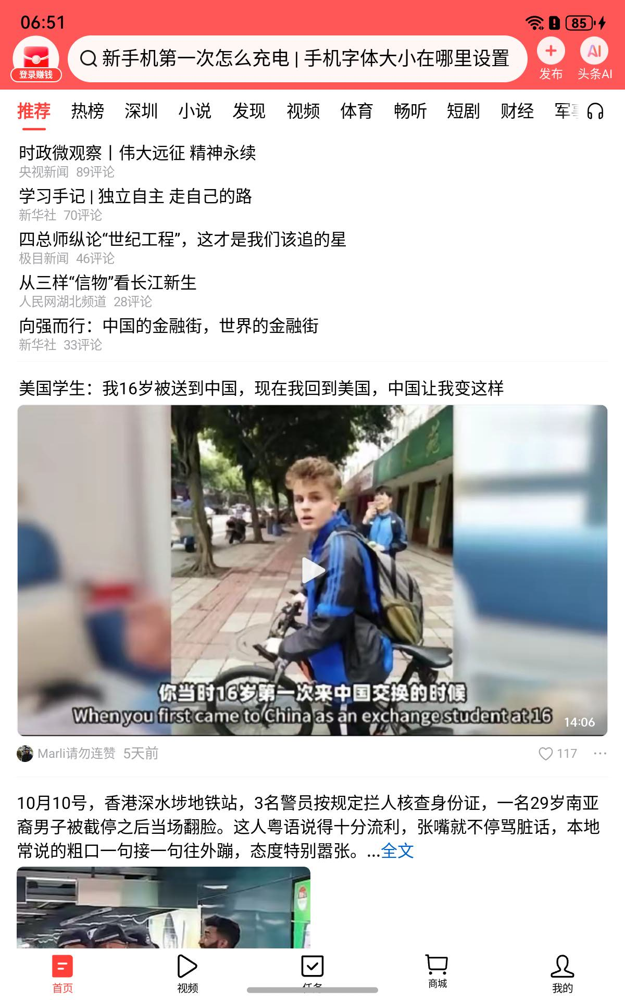

# T31: retained Toutiao video demonstration on 5cd

Earlier T31 windows rolled back because the outer loop did not complete a timely retention decision. Replay02 did complete two visual playback cycles; its unsigned outcome must not be described as another playback failure. The successor activation reused those exact-candidate observations under an explicit acceptance addendum and completed its real retention decision at **590.842 seconds**, then released the board lock at **608.565 seconds**.

The retained device is **5cd1e3dd00000000000000000923012c**. The final reviewed image shows the actual Toutiao recommendation feed. Six deployed files matched their parent-private counterparts; all five checked function bindings matched; the current process identities and host window 29 were verified. Temporary screen timeout settings were restored to 10000/10000 ms and the debug parameter remained absent.

The user explicitly confirmed manual video playback with sound. Replay02 supplies two complete visual cycles of the same clip, including pause, resume, exit and icon reentry. This acceptance does not fill historical per-title audio unknowns or assert that every video, codec, or crash scenario is fixed.

## Source, build and implementation

| Item | Repository entry |
| --- | --- |
| Resource-free RequestBuffer failure recovery | [window module](../2026-10-20-t30-request-recovery/src/window_module.c) and [provider adapter](../2026-10-20-t30-request-recovery/src/provider_adapter.c) |
| Design and bounded recovery behavior | [T30 design](../2026-10-20-t30-request-recovery/DESIGN.md) |
| Exact build recipe and entry point | [production recipe](../2026-10-20-t30-request-recovery/production/recipe.json), [build script](../2026-10-20-t30-request-recovery/production/build.py), [build instructions](../2026-10-20-t30-request-recovery/production/README.md) |
| Actual successful build and pinned inputs | [production results](../2026-10-20-t30-request-recovery/production/production-01/results.json), [production archive](../2026-10-20-t30-production-archive/README.md) |
| Evidence reuse and fresh activation requirements | [acceptance addendum](../2026-10-20-t31-demo-retain/activation-verified/acceptance-addendum.json), [activation execution card](../2026-10-20-t31-demo-retain/activation-verified/ROOT-ACTIVATION.md) |
| Independent deployed-state verification | [activation peer review](../2026-10-20-t31-runtime-peer/activation-01/README.md) |
| Original in-window approval | [retention decision](retain-decision.json), [closure](close.json) |
| Separate archival signoff | [final signoff](final-signoff.json) |

The retained shim SHA256 is `7f8d75bbf09e28e2b57a4621f1181ff944e79e462b78707c620dd67aef0b0bcb`; the bridge SHA256 is `b0e5602a97133ebb1dca12972a8931a86528322685a211bb1a7a0a2185fefbd4`. T30 rebuilt two units while preserving the other link inputs. Large input artifacts and original build stdout/stderr are addressed by the production archive receipts; they are not silently substituted with local untracked binaries.

## Operation and recovery

Use the Toutiao desktop icon on 5cd. A cold launch currently displays the Westlake IME host page before the real feed appears; that transition is a separate follow-up. The current video acceptance does not claim it has been removed.

The original activation plan, scoped admission, five before-image backups and the original absence marker remain the recovery origin. Follow the **Future recovery** section of the [root execution card](../2026-10-20-t31-demo-retain/ROOT-COMMANDS.md) with a new lock and fresh identities. Its reviewed recovery path requires a live verified parent and host window 29; other states require separate diagnosis. Never replay an old holder, boot ID or process birth.

The original retention decision is immutable. The later `final-signoff.json` binds that decision to the verified persistent archive; it is outside its own archive, avoiding a self-reference.

